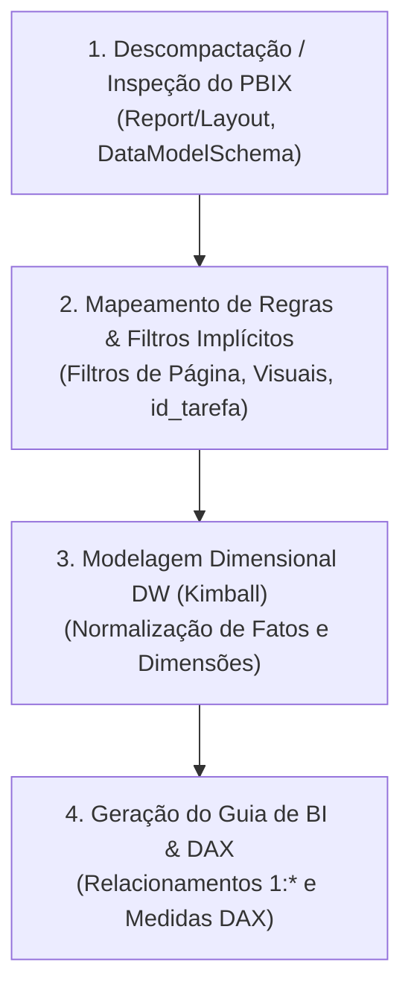

# Skill: Engenharia Reversa de Power BI (.pbix) para Data Warehouse

Esta skill orienta o agente na análise minuciosa de arquivos ou relatórios legados do **Power BI (`.pbix`)**, permitindo desconstruir tabelas desnormalizadas e regras visuais para projetar um **Data Warehouse Star Schema (Kimball)** e produzir o **Guia do Analista de BI**.

---

## 🎯 Quando Ativar Esta Skill

Ative esta skill quando:
1. O usuário fornecer um arquivo `.pbix`, relatórios extraídos ou arquivos JSON/markdown descrevendo visuais do Power BI na pasta `entrega/planejador_dw/`.
2. Houver menção explícita de "migrar dashboard Power BI para DW", "otimizar relatório Power BI" ou "fazer engenharia reversa de PBIX".
3. For necessário documentar as regras de negócio embutidas em filtros visuais e convertê-las em dimensões, fatos ou views analíticas.

---

## 🔍 Método de Engenharia Reversa em 4 Passos



### 1. Extração Determinística Automatizada via CLI (`inspecionar_pbix.py`)
- Antes de qualquer análise manual, execute o motor determinístico do NINHO sobre o arquivo `.pbix` ou diretório contendo múltiplos arquivos `.pbix`:
  ```bash
  python core/scripts_comuns/inspecionar_pbix.py <caminho_arquivo_ou_pasta_pbix> --output saida/planejador_dw/09_relatorio_estrategias/regras_visuais_origem.md
  ```
- O script descompacta o `.pbix` (ZIP nativo), decodifica `Connections`, `DiagramLayout` e `Report/Layout` (`UTF-16-LE`), reconstrói a AST de filtros do Power BI para SQL/DAX legível e executa **5 Heurísticas Automáticas de Auditoria de BI (`PBIX-H1` a `PBIX-H5`)**:
  - **`PBIX-H1` (Clonagem Multi-Tenant sem RLS):** Detecta relatórios `.pbix` duplicados por órgão (ex.: um arquivo para `PRODEB`, outro para `URBIS`, outro para `SAEB` filtrados por página) e prescreve unificação com `seguranca-rls-oracle`.
  - **`PBIX-H2` (Bug de Copy-Paste / Vazamento Cross-Tenant):** Detecta filtros visuais internos esquecidos com o código de outro órgão após clonagem de `.pbix` (ex.: cartão filtrado para `'SAEB'` dentro do painel da `'PRODEB'` ou `'URBIS'`).
  - **`PBIX-H3` (Tabelão Flat Desnormalizado):** Identifica tabelas planas monolíticas (`dadosConsolidados`, `Consulta1`, `RElatório da Unidade`) para decomposição em Star Schema.
  - **`PBIX-H4` (Regras de Negócio Hardcoded em Visuais):** Extrai indicadores definidos por filtros laterais de visual (ex.: `id_tarefa = 1` para Processos Gerados, `id_tarefa IN (2, 13)` para Documentos, `id_tarefa IN (32, 48)` para Processos Tramitados, e nível hierárquico `Unidade_N.3 IS NOT NULL AND Unidade_N.4 IS NULL`) para promoção às Views de KPI e `META_REGRAS_NEGOCIO`.
  - **`PBIX-H5` (Sanitização de Lixo/Teste no Visual):** Identifica filtros visuais que expurgam sujeira na camada de apresentação (`Unidade1 <> 'TESTE-SEI'`, `sigla <> '*'`, `usuario.nome <> ''`, `TAREFA_NOME <> '@'`) e transfere esse saneamento para a Staging/DW.

### 2. Identificação de Regras Ocultas nos Visuais e Domínios SEI / SIP
- **Domínio Executivo SEI:** Mapeie os códigos de `id_tarefa` (`1` = Geração de Processo, `2, 13` = Geração/Recebimento de Documento, `32, 48` = Tramitação/Remessa entre unidades) e a hierarquia de unidades (`Unidade_N.1` a `Unidade_N.5`) diretamente em atributos e flags semânticas na `DIM_TAREFA` e `DIM_UNIDADE`.
- **Domínio Administrador Local (SIP — Sistema de Permissões):** Modele as tabelas `permissao`, `usuario`, `unidade SIP`, `email_unidade` e `orgao` em uma Fato de Permissões/Acessos (`FATO_PERMISSAO_SIP`) cercada por `DIM_USUARIO`, `DIM_UNIDADE`, `DIM_ORGAO` e `DIM_TEMPO`, expurgando registros `TESTE-SEI` e siglas inválidas (`*`) na carga.

### 3. Decomposição para Modelo Dimensional Star Schema
- Separe os atributos repetitivos em **Dimensões Conformadas** (`DIM_UNIDADE`, `DIM_TAREFA`, `DIM_USUARIO`, `DIM_TEMPO`, `DIM_ORGAO`).
- Defina as **Fatos Transacionais ou Periódicas** no grão correto (ex: `FATO_PROCESSO`, `FATO_TRAMITACAO`, `FATO_DOCUMENTO`, `FATO_PERMISSAO_SIP`), mantendo as chaves surrogate (`DIMENSION_KEY` na dimensão e `DIM_<ENTIDADE>` na fato), chaves naturais degeneradas e métricas numéricas.

### 4. Geração do Guia de Implementação no Power BI
- Produza o documento `GUIA_ANALISTA_BI_<PROJETO>.md` contendo:
  - Diagrama Mermaid do Star Schema.
  - Mapeamento das tabelas ou views analíticas da Camada Semântica (`VW_<PROJETO>_DIM_*`, `VW_<PROJETO>_EVENTO_*` e `VW_<PROJETO>_KPI_*`).
  - Configuração de cardinalidade **1 para Muitos (1:*)** com **Direção de filtro única (Single)**.
  - Catálogo completo de métricas DAX reescritas para consumir as novas views limpas do DW.

---

## 📂 Artefatos e Modelos de Saída

Os artefatos gerados por esta skill devem ser gravados em:
- `saida/planejador_dw/09_relatorio_estrategias/regras_visuais_origem.md` (resumo de visuais e filtros de origem gerado por `inspecionar_pbix.py`)
- `saida/planejador_dw/08_datasets_bi/GUIA_ANALISTA_BI_<PROJETO>.md` (guia para o time de Power BI reconectar o modelo)

Consulte os modelos de referência em:
- [templates/template_guia_analista_bi.md](./templates/template_guia_analista_bi.md)
- [templates/template_resumo_regras_visuais.md](./templates/template_resumo_regras_visuais.md)


