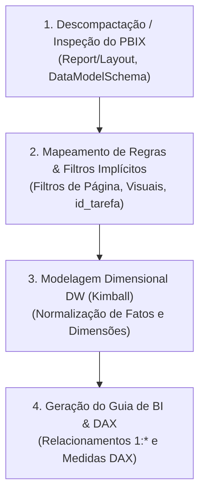

# Skill: Engenharia Reversa de Power BI (.pbix) para Data Warehouse

Esta skill orienta o agente na análise minuciosa de arquivos ou relatórios legados do **Power BI (`.pbix`)**, permitindo desconstruir tabelas desnormalizadas e regras visuais para projetar um **Data Warehouse Star Schema (Kimball)** e produzir o **Guia do Analista de BI**.

---

## 🎯 Quando Ativar Esta Skill

Ative esta skill quando:
1. O usuário fornecer um arquivo `.pbix`, relatórios extraídos ou arquivos JSON/markdown descrevendo visuais do Power BI na pasta `entrega/planejador_dw/`.
2. Houver menção explícita de "migrar dashboard Power BI para DW", "otimizar relatório Power BI" ou "fazer engenharia reversa de PBIX".
3. For necessário documentar as regras de negócio embutidas em filtros visuais e convertê-las em dimensões, fatos ou views analíticas.

---

## 🔍 Método de Engenharia Reversa em 4 Passos

### 1. Descompactação e Leitura Estrutural
- Um arquivo `.pbix` é um arquivo ZIP que contém:
  - `Report/Layout`: Arquivo JSON contendo todas as páginas (`sections`), visuais (`visualContainers`), filtros aplicados e eixos/legendas.
  - `DataModelSchema`: Metadados das tabelas, colunas calculadas, relacionamentos e medidas DAX (quando em formato Analysis Services).
- Identifique a tabela base original (geralmente plana ou desnormalizada, como `dadosConsolidados`).

### 2. Identificação de Regras Ocultas nos Visuais
- **Filtros de Página:** Condições aplicadas a uma aba inteira (ex: `sigla_orgao = 'URBIS'`).
- **Filtros de Visual Específicos:** Condições que definem conceitos de negócio (ex: Cartão "Processos Gerados" tem filtro oculto `id_tarefa = 1`; "Processos Recebidos" tem `id_tarefa IN (32, 48)`).
- **Métricas DAX:** Decomponha fórmulas como `CALCULATE(SUM(...), FILTER(...))` em grão de fato e colunas dimensionais.

### 3. Decomposição para Modelo Dimensional Star Schema
- Separe os atributos repetitivos em **Dimensões Conformadas** (`DIM_UNIDADE`, `DIM_TAREFA`, `DIM_USUARIO`, `DIM_TEMPO`, `DIM_ORGAO`).
- Defina as **Fatos Transacionais ou Periódicas** no grão correto (ex: `FATO_ANDAMENTO_PROCESSO`, `FATO_ATENDIMENTO`), mantendo as chaves surrogate (`DIMENSION_KEY` na dimensão e `DIM_<ENTIDADE>` na fato), chaves naturais degeneradas e métricas numéricas.

### 4. Geração do Guia de Implementação no Power BI
- Produza o documento `GUIA_ANALISTA_BI_<PROJETO>.md` contendo:
  - Diagrama Mermaid do Star Schema.
  - Mapeamento das tabelas ou views analíticas da Camada Semântica (`VW_<PROJETO>_DIM_*`, `VW_<PROJETO>_EVENTO_*` e `VW_<PROJETO>_KPI_*`).
  - Configuração de cardinalidade **1 para Muitos (1:*)** com **Direção de filtro única (Single)**.
  - Catálogo completo de métricas DAX reescritas para consumir as novas views limpas do DW.

---

## 📂 Artefatos e Modelos de Saída

Os artefatos gerados por esta skill devem ser gravados em:
- `saida/planejador_dw/09_relatorio_estrategias/regras_visuais_origem.md` (resumo de visuais e filtros de origem)
- `saida/planejador_dw/08_datasets_bi/GUIA_ANALISTA_BI_<PROJETO>.md` (guia para o time de Power BI reconectar o modelo)

Consulte os modelos de referência em:
- [templates/template_guia_analista_bi.md](./templates/template_guia_analista_bi.md)
- [templates/template_resumo_regras_visuais.md](./templates/template_resumo_regras_visuais.md)

