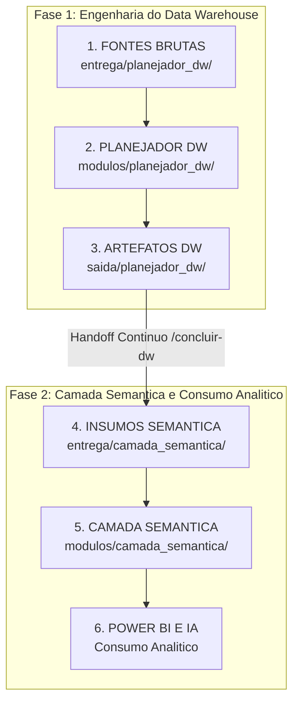

# NINHO — Plataforma Integrada de Engenharia, Modelagem & Governança de Dados

> *"Onde os dados brutos são acolhidos, cuidados e preparados para ganhar asas."*
>
> 🏷️ **Versão Atual:** **`v0.9.5`** *(Pré-Lançamento — 26/10/2026)* — 📖 [**Ver Histórico Completo de Versões, Novidades e Correções (`PATCH_NOTES.md`)**](PATCH_NOTES.md)

Bem-vindo ao **NINHO**, o framework corporativo de engenharia analítica que automatiza o ciclo completo de dados: desde o planejamento dimensional de Data Warehouses no Oracle, passando pela geração de camadas semânticas ativas e governança em nuvem, até a entrega de diretrizes prontas para Power BI.

---

## 🎯 Por Onde Começar? (Guia Rápido para Quem Está Chegando Agora)

> ⚙️ **Configuração Inicial dos Comandos `/` (Primeira vez no projeto):**
> Para registrar ou sincronizar todos os atalhos `/<comando>` no menu de autocompletar da sua IDE, digite no chat:
> - **`/instalar-comandos`** *(ou `/setup`, ou peça no chat: `"Execute python ninho.py instalar-comandos"`)*
> - No terminal Windows: `.\ninho instalar-comandos` *(ou `python ninho.py instalar-comandos`)*

> 🚀 **É a sua primeira vez abrindo o NINHO? Experimente digitar um destes comandos diretamente no chat:**
> - **`/comecar`** *(ou `/onboarding`)*: Abre o **Assistente de Boas-Vindas** com as 5 missões reais explicadas em apenas **3 passos simples** (*Onde soltar o arquivo* $\rightarrow$ *Comando para simular* $\rightarrow$ *Comando para gerar*).
> - **`/demo`** *(e depois `/limpar-demo`)*: **Modo Playground em 1 Comando!** Não tem arquivos agora? Ele cria sozinho um projeto completo de demonstração (*Licitações SAEB*), gera as Blueprints editáveis, o DW, a Camada Semântica, o Dicionário HTML interativo e um CSV sintético para Power BI em 3 segundos. Depois, digite `/limpar-demo` para zerar a bancada.
> - **`/onde-estou`** *(ou `/status`)*: Abre a **Bússola Contextual** com barra visual de progresso (`[███░░] Fase X/5`), mostrando o que já existe nas pastas `entrega/` e `saida/` e qual o próximo comando recomendado.
> - **`/duvida listar`** *(ou `/duvida <tema>`)*: Abre o **Oráculo de Arquitetura** para responder dúvidas técnicas sobre o programa (`estrategia-carga`, `scd`, `linha-default`, `camadas-views`, `arquitetura-etl`, `gate-governanca`, `simulacao`, `fast-track`, `rls`).
> - **`/doctor`**: Verifica se você soltou algum arquivo na pasta errada de `entrega/` e o move automaticamente para a subpasta canônica correta (`--corrigir`).
> - **`/ajuda`** *(ou `/help`)*: Exibe no chat a tabela completa de todos os comandos disponíveis por tópico.

> 👋 **Quer ler o manual completo para iniciantes?** Comece pelo [**Guia Inicial do Engenheiro — Bem-vindo ao NINHO (`GUIA_INICIAL_ENGENHEIRO.md`)**](documentacao/guias/GUIA_INICIAL_ENGENHEIRO.md)! Ele explica passo a passo a "Regra das 3 Pastas" (`entrega/` $\rightarrow$ `modulos/` $\rightarrow$ `saida/`), o que cada script/skill faz e como rodar sua primeira tarefa em 5 minutos.

> ⚡ **Precisa de comandos de terminal, SQL ou DAX prontos para copiar?** Consulte o [**Guia Central de Comandos Rápidos & Cheat Sheet (`GUIA_COMANDOS_RAPIDOS.md`)**](documentacao/guias/GUIA_COMANDOS_RAPIDOS.md) com sumário interativo ancorado.

> 🛡️ **Público-Alvo Exclusivo:** O **NINHO** é uma plataforma corporativa 100% focada em **Engenheiros de Dados**. O Analista de BI **não possui acesso ao NINHO** e **não executa módulos**. Em vez disso, ao concluir o planejamento do DW, a plataforma gera automaticamente o artefato **`GUIA_ANALISTA_BI_<PROJETO>.md`**, o Mockup Visual Full HD (**`mockup_painel_bi.svg` / `preview_painel_bi.html`**), a planilha **`Indicadores_PowerBI_<PROJETO>.xlsx`** e o dataset sintético **`mock_dados_bi.csv`** (em `saida/planejador_dw/08_datasets_bi/`), que o Engenheiro entrega à equipe de BI.
>
> 📄 **Geração Sob Demanda de Formatos Alternativos (`.docx`, `.pdf`) e Apresentação Executiva (`.pptx`):**
> Por padrão, nas execuções normais do projeto (`/executar-simulacao`, `/melhorar-dw-existente`, `/gerar-guia-bi`, `/gerar-guia-odi`), os guias técnicos são gerados **apenas em Markdown (`.md`)** para manter o repositório enxuto. Caso você precise exportar os guias em outros formatos ou gerar a apresentação de slides, solicite explicitamente via comando ou marque na Blueprint:
> - **`/exportar-docx`**: Exporta os guias (`GUIA_ANALISTA_BI_<PROJETO>.docx` e `RELATORIO_ESTRATEGIAS.docx`) em Microsoft Word corporativo.
> - **`/exportar-pdf`**: Exporta os guias (`GUIA_ANALISTA_BI_<PROJETO>.pdf` e `RELATORIO_ESTRATEGIAS.pdf`) em PDF 1.4 oficial pronto para SEI/Ofícios.
> - **`/gerar-apresentacao`**: Gera a Apresentação Executiva em PowerPoint nativo (`apresentacao_executiva_<PROJETO>.pptx`) e Deck HTML 16:9 (`apresentacao_slides.html`).
> - *(Nota: No modo **`/demo`**, todos os formatos acima são gerados automaticamente de uma só vez como vitrine completa do que a ferramenta é capaz).*

Não perca tempo procurando arquivos. Localize seu desafio abaixo e acesse diretamente os manuais, formulários, scripts e pastas correspondentes:

| Seu Papel / Desafio Atual | O que você deve ler | Onde colocar seus arquivos | Comando / Módulo de Execução | Onde ficam os resultados |
| :--- | :--- | :--- | :--- | :--- |
| 👋 **Primeira Vez na Plataforma**<br/>*(Explorar, aprender ou tirar dúvidas)* | 🌟 [**Guia Inicial do Engenheiro**](documentacao/guias/GUIA_INICIAL_ENGENHEIRO.md)<br/>⚡ [Comandos Rápidos (Seção 1.14)](documentacao/guias/GUIA_COMANDOS_RAPIDOS.md#114-ux-conversacional-oraculo-demo) | *(Opcional no `/demo`)* | No chat: **`/comecar`**, **`/demo`**, **`/onde-estou`**, **`/duvida listar`**, **`/doctor`**<br/>CLI: `python core/scripts_comuns/ajuda_ninho.py --onboarding` | No `/demo`: gera exemplo completo em `entrega/` e `saida/` *(limpe com `/limpar-demo`)* |
| 👷 **Engenheiro de Dados**<br/>*(Criar ou reformular um DW)* | 📘 [**Guia do Engenheiro de DW**](documentacao/guias/GUIA_ENGENHEIRO_DW.md)<br/>📋 [Formulário INTAKE_DW](modulos/planejador_dw/INTAKE_DW.md) | 📥 [`entrega/planejador_dw/`](entrega/planejador_dw/) | ⚙️ [`modulos/planejador_dw/`](modulos/planejador_dw/README.md)<br/>`/inspecionar-fontes` $\rightarrow$ `/simular-dw` $\rightarrow$ `/executar-simulacao` | 📤 [`saida/planejador_dw/`](saida/planejador_dw/README.md) *(11 pastas + Guia de BI)* |
| 🧪 **Engenheiro — Simulador & Blueprint 100% Editável**<br/>*(Simular ponta a ponta e editar tabelas/colunas/KPIs antes de gerar)* | 📘 [Comandos Rápidos (Seção 1.12)](documentacao/guias/GUIA_COMANDOS_RAPIDOS.md#112-simulador-blueprint-editavel) | 📥 [`entrega/planejador_dw/`](entrega/planejador_dw/) ou [`entrega/camada_semantica/`](entrega/camada_semantica/) | `python core/scripts_comuns/simular_projeto.py --modulo {dw,semantica,ambos} --acao {simular,executar}`<br/>ou `/simular-projeto` $\rightarrow$ `/executar-simulacao` | 📋 `SIMULACAO_BLUEPRINT_DW.md` / `SIMULACAO_BLUEPRINT_SEMANTICA.md` $\rightarrow$ 📤 `saida/` |
| ⚡ **Engenheiro — DW Já Construído (Fast-Track & Micro-Processos)**<br/>*(Só Comentários, Índices, Dicionário, Linha `-1`, Selects ODI, Guia BI)* | 📘 [Comandos Rápidos (Seção 1.11)](documentacao/guias/GUIA_COMANDOS_RAPIDOS.md#111-melhorar-dw-existente)<br/>🧩 [Skill Planejador DW (Seção 5)](.agents/skills/planejador-dw-oracle/SKILL.md) | 📥 [`entrega/planejador_dw/ddl/`](entrega/planejador_dw/ddl/) (`.sql` do DW atual) | `python core/scripts_comuns/melhorar_dw_existente.py --modo {comentarios,dicionario,indices,linha-default,constraints,testes,guia-bi,selects-odi,guia-odi,tudo}` | 📤 [`saida/planejador_dw/`](saida/planejador_dw/README.md) *(`90_patch_*`, `91_patch_*`, `92_patch_*`, ODI, Dicionário HTML)* |
| 🦅 **Engenheiro ETL — ODI 12c**<br/>*(Auditar e fazer tuning de ODI)* | 🧩 [Skill Gerador/Auditor ODI](.agents/skills/gerador-consultas-odi/SKILL.md) | 📥 Pasta com XMLs (`Mapas`, `Cenas`, `Pacotes`, `Procedures`) | `python core/scripts_comuns/auditar_mapa_odi.py <pasta>`<br/>ou `/auditar-mapa-odi` | 📊 Diagnóstico preditivo (`H1` a `H9`) + SQL otimizado |
| 🐝 **Engenheiro ETL — Apache Hop**<br/>*(Auditar Hop `.hpl`/`.hwf`, FTPS e Python)* | 🧩 [Skill ETL Hop](.agents/skills/gerador-etl-hop/SKILL.md)<br/>🧩 [Skill FTPS Lote](.agents/skills/extrator-ftps-lote-hop/SKILL.md) | 📥 Pasta do projeto Hop (`.hpl`, `.hwf`, `.json`, `.py`, `.sh`) | `python core/scripts_comuns/auditar_esteira_hop.py <pasta>`<br/>ou `/auditar-hop` | 📊 Auditoria de segurança e qualidade (`HOP-H1` a `HOP-H8`) |
| 📊 **Engenheiro — Migração Power BI**<br/>*(Engenharia reversa de `.pbix` legado)* | 🧩 [Skill Engenharia Reversa PBIX](.agents/skills/engenharia-reversa-pbix/SKILL.md) | 📥 [`entrega/planejador_dw/pbix/`](entrega/planejador_dw/) (arquivo `.pbix`) | `python core/scripts_comuns/inspecionar_pbix.py <arquivo.pbix>`<br/>ou `/inspecionar-pbix` | 📤 Star Schema DW + DAX + Diagnóstico (`PBIX-H1` a `PBIX-H5`) |
| 🧠 **Engenheiro de Dados**<br/>*(Camada Semântica Completa ou Micro-Processos)* | 📘 [**Guia de Camada Semântica**](documentacao/guias/GUIA_ENGENHEIRO_SEMANTICA.md)<br/>📋 [Formulário INTAKE_SEMANTICA](modulos/camada_semantica/INTAKE_SEMANTICA.md) | 📥 [`entrega/camada_semantica/`](entrega/camada_semantica/) *(ou via `/concluir-dw`)* | `python core/scripts_comuns/modular_semantica.py --modo {views-dim,views-evento,views-kpi,catalogo-meta,rls,tudo}`<br/>ou `/simular-semantica`, `/iniciar-semantica` | 📤 [`saida/camada_semantica/`](saida/camada_semantica/) *(Views 3 níveis + 8 `META_*` + RLS)* |
| 🛡️ **Engenheiro de Governança**<br/>*(MongoDB PRODEB, AWS SageMaker Catalog, LAI/LGPD)* | 📘 [**README de Governança**](modulos/governanca_dados/README.md)<br/>📋 [Formulário INTAKE_GOVERNANCA](modulos/governanca_dados/INTAKE_GOVERNANCA.md)<br/>🏛️ [Arquitetura Mongo + AWS SageMaker](modulos/governanca_dados/ARQUITETURA_MONGO_AWS.md) | 📥 [`entrega/governanca_dados/`](entrega/governanca_dados/) (`.xlsx` e `.csv` do cliente) | `python core/scripts_comuns/inspecionar_insumos_governanca.py`<br/>ou `/inspecionar-governanca` | 📤 [`saida/governanca_dados/`](saida/governanca_dados/) *(Gate 0.5 Devolução ou Mongo+AWS)* |
| ✅ **Líder Técnico / QA**<br/>*(Validação, Testes E2E e Empacotamento)* | 📋 [**Checklist de Validação**](documentacao/checklists/CHECKLIST_VALIDACAO.md)<br/>📜 [Convenções DW](core/convencoes/CONVENCOES_DW.md) | 📚 [Catálogo de Projetos](documentacao/catalogo_projetos/PROJETO_RESUMO.md) | `python core/scripts_comuns/validar_entrega.py saida`<br/>`python core/scripts_comuns/testar_ninho.py` | 📦 `pacotes_exportados/*.zip` |

---

## 🗺️ Mapa Completo de Navegação da Plataforma

```text
NINHO /
│
├── AGENTS.md                            # 🤖 Orquestrador Principal (Regras & Gates)
├── PATCH_NOTES.md                       # 📋 Histórico amigável de versões, novidades e correções
├── ninho.py                             # 🚀 Dispatcher CLI Unificado + Instalador de Comandos (/instalar-comandos)
├── ninho.bat                            # ⚡ Atalho de execução rápida no Windows (.\ninho <comando>)
├── 🤖 .agents/skills/                   # 🧩 SKILLS MODULARES ESPECIALIZADAS + ATALHOS DE COMANDO (/comando)
│   ├── planejador-dw-oracle/            # Star Schema, SCD2, Sequences, Índices e Fast-Track
│   ├── gerador-etl-hop/                 # Pipelines (.hpl) e workflows (.hwf) Apache Hop 2.x
│   ├── gerador-consultas-odi/           # Consultas SQL, pacotes e tuning preditivo ODI 12c
│   ├── extrator-api-python/             # Extratores Python (REST, OAuth2, bulk insert)
│   ├── extrator-ftps-lote-hop/          # Ingestão FTPS/SFTP + Shell curl + Apache Hop
│   ├── camada-semantica-oracle/         # Views em 3 camadas e carga das 8 tabelas META_*
│   ├── seguranca-rls-oracle/            # Row Level Security (RLS) e VPD no Oracle
│   ├── governanca-dados-corporativa/    # MongoDB PRODEB, AWS SageMaker Catalog e LGPD/LAI
│   ├── engenharia-reversa-pbix/         # Engenharia reversa de Power BI (.pbix) para DW
│   └── validador-qualidade-entrega/     # Validação pré-voo e auditoria pós-geração
│
├── 🧠 core/                             # NÚCLEO COMPARTILHADO & MOTORES PYTHON
│   ├── convencoes/
│   │   ├── CONVENCOES_DW.md             # 📜 DNA do DW (SCD2, B-Tree, Dual Strategy, Linha -1)
│   │   └── CONVENCOES_SEMANTICA.md      # 📜 DNA da Semântica (Views, 8 Tabelas META_)
│   ├── scripts_comuns/                  # 🛠️ 14 Utilitários Python determinísticos
│   │   ├── ajuda_ninho.py               # 🧭 Central UX (/help, /comecar, /onde-estou, /demo)
│   │   ├── validar_entrega.py           # 🔍 Validador pré-voo e pós-geração (all/saida)
│   │   ├── testar_ninho.py              # 🧪 Suíte automatizada de testes E2E (13 baterias)
│   │   ├── inspecionar_ddl_origem.py    # 🔎 Extrator de DDLs e Radar Consultivo de KPIs
│   │   ├── simular_projeto.py           # 🧪 Simulador e Blueprints Editáveis (DW/Semântica)
│   │   ├── melhorar_dw_existente.py     # ⚡ Motor Fast-Track e Micro-Processos DW & ODI
│   │   ├── modular_semantica.py         # 🧠 Micro-Processos Semântica (Views, META_*, RLS)
│   │   ├── inspecionar_insumos_governanca.py # 🛡️ Auditor Gate 0.5 + DE/PARA MongoDB PRODEB
│   │   ├── auditar_mapa_odi.py          # 🦅 Auditor preditivo de tuning ODI 12c (H1 a H9)
│   │   ├── auditar_esteira_hop.py       # 🐝 Auditor Apache Hop & Python/FTPS (HOP-H1 a H8)
│   │   ├── inspecionar_pbix.py          # 📊 Extrator e auditor Power BI (PBIX-H1 a H5)
│   │   ├── transicionar_dw_para_semantica.py # 🔄 Handoff automatizado DW -> Semântica
│   │   ├── gerar_mock_dados.py          # 🎲 Gerador de dados sintéticos CSV com linha -1
│   │   └── gerenciar_projeto.py         # 📦 Exportação .zip e limpeza do workspace
│   └── README.md                        # 📖 Visão geral do Core
│
├── 📥 entrega/                          # ENTRADA DE DADOS (Insumos do Engenheiro)
│   ├── planejador_dw/                   # 📁 DDLs de origem, amostras CSV, FTP e APIs
│   │   ├── ddl/                         # DDLs das tabelas transacionais de origem
│   │   ├── amostras/                    # Amostras reais de dados em CSV/Excel
│   │   ├── arquivos_ftp/                # Layouts de arquivos recebidos via SFTP
│   │   └── api_specs/                   # Swagger/OpenAPI e payloads JSON de APIs
│   ├── camada_semantica/                # 📁 DDLs do DW Oracle, amostras e relatórios
│   ├── governanca_dados/                # 📁 Planilha PRODEB (.xlsx), amostras (.csv) e LGPD
│   └── README.md                        # 📖 Roteiro de preenchimento dos insumos
│
├── ⚙️ modulos/                          # MOTORES DE INTELIGÊNCIA & EXECUÇÃO
│   ├── planejador_dw/                   # 🏛️ MÓDULO 1: Planejamento e Modelagem de DW
│   │   ├── INTAKE_DW.md                 # 📋 Formulário de requisitos do novo DW
│   │   ├── AGENTS.md                    # 🤖 Orquestrador do módulo
│   │   ├── templates/                   # 📄 14 templates (SQL, Hop, Py, BI, Testes, HTML)
│   │   └── README.md                    # 📖 Manual completo do Planejador de DW
│   │
│   ├── camada_semantica/                # 🧠 MÓDULO 2: Camada Semântica & Metadados Ativos
│   │   ├── INTAKE_SEMANTICA.md          # 📋 Formulário de requisitos de semântica
│   │   ├── AGENTS.md                    # 🤖 Orquestrador da Camada Semântica
│   │   ├── templates/                   # 📄 Templates de views e tabelas META_*
│   │   └── README.md                    # 📖 Manual completo da Camada Semântica
│   │
│   ├── governanca_dados/                # 🛡️ MÓDULO 3: Governança MongoDB & SageMaker
│   │   ├── INTAKE_GOVERNANCA.md         # 📋 Formulário de governança e Gate 0.5
│   │   ├── AGENTS.md                    # 🤖 Orquestrador de Governança (Gate 0.5)
│   │   ├── ARQUITETURA_MONGO_AWS.md     # 🏛️ Arquitetura MongoDB + AWS Glue & SageMaker
│   │   ├── DOCUMENTO_CONSOLIDADO_GOVERNANCA_DADOS.md # 📘 Padrão PRODEB ($jsonSchema, BSON)
│   │   ├── CAMADA_SEMANTICA_GOVERNANCA_DADOS_MONGODB.md # 🧠 Domínios e Conceitos MongoDB
│   │   ├── templates/                   # 📄 Template Excel (Dados - Insumos / Dicionário)
│   │   └── README.md                    # 📖 Manual do módulo de Governança
│   │
│   └── README.md                        # 📖 Visão integrada dos módulos
│
├── 📚 documentacao/                     # GOVERNANÇA, MANUAIS & CATALOGAÇÃO
│   ├── guias/                           # 📘 MANUAIS OPERACIONAIS PASSO A PASSO
│   │   ├── GUIA_INICIAL_ENGENHEIRO.md   # 👋 Guia de boas-vindas e onboarding
│   │   ├── GUIA_COMANDOS_RAPIDOS.md     # ⚡ Cheat sheet central de comandos
│   │   ├── GUIA_ENGENHEIRO_DW.md        # Manual prático de DW (ODI, Hop, SQL)
│   │   ├── GUIA_ENGENHEIRO_SEMANTICA.md # Manual prático de Camada Semântica
│   │   └── GUIA_ANALISTA_BI.md          # Manual de BI (Power BI, DAX, Star Schema)
│   ├── GLOSSARIO.md                     # 📖 Glossário analítico (SCD2, Linha -1, etc.)
│   ├── checklists/
│   │   └── CHECKLIST_VALIDACAO.md       # ✅ Checklist de homologação pré-entrega
│   ├── catalogo_projetos/
│   │   ├── PROJETO_RESUMO.md            # 📄 Ficha técnica viva do projeto ativo
│   │   └── PROJETO_VERSION.md           # 📜 Histórico de versionamento incremental
│   └── README.md                        # 📖 Índice central da documentação
│
└── 📤 saida/                            # ARTEFATOS FINAIS GERADOS PARA IMPLANTAÇÃO
    ├── planejador_dw/                   # 📦 Entregáveis do DW (11 subpastas canônicas)
    │   ├── 01_controle_carga/           # Script TB_CONTROLE_CARGA
    │   ├── 02_staging/                  # DDLs das tabelas STG_*
    │   ├── 03_dimensoes/                # DDLs DIM_*, ODI_DIM_*, Sequences e linha -1
    │   ├── 04_fatos/                    # DDLs FATO_* (Estratégia A ou B)
    │   ├── 05_procedimentos_manutencao/ # Procedure PRC_POS_CARGA_FATO
    │   ├── 06_pipelines_hop/            # Pipelines Hop (.hpl / .hwf)
    │   ├── 07_extratores_python/        # Extratores Python modulares
    │   ├── 08_datasets_bi/              # Guia do Analista de BI e Mock CSV
    │   ├── 09_relatorio_estrategias/    # Relatório executivo e Guias ODI 12c
    │   ├── 10_testes_integridade/       # Scripts SQL de auditoria pós-carga
    │   └── 11_dicionario_dados/         # Dicionário de dados HTML interativo
    ├── camada_semantica/                # 📦 Views analíticas e cargas nas 8 tabelas META_*
    ├── governanca_dados/                # 📦 Schemas MongoDB, SageMaker e Gate 0.5
    └── README.md                        # 📖 Catálogo de saídas da plataforma
```

---

## 🔄 Fluxo de Trabalho Integrado (Pipeline Contínuo de Ponta a Ponta)



1. **Depósito de Insumos (`entrega/planejador_dw/`):** Você deposita DDLs de origem, amostras CSV/Excel ou especificações de APIs.
2. **Planejamento & Modelagem Dimensional:** Você preenche `INTAKE_DW.md` e a IA planeja a esteira híbrida (Hop + Python + ODI), SCD Tipo 2, tabela de controle e estratégia de carga.
3. **Geração Automatizada de Código DW (`saida/planejador_dw/`):** A IA gera todos os DDLs (`STG_*`, `ODI_DIM_*`, `DIM_*`, `FATO_*`), procedures de manutenção, pipelines Hop, extratores Python e o `RELATORIO_ESTRATEGIAS.md`.
4. **Handoff Automático & Documentação Central (`/concluir-dw`):** O pipeline **não para** no DW! Com o comando `/concluir-dw` ou via script CLI, a plataforma consolida os DDLs, transfere/gera amostras, move relatórios, preenche o `INTAKE_SEMANTICA.md` e atualiza o catálogo corporativo (`PROJETO_RESUMO.md` e `PROJETO_VERSION.md`).
5. **Geração da Camada Semântica (`saida/camada_semantica/`):** A IA gera as views analíticas (`VW_DIM_*_ATUAL`, `VW_EVENTO`, `VW_KPI_*`) e os scripts de carga para as 8 tabelas `META_*`.
6. **Handoff para BI & Governança:** O Engenheiro de Dados exporta o `GUIA_ANALISTA_BI_<PROJETO>.md` (gerado na pasta `08_datasets_bi/`) e o entrega à equipe externa de BI para a construção autônoma dos painéis no Power BI. Paralelamente, o time de governança conecta o catálogo ao Lakehouse Mongo / AWS SageMaker Catalog.

---

## 💬 Dicionário Rápido de Comandos do Chat (`/comando`)

> 📖 Para ver a explicação detalhada do que cada comando faz por trás dos panos e exemplos prontos, acesse a [**Seção 3.3 do Guia Inicial do Engenheiro (`GUIA_INICIAL_ENGENHEIRO.md`)**](documentacao/guias/GUIA_INICIAL_ENGENHEIRO.md#33-dicionario-comandos-chat).

| Categoria | Comando no Chat | O que a IA Faz |
| :--- | :--- | :--- |
| ⚙️ **Setup & Comandos** | **`/instalar-comandos`** *(ou `/setup`, `/configurar`)* | Registra e sincroniza todos os comandos `/<comando>` como Skills nativas em `.agents/skills/` mantendo as 10 skills arquiteturais protegidas (`ninho.py instalar-comandos`). |
| 🧭 **UX, Onboarding & Oráculo** | **`/ajuda`** *(ou `/help`, `/comandos`, `/ajuda <topico>`)* | Lista diretamente aqui no chat todos os comandos organizados por tópico (`ux`, `simulacao`, `micro`, `auditoria`, `dw`, `semantica`, `governanca`, `qualidade`) (`ajuda_ninho.py`). |
| 🧭 **UX, Onboarding & Oráculo** | **`/comecar`** *(ou `/onboarding`)* | Exibe o **Assistente de Boas-Vindas** com as 5 trilhas guiadas de 3 passos para você saber onde colocar seus arquivos e qual comando rodar (`ajuda_ninho.py --onboarding`). |
| 🧭 **UX, Onboarding & Oráculo** | **`/onde-estou`** *(ou `/status`)* | Exibe a **Bússola Contextual** com barra visual de progresso (`[███░░] Fase X/5`), arquivos detectados em `entrega/` e `saida/` e o próximo comando ideal (`ajuda_ninho.py --onde-estou`). |
| 🧭 **UX, Onboarding & Oráculo** | **`/duvida <tema>`** *(ou `/duvida listar`)* | Consulta o **Oráculo de Arquitetura** sobre `estrategia-carga`, `scd`, `linha-default`, `camadas-views`, `arquitetura-etl`, `gate-governanca`, `simulacao`, `fast-track` e `rls` (`ajuda_ninho.py --explicar <tema>`). |
| 🧭 **UX, Onboarding & Oráculo** | **`/doctor`** | Audita a saúde do workspace, detecta arquivos soltos na pasta errada de `entrega/` e os move automaticamente para a subpasta canônica (`ajuda_ninho.py --doctor --corrigir`). |
| 🎮 **Modo Playground** | **`/demo`** e **`/limpar-demo`** | Roda um projeto corporativo completo de demonstração em 3 segundos (DDL + Blueprints + DW + Semântica + Dicionário HTML + Mock CSV BI) e limpa a bancada ao final (`ajuda_ninho.py --demo` / `--limpar-demo`). |
| 🔍 **Inspeção & Auditoria** | **`/inspecionar-fontes`** | Lê os DDLs/CSVs de `entrega/planejador_dw/`, extrai colunas/PKs e sugere KPIs (`inspecionar_ddl_origem.py`). |
| 🔍 **Inspeção & Auditoria** | **`/inspecionar-pbix`** | Desconstrói relatórios `.pbix` do Power BI, extrai DAX, filtros ocultos e anti-padrões `PBIX-H1` a `PBIX-H5` (`inspecionar_pbix.py`). |
| 🔍 **Inspeção & Auditoria** | **`/auditar-mapa-odi`** | Audita XMLs ou pastas do ODI 12c (`Mapas`, `Cenas`, `Pacotes`, `Procedures`) com as heurísticas `H1` a `H9` (`auditar_mapa_odi.py`). |
| 🔍 **Inspeção & Auditoria** | **`/auditar-hop`** | Audita projetos Apache Hop 2.x (`.hpl`, `.hwf`, `.json`), scripts FTPS e Python com as heurísticas `HOP-H1` a `HOP-H8` (`auditar_esteira_hop.py`). |
| 🔍 **Inspeção & Auditoria** | **`/inspecionar-governanca`** | Executa o Gate 0.5 sobre planilhas `.xlsx` e `.csv` do cliente: emite o Relatório de Devolução ou a Matriz DE/PARA MongoDB (`inspecionar_insumos_governanca.py`). |
| 🏛️ **Modelagem DW** | **`/desafiar-grao`** | Propõe e compara alternativas de granularidade para a tabela Fato contra as perguntas de negócio. |
| 🏛️ **Modelagem DW** | **`/classificar-scd`** | Classifica atributos das dimensões entre Chave Natural (`ID_*`), SCD Tipo 1 e SCD Tipo 2 (histórico). |
| 🏛️ **Modelagem DW** | **`/definir-estrategia-carga`** | Recomenda e justifica entre Estratégia A (Truncate & Load + Bitmap) e Estratégia B (MERGE Incremental + B-Tree). |
| 🏛️ **Modelagem DW** | **`/gerar-blueprint`** | Monta a proposta completa do DW (Star Schema, Matriz De/Para fiel à origem e **💡 Radar Consultivo da IA**) sem gerar código ainda. |
| 🏛️ **Modelagem DW** | **`/aprovar-blueprint`** | Libera o Gate de aprovação e gera todos os scripts DDL, procedures, ETL e Guia de BI nas 11 pastas de `saida/planejador_dw/`. |
| 🏛️ **Modelagem DW** | **`/auditar-ddl`** | Confere sintaxe Oracle, linha `-1`, sequences e índices dos scripts gerados. |
| 🧪 **Simulador & Blueprint Editável** | **`/simular-dw`** / **`/simular-semantica`** / **`/simular-projeto`** | Gera `SIMULACAO_BLUEPRINT_DW.md` e/ou `SIMULACAO_BLUEPRINT_SEMANTICA.md` 100% editáveis (colunas `[x]/[ ]`, tipos, SCD, prévia 3 linhas + `-1`, KPIs do Radar) (`simular_projeto.py --acao simular`). |
| 🧪 **Simulador & Blueprint Editável** | **`/executar-simulacao`** | Lê todas as suas edições nas Blueprints aprovadas (`[x]`) e gera os arquivos reais em `saida/planejador_dw/` e `saida/camada_semantica/` (`simular_projeto.py --acao executar`). |
| ⚡ **Micro-Processos DW & ODI** | **`/gerar-comentarios`** / **`/gerar-dicionario`** | Gera apenas `COMMENT ON TABLE / COLUMN` (`--modo comentarios`) ou apenas o `dicionario_dados.html` (`--modo dicionario`). |
| ⚡ **Micro-Processos DW & ODI** | **`/gerar-indices`** / **`/gerar-linha-default`** / **`/gerar-constraints`** | Gera apenas índices + `PRC_POS_CARGA_FATO` (`--modo indices`), apenas `MERGE` da linha `-1` (`--modo linha-default`) ou apenas constraints `NOVALIDATE` (`--modo constraints`). |
| ⚡ **Micro-Processos DW & ODI** | **`/gerar-testes-dw`** / **`/gerar-guia-bi`** / **`/gerar-mockup-bi`** / **`/gerar-mock-bi`** | Gera apenas os 6 testes SQL pós-carga (`--modo testes`), o `GUIA_ANALISTA_BI_<PROJETO>.md` + Mockup SVG/HTML + `.xlsx` (`--modo guia-bi`), o Mockup Visual Full HD (`--modo mockup-bi`) ou CSV sintético com linha `-1` (`gerar_mock_dados.py`). |
| ⚡ **Micro-Processos DW & ODI** | **`/validar-medidas-bi`** *(ou `/provar-medidas-bi`)* | Executa a **Prova Real Pós-Carga** das medidas DAX do Guia de BI contra amostras de `DIM_*` e `FATO_*` (CSV/SQL/XLSX/ODS), corrige medidas parcialmente corretas (`MED-01..06`) e popula o Mockup Visual com os números reais. |
| 📄 **Exportação Sob Demanda** | **`/exportar-docx`** / **`/exportar-pdf`** / **`/gerar-apresentacao`** | **(Somente quando solicitado)** Exporta os guias para Word (`.docx`), PDF 1.4 oficial (`.pdf`) ou gera a Apresentação Executiva (`.pptx` + `apresentacao_slides.html`). |
| ⚡ **Micro-Processos DW & ODI** | **`/gerar-selects-odi`** / **`/gerar-guia-odi`** | Gera apenas as queries SQL do ODI (`03_selects_odi_dimensoes.sql` + `04_select_odi_fato.sql`) ou apenas o Guia do Canvas ODI 12c em `.md` + `mapa_canvas_odi.svg` (`--modo selects-odi` / `--modo guia-odi`). |
| 🐝 **Engenharia Apache Hop 2.x** | **`/gerar-pacote-hop`** / **`/migrar-kettle-hop`** | Gera um pacote Apache Hop 2.x completo (`wf_*.hwf`, `ppl_*.hpl`, `OraBulkLoader`, `hop-lint.yml`, `hop-pwd.json`, SVG) ou migra legados Pentaho Kettle (`.ktr`/`.kjb`) para Hop 2.x. |
| ⚡ **Fast-Track DW Completo** | **`/melhorar-dw-existente`** | Executa o Raio-X não-destrutivo e gera o pacote completo de melhorias sem mexer no ETL (`melhorar_dw_existente.py --modo tudo`). |
| 🧠 **Micro-Processos Semântica** | **`/gerar-views-semantica`** / **`/gerar-views-dim`** / **`/gerar-views-evento`** / **`/gerar-views-kpi`** | Gera todas as views analíticas ou individualmente a Camada 1 (`VW_DIM_*_ATUAL`), Camada 2 (`VW_EVENTO_*`) ou Camada 3 (`VW_KPI_*`) (`modular_semantica.py`). |
| 🧠 **Micro-Processos Semântica** | **`/gerar-catalogo-meta`** / **`/gerar-rls`** | Gera apenas o DDL + `MERGE INTO` das 8 tabelas `META_*` (`--modo catalogo-meta`) ou apenas a segurança VPD/RLS (`--modo rls`). |
| 🧠 **Semântica & Cloud** | **`/concluir-dw`** / **`/iniciar-semantica`** | Transfere os DDLs/amostras do DW (`transicionar_dw_para_semantica.py`) e gera a Camada Semântica completa em `saida/camada_semantica/`. |
| 🧠 **Semântica & Cloud** | **`/gerar-governanca`** | Gera os scripts das 5 coleções MongoDB padrão PRODEB, matriz LGPD/LAI e artefatos para AWS Glue & SageMaker Catalog em `saida/governanca_dados/`. |
| ✅ **Qualidade, Testes & Entrega** | **`/validar-entrega`** / **`/testar-ninho`** | Audita a entrega atual (`validar_entrega.py`) ou roda a suíte automatizada de 16 testes End-to-End da plataforma (`testar_ninho.py`). |
| ✅ **Qualidade, Testes & Entrega** | **`/diagnosticar-erro-carga`** / **`/empacotar-projeto`** | Analisa erros de execução (`ORA-xxxxx`, logs ODI/Hop) ou exporta a entrega final em `.zip` para `pacotes_exportados/` (`gerenciar_projeto.py`). |
