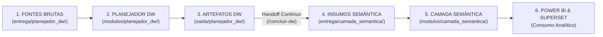

# NINHO — Plataforma Integrada de Engenharia, Modelagem & Governança de Dados

> *"Onde os dados brutos são acolhidos, cuidados e preparados para ganhar asas."*

Bem-vindo ao **NINHO**, o framework corporativo de engenharia analítica que automatiza o ciclo completo de dados: desde o planejamento dimensional de Data Warehouses no Oracle, passando pela geração de camadas semânticas ativas e governança em nuvem, até a entrega de diretrizes prontas para Power BI e Apache Superset.

---

## 🎯 Por Onde Começar? (Guia por Papel e Objetivo)

> ⚡ **Precisa de comandos rápidos ou queries operacionais?** Consulte o [**Guia Central de Comandos Rápidos & Cheat Sheet**](documentacao/guias/GUIA_COMANDOS_RAPIDOS.md) com sumário interativo ancorado cobrindo Python, Hop, Shell, Oracle SQL, DAX e Prompts da IA.

> 🛡️ **Público-Alvo Exclusivo:** O **NINHO** é uma plataforma corporativa 100% focada em **Engenheiros de Dados**. O Analista de BI **não possui acesso ao NINHO** e **não executa módulos**. Em vez disso, ao concluir o planejamento do DW, a plataforma gera automaticamente o artefato **`GUIA_ANALISTA_BI_<PROJETO>.md`** (em `saida/planejador_dw/<PROJETO>/08_datasets_bi/`). O Engenheiro de Dados exporta este guia e entrega à equipe externa de BI para orientar e acelerar a construção do painel no Power BI com máxima conformidade.

Não perca tempo procurando arquivos. Localize seu perfil abaixo e acesse diretamente os manuais, formulários e pastas correspondentes:

| Seu Papel / Desafio Atual | O que você deve ler | Onde colocar seus arquivos | Módulo de Execução | Onde ficam os resultados |
| :--- | :--- | :--- | :--- | :--- |
| 👷 **Engenheiro de Dados**<br/>*(Criar ou reformular um DW)* | 📘 [**Guia do Engenheiro de DW**](documentacao/guias/GUIA_ENGENHEIRO_DW.md)<br/>📋 [Formulário INTAKE_DW](modulos/planejador_dw/INTAKE_DW.md) | 📥 [`entrega/planejador_dw/`](entrega/planejador_dw/) | ⚙️ [`modulos/planejador_dw/`](modulos/planejador_dw/README.md) | 📤 [`saida/planejador_dw/`](saida/planejador_dw/README.md) *(inclui Guia de BI para Handoff)* |
| 🧠 **Engenheiro de Dados**<br/>*(Criar Camada Semântica & Metadados)* | 📘 [**Guia de Camada Semântica**](documentacao/guias/GUIA_ENGENHEIRO_SEMANTICA.md)<br/>📋 [Formulário INTAKE_SEMANTICA](modulos/camada_semantica/INTAKE_SEMANTICA.md) | 📥 [`entrega/camada_semantica/`](entrega/camada_semantica/) | ⚙️ [`modulos/camada_semantica/`](modulos/camada_semantica/README.md) | 📤 [`saida/camada_semantica/`](saida/camada_semantica/) |
| 🛡️ **Engenheiro de Governança**<br/>*(Lakehouse Mongo, LAI e LGPD)* | 📘 [**README de Governança**](modulos/governanca_dados/README.md)<br/>🏛️ [Arquitetura Framework](modulos/governanca_dados/ARQUITETURA_FRAMEWORK_GOVERNANCA.md) | 📥 [`entrega/governanca_dados/`](entrega/governanca_dados/) | ⚙️ [`modulos/governanca_dados/`](modulos/governanca_dados/README.md) | 📤 [`saida/governanca_dados/`](saida/governanca_dados/) |
| ✅ **Líder Técnico / QA**<br/>*(Validação, Qualidade e Catálogo)* | 📋 [**Checklist de Validação**](documentacao/checklists/CHECKLIST_VALIDACAO.md)<br/>📜 [Convenções DW](core/convencoes/CONVENCOES_DW.md) | 📚 [Catálogo de Projetos](documentacao/catalogo_projetos/PROJETO_RESUMO.md) | 🧠 [`core/`](core/README.md) | 📚 [`documentacao/`](documentacao/README.md) |

---

## 🗺️ Mapa Completo de Navegação da Plataforma

```text
NINHO /
│
├── 🤖 .agents/skills/                          # 🧩 SKILLS MODULARES & PROGRESSIVE DISCLOSURE
│   ├── planejador-dw-oracle/                   # Modelagem dimensional, SCD2, Sequences, Tuning e Índices
│   ├── gerador-etl-hop/                        # Pipelines (.hpl) e workflows (.hwf) do Apache Hop 2.x
│   ├── gerador-consultas-odi/                  # Consultas analíticas para interfaces/mappings do ODI 12c
│   ├── extrator-api-python/                    # Extratores Python modulares (REST, OAuth2, bulk insert)
│   ├── extrator-ftps-lote-hop/                 # Ingestão em lote via FTPS/SFTP + Shell curl + Apache Hop
│   ├── camada-semantica-oracle/                # Views em 3 camadas e carga das 8 tabelas META_*
│   ├── seguranca-rls-oracle/                   # Row Level Security (RLS) e VPD (DBMS_RLS) no Oracle
│   ├── governanca-dados-corporativa/           # Catálogos Mongo, formulários DataZone, LAI e LGPD
│   ├── engenharia-reversa-pbix/                # Engenharia reversa de relatórios Power BI legados para DW
│   └── validador-qualidade-entrega/            # Validação pré-voo e gates automatizados de integridade
│
├── 🧠 core/                                    # NÚCLEO COMPARTILHADO & PADRÕES CORPORATIVOS
│   ├── convencoes/
│   │   ├── CONVENCOES_DW.md                    # 📜 DNA do DW (SCD2, B-Tree, Dual Strategy, Linha -1)
│   │   └── CONVENCOES_SEMANTICA.md             # 📜 DNA da Semântica (Views, 8 Tabelas META_, AI Rules)
│   ├── scripts_comuns/                         # 🛠️ Utilitários Python/SQL reutilizáveis
│   │   ├── validar_entrega.py                  # 🔍 Validador pré-voo de formulários e insumos
│   │   └── gerar_mock_dados.py                 # 🎲 Gerador de dados sintéticos para testes no Power BI
│   └── README.md                               # 📖 Visão geral do Core
│
├── 📥 entrega/                                 # ENTRADA DE DADOS (Insumos depositados pelo Usuário)
│   ├── planejador_dw/                          # 📁 DDLs de origem, amostras CSV, FTP e APIs
│   │   ├── ddl/                                # DDLs das tabelas transacionais de origem
│   │   ├── amostras/                           # Amostras reais de dados em CSV/Excel
│   │   ├── arquivos_ftp/                       # Layouts de arquivos recebidos via lote/SFTP
│   │   └── api_specs/                          # Swagger/OpenAPI e payloads JSON de APIs
│   ├── camada_semantica/                       # 📁 DDLs do DW Oracle, amostras e relatórios de carga
│   ├── governanca_dados/                       # 📁 Classificações LAI e inventários LGPD
│   └── README.md                               # 📖 Roteiro de preenchimento dos insumos
│
├── ⚙️ modulos/                                 # MOTORES DE INTELIGÊNCIA & EXECUÇÃO
│   ├── planejador_dw/                          # 🏛️ MÓDULO 1: Planejamento e Modelagem de DW
│   │   ├── INTAKE_DW.md                        # 📋 Formulário de requisitos do novo DW
│   │   ├── AGENTS.md                           # 🤖 Orquestrador do módulo (chama skills sob demanda)
│   │   ├── templates/                          # 📄 15 templates (SQL, Hop, Py, YAML, BI, Testes, HTML)
│   │   └── README.md                           # 📖 Manual completo do módulo Planejador de DW
│   │
│   ├── camada_semantica/                       # 🧠 MÓDULO 2: Camada Semântica & Metadados Ativos
│   │   ├── INTAKE_SEMANTICA.md                 # 📋 Formulário de requisitos de semântica
│   │   ├── AGENTS.md                           # 🤖 Orquestrador da Camada Semântica (chama skills)
│   │   ├── templates/                          # 📄 Templates de views analíticas e tabelas META_
│   │   └── README.md                           # 📖 Manual completo da Camada Semântica
│   │
│   ├── governanca_dados/                       # 🛡️ MÓDULO 3: Lakehouse MongoDB & AWS Glue/DataZone
│   │   ├── ARQUITETURA_FRAMEWORK_GOVERNANCA.md # 🏛️ Envelope canônico, LAI, LGPD e Glue
│   │   └── README.md                           # 📖 Manual do módulo de Governança
│   │
│   ├── README.md                               # 📖 Visão integrada dos módulos
│   └── AGENTS.md                               # 🤖 Orquestrador mestre raiz
│
├── 📚 documentacao/                            # GOVERNANÇA, MANUAIS & CATALOGAÇÃO CONSOLIDADA
│   ├── guias/                                  # 📘 MANUAIS OPERACIONAIS PASSO A PASSO
│   │   ├── GUIA_COMANDOS_RAPIDOS.md            # ⚡ Cheat sheet central (Python, Bash, Hop, SQL, DAX)
│   │   ├── GUIA_ENGENHEIRO_DW.md               # Manual prático do Engenheiro de DW (ODI, Hop, SQL)
│   │   ├── GUIA_ENGENHEIRO_SEMANTICA.md        # Manual prático de Camada Semântica
│   │   └── GUIA_ANALISTA_BI.md                 # Manual corporativo de BI (Power BI, DAX, Superset)
│   ├── GLOSSARIO.md                            # 📖 Glossário analítico (SCD2, VertiPaq, Linha -1, Star Schema)
│   ├── checklists/
│   │   └── CHECKLIST_VALIDACAO.md              # ✅ Checklist de integridade e homologação pré-entrega
│   ├── catalogo_projetos/
│   │   ├── PROJETO_RESUMO.md                   # 📄 Ficha técnica viva do projeto ativo
│   │   └── PROJETO_VERSION.md                  # 📜 Histórico de versionamento incremental
│   └── README.md                               # 📖 Índice central da documentação
│
└── 📤 saida/                                   # ARTEFATOS FINAIS GERADOS PARA IMPLANTAÇÃO
    ├── planejador_dw/                          # 📦 Entregáveis do DW (direto nas 11 subpastas canônicas)
    │   ├── 01_controle_carga/                  # Script TB_CONTROLE_CARGA
    │   ├── 02_staging/                         # DDLs das tabelas STG_*
    │   ├── 03_dimensoes/                       # DDLs DIM_*, ODI_DIM_*, Sequences e linha -1
    │   ├── 04_fatos/                           # DDLs FATO_* (Estratégia A ou B)
    │   ├── 05_procedimentos_manutencao/        # Procedure PRC_POS_CARGA_FATO
    │   ├── 06_pipelines_hop/                   # Pipelines Hop (.hpl / .hwf) (se solicitado)
    │   ├── 07_extratores_python/               # Extratores Python modulares (se solicitado)
    │   ├── 08_datasets_bi/                     # Dataset Superset e Guia Power BI
    │   ├── 09_relatorio_estrategias/           # Relatório executivo de arquitetura
    │   ├── 10_testes_integridade/              # Scripts de testes pós-carga
    │   └── 11_dicionario_dados/                # Dicionário de dados HTML
    ├── camada_semantica/                       # 📦 Views analíticas geradas e cargas nas 8 tabelas META_
    ├── governanca_dados/                       # 📦 Schemas Mongo e especificações do DataZone
    └── README.md                               # 📖 Catálogo de saídas da plataforma
```

---

## 🔄 Fluxo de Trabalho Integrado (Pipeline Contínuo de Ponta a Ponta)



1. **Depósito de Insumos (`entrega/planejador_dw/`):** Você deposita DDLs de origem, amostras CSV/Excel ou especificações de APIs.
2. **Planejamento & Modelagem Dimensional:** Você preenche `INTAKE_DW.md` e a IA planeja a esteira híbrida (Hop + Python + ODI), SCD Tipo 2, tabela de controle e estratégia de carga.
3. **Geração Automatizada de Código DW (`saida/planejador_dw/`):** A IA gera todos os DDLs (`STG_*`, `ODI_DIM_*`, `DIM_*`, `FATO_*`), procedures de manutenção, pipelines Hop, extratores Python e o `RELATORIO_ESTRATEGIAS.md`.
4. **Handoff Automático & Documentação Central (`/concluir-dw`):** O pipeline **não para** no DW! Com o comando `/concluir-dw` ou via script CLI, a plataforma consolida os DDLs, transfere/gera amostras, move relatórios, preenche o `INTAKE_SEMANTICA.md` e atualiza o catálogo corporativo (`PROJETO_RESUMO.md` e `PROJETO_VERSION.md`).
5. **Geração da Camada Semântica (`saida/camada_semantica/`):** A IA gera as views analíticas (`VW_DIM_*_ATUAL`, `VW_EVENTO`, `VW_KPI_*`) e os scripts de carga para as 8 tabelas `META_*`.
6. **Handoff para BI & Governança:** O Engenheiro de Dados exporta o `GUIA_ANALISTA_BI_<PROJETO>.md` (gerado na pasta `08_datasets_bi/`) e o entrega à equipe externa de BI para a construção autônoma dos painéis no Power BI. Paralelamente, o time de governança conecta o catálogo ao Lakehouse Mongo / AWS DataZone.

---

## 🤖 Prompts Rápidos para Acionar a IA

Copie e cole os comandos abaixo diretamente no chat para interagir com o agente:

### 1. Para Iniciar um Novo Data Warehouse:
> *"Olá! Depositei os insumos na pasta `entrega/planejador_dw/` e preenchi o `INTAKE_DW.md`. Por favor, analise as fontes, identifique o grão, as dimensões SCD2, a estratégia de carga ideal e me apresente o Documento de Entendimento e Blueprint do projeto."*

### 2. Para Concluir o DW e Transicionar Automaticamente para a Semântica:
> `/concluir-dw`  
> *(ou: "O DW está validado e aprovado! Documente a versão no catálogo central e transfira automaticamente todos os insumos para a entrega da Camada Semântica.")*

### 3. Para Gerar a Camada Semântica & Metadados:
> `/iniciar-semantica`  
> *(ou: "Os insumos do DW estão prontos em `entrega/camada_semantica/`. Por favor, estruture as views analíticas (`VW_DIM_*_ATUAL`, `VW_EVENTO`, `VW_KPI_*`) e gere os scripts de carga para as 8 tabelas `META_*`.")*

### 4. Para Gerar o Guia de Handoff para o Analista de BI:
> *"Gere o guia de entrega para o analista de BI (`GUIA_ANALISTA_BI_<PROJETO>.md`) em `saida/planejador_dw/08_datasets_bi/`, detalhando o Star Schema, configuração da DIM_TEMPO, catálogo de tabelas e as fórmulas DAX dos KPIs."*
