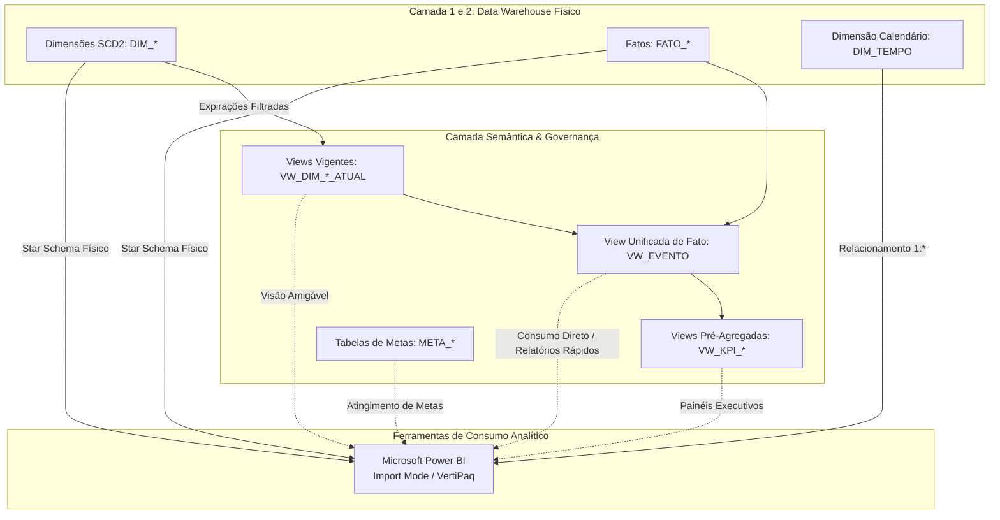
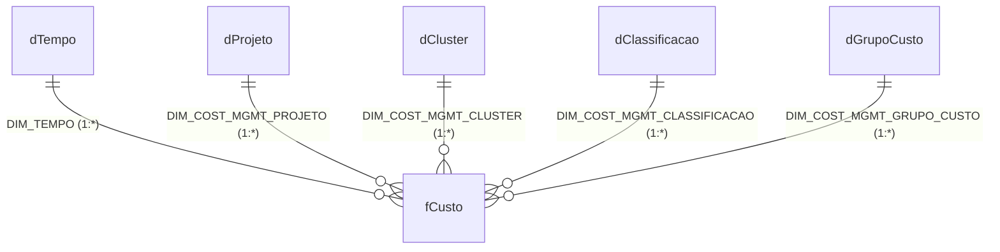

# Padrão Corporativo de Handoff para Business Intelligence — Especificação de Entrega para Power BI

Este guia estabelece os padrões corporativos de Business Intelligence que o **Engenheiro de Dados** e a IA do **NINHO** devem aplicar na geração do artefato **`GUIA_ANALISTA_BI_<PROJETO>.md`** (armazenado em `saida/planejador_dw/08_datasets_bi/`), entregável essencial para que a equipe externa de **Analistas de BI** e **Desenvolvedores de Painéis** construa relatórios no **Microsoft Power BI** com autonomia e conformidade.

> 🛡️ **Aviso de Arquitetura & Governança da Plataforma:**  
> O **NINHO** é uma plataforma de engenharia analítica de uso **100% exclusivo para Engenheiros de Dados**. O Analista de BI **não acessa o repositório NINHO nem possui módulos de execução no sistema**.  
> Este documento funciona como o **manual canônico de referência corporativa**: ele dita todas as diretrizes técnicas que devem compor o entregável do projeto. Ao finalizar o DW, o Engenheiro de Dados exporta o guia gerado do projeto e o entrega ao Analista de BI fora do NINHO.  
> **Fontes de Dados do DW:** Data Warehouse Oracle (`DIM_*`, `FATO_*`), Views Vigentes (`VW_DIM_*_ATUAL`), Visões de Negócio (`VW_EVENTO`, `VW_KPI_*`) e Metas (`META_*`).  
> **Objetivo:** Garantir modelos analíticos com altíssima performance no motor VertiPaq, integridade matemática em cálculos DAX/SQL, governança de dimensões de tempo e padronização visual corporativa.

---

## Sumário

- [1. Visão Geral da Arquitetura de Consumo](#1-visao-geral)
- [2. Modos de Conexão no Power BI (Import vs. DirectQuery)](#2-modos-conexao)
- [3. Topologia do Modelo no Power BI (Star Schema Puro)](#3-topologia-modelo)
  - [3.1 Cardinalidade e Direção de Filtro Cruzado](#31-cardinalidade-filtros)
  - [3.2 Ocultação de Chaves Técnicas e Surrogate Keys](#32-ocultacao-chaves)
- [4. Tratamento da Dimensão Tempo Corporativa (DIM_TEMPO)](#4-dimensao-tempo)
  - [4.1 Marcar como Tabela de Data (Mark as Date Table)](#41-marcar-tabela-data)
  - [4.2 Ordenação Obrigatória de Colunas (Sort by Column)](#42-ordenacao-colunas)
  - [4.3 Calendários Acadêmico, Fiscal e Governamental](#43-calendarios-especiais)
- [5. Governança de Dimensões SCD2 e Linha -1](#5-scd2-linha-menos-1)
- [6. Padrão Corporativo de Desenvolvimento DAX](#6-padrao-dax)
  - [6.1 Tabela Dedicada de Medidas (_Medidas)](#61-tabela-medidas)
  - [6.2 Medidas Explícitas vs. Implícitas](#62-medidas-explicitas)
  - [6.3 Divisão Segura com DIVIDE](#63-divisao-segura)
  - [6.4 Organização em Pastas de Exibição (Display Folders)](#64-pastas-exibicao)
  - [6.5 Fórmulas Canônicas de Inteligência Temporal (Time Intelligence)](#65-time-intelligence)
- [7. Checklist de Qualidade e Homologação Pré-Publicação](#7-checklist-qualidade)

---

<a id="1-visao-geral"></a>
## 1. Visão Geral da Arquitetura de Consumo

O ecossistema analítico disponibiliza duas camadas estruturadas no Oracle para consumo das ferramentas de BI:



### Qual camada conectar no seu relatório?
1. **Modelos Ricos e Detalhados (Power BI):** Conecte diretamente nas tabelas dimensionais (`DIM_*` ou `VW_DIM_*_ATUAL`), na dimensão calendário (`DIM_TEMPO` ou `VW_DIM_TEMPO`) e nas tabelas fato (`FATO_*`), montando um **Star Schema** puro no Power BI.
2. **Relatórios Rápidos ou Self-Service:** Conecte nas views da Camada Semântica (`VW_EVENTO`, `VW_KPI_*`), onde os joins, filtros de vigência e regras de negócio já vêm pré-resolvidos pelo banco.

---

<a id="2-modos-conexao"></a>
## 2. Modos de Conexão no Power BI (Import vs. DirectQuery)

### 🔹 Modo Recomendado: Importação (Import Mode)
O motor colunar em memória **VertiPaq** do Power BI oferece desempenho centenas de vezes superior a consultas diretas no banco de dados.

* **Quando utilizar:** Padrão institucional para 95% dos projetos. As tabelas fatos do nosso DW são modeladas com o grão ideal e dimensões compactas, garantindo que mesmo bases de dezenas de milhões de linhas ocupem poucas centenas de megabytes em memória.
* **Benefícios:**
  - Resposta sub-segundo em qualquer filtro ou segmentação.
  - Suporte completo a todas as funções DAX (`CALCULATE`, `SAMEPERIODLASTYEAR`, `DISTINCTCOUNT`).
  - Sem concorrência ou overhead no banco de dados operacional durante o horário de expediente.

### 🔹 Modo DirectQuery
Consulta o banco de dados Oracle em tempo real a cada clique ou interação do usuário.

* **Quando utilizar:** Apenas quando houver exigência estrita de dados em tempo real (atualização a cada minuto) ou quando o volume da fato ultrapassar **500 milhões de linhas** e inviabilizar o limite de memória do workspace do Power BI Service.
* **Restrições estritas do DirectQuery:**
  - Limitação severa de funções DAX (bloqueio de Time Intelligence nativa e operações complexas).
  - Cada interação do usuário gera múltiplas queries SQL pesadas no Oracle.
  - Risco de gargalo na rede corporativa e degradação da experiência do usuário final.

---

<a id="3-topologia-modelo"></a>
## 3. Topologia do Modelo no Power BI (Star Schema Puro)

No Power BI, estruture o diagrama da guia **Modelo** em formato de **Estrela (Star Schema)**. As dimensões ficam posicionadas acima ou ao redor, e as tabelas fato ficam no centro:



<a id="31-cardinalidade-filtros"></a>
### 3.1 Cardinalidade e Direção de Filtro Cruzado

| Parâmetro | Padrão Corporativo Obrigatório | Justificativa Técnica |
| :--- | :--- | :--- |
| **Cardinalidade** | **1 para Muitos (1:\*)** | O lado "1" é sempre a Dimensão (chave primária `DIMENSION_KEY` ou `SK_*`), e o lado "\*" é a Tabela Fato. |
| **Direção de Filtro Cruzado** | **Única (Single)** | O filtro flui exclusivamente da Dimensão para a Fato. |

> [!CAUTION]
> **PROIBIDO FILTRO BIDIRECIONAL (BOTH):**  
> NUNCA configure relacionamentos como "Ambos" (`Both`). O filtro bidirecional causa:
> 1. Degradação massiva da compressão de cache do VertiPaq.
> 2. Ambiguidade nos caminhos de filtragem do motor relacional.
> 3. Resultados incorretos em métricas calculadas que utilizam `CALCULATE()` ou `ALL()`.  
> Caso precise filtrar uma dimensão a partir de outra, utilize DAX específico com `CROSSFILTER()` ou `TREATAS()` localmente na medida.

<a id="32-ocultacao-chaves"></a>
### 3.2 Ocultação de Chaves Técnicas e Surrogate Keys

Para manter o modelo limpo, intuitivo e amigável para usuários de negócio:
1. **Oculte na Tabela Fato:** Todas as Foreign Keys numéricas (`DIM_TEMPO`, `DIM_PROJETO`, `DIM_CLUSTER`, etc.). Usuários nunca devem arrastar chaves da fato para os visuais.
2. **Oculte nas Dimensões:** A Surrogate Key (`DIMENSION_KEY`), flags de auditoria (`DES_ATUALIZAR`, `SIN_ATIVO`) e datas de vigência técnica (`DTC_EFETIVACAO`, `DTC_EXPIRACAO`).
3. **Deixe Visíveis:** Apenas colunas descritivas de negócio (`NOM_PROJETO`, `DES_AMBIENTE`, `NOM_CLASSIFICACAO`) e métricas na tabela de medidas.

---

<a id="4-dimensao-tempo"></a>
## 4. Tratamento da Dimensão Tempo Corporativa (`DIM_TEMPO`)

A dimensão calendário do nosso Data Warehouse (`DIM_TEMPO` ou view `VW_DIM_TEMPO`) é uma **dimensão conformada** que atende todos os projetos corporativos.

<a id="41-marcar-tabela-data"></a>
### 4.1 Marcar como Tabela de Data (Mark as Date Table)

Assim que importar a tabela para o Power BI:
1. Renomeie a tabela para **`dTempo`** ou **`dCalendario`**.
2. Clique com o botão direito sobre a tabela `dTempo` na barra lateral de dados.
3. Selecione **Marcar como tabela de data** (ou *Mark as date table*).
4. No campo de coluna de data, selecione a coluna de data contínua (`DTC_COMPLETA` ou `DTC_DATA`).
5. Confirme.

> [!TIP]
> **Por que fazer isso?**  
> Quando você marca formalmente a tabela de datas, o Power BI desativa automaticamente as tabelas de data/hora automáticas ocultas (`LocalDateTable_...`), reduzindo imediatamente o tamanho do arquivo `.pbix` e habilitando o funcionamento correto de todas as funções de **Time Intelligence** do DAX.

<a id="42-ordenacao-colunas"></a>
### 4.2 Ordenação Obrigatória de Colunas (Sort by Column)

Por padrão, ferramentas de BI ordenam campos de texto alfabeticamente (ex: *Abril, Agosto, Dezembro, Fevereiro...*). Para garantir a cronologia correta nos eixos dos gráficos e tabelas, configure a classificação de colunas na guia **Modelagem** (*Classificar por coluna* / *Sort by column*):

| Coluna Exibida no Gráfico | Coluna de Ordenação Obrigatória | Exemplo de Valor Exibido |
| :--- | :--- | :--- |
| `DES_MES` / `DES_MES_NOME` | **`NUM_MES`** | Janeiro, Fevereiro, Março... |
| `DES_ANO_MES` / `DES_MES_ANO` | **`NUM_ANO_MES`** ou **`COD_ANO_MES`** | Jan/2026, Fev/2026, Mar/2026... |
| `DES_TRIMESTRE` | **`NUM_TRIMESTRE`** | 1º Trimestre, 2º Trimestre... |
| `DES_SEMESTRE` | **`NUM_SEMESTRE`** | 1º Semestre, 2º Semestre... |
| `DES_BIMESTRE` | **`NUM_BIMESTRE`** | 1º Bimestre, 2º Bimestre... |
| `DES_QUADRIMESTRE` | **`NUM_QUADRIMESTRE`** | 1º Quadrimestre... |
| `DES_DIA_SEMANA` | **`NUM_DIA_SEMANA`** | Segunda-feira, Terça-feira... |

<a id="43-calendarios-especiais"></a>
### 4.3 Calendários Acadêmico, Fiscal e Governamental

A `DIM_TEMPO` disponibiliza atributos avançados pré-calculados que dispensam cálculos complexos em DAX:
- **`NUM_SEMESTRE` / `DES_SEMESTRE`:** Crucial para instituições públicas e de ensino (ex: *2026.1*, *2026.2*).
- **`IND_FINAL_SEMANA` (1/0) ou `SIN_FIM_SEMANA` ('S'/'N'):** Permite filtrar instantaneamente apenas dias úteis ou fins de semana.
- **`IND_FERIADO_FACULTATIVO` (1/0) ou `SIN_FERIADO` ('S'/'N'):** Identifica feriados nacionais e pontos facultativos mapeados no calendário corporativo.

---

<a id="5-scd2-linha-menos-1"></a>
## 5. Governança de Dimensões SCD2 e Linha `-1`

### Como Trabalhar com a Linha `-1` (Registro Padrão Não Informado)
Todas as dimensões do nosso DW contêm obrigatoriamente a linha técnica com `DIMENSION_KEY = -1`:
- `NOM_... = 'NAO INFORMADO'` ou `'NAO SE APLICA'`.
- `DES_ATUALIZAR = 'N'` e `SIN_ATIVO = 'S'`.

**No Power BI:**  
Graças à linha `-1`, quando uma fato tiver uma chave desconhecida ou nula, ela se conectará à linha `-1` da dimensão em vez de criar uma linha em branco (`(Blank)`) nos visuais.  
*Recomendação:* Deixe o valor `'NAO INFORMADO'` visível nos filtros ou configure filtros de página para excluí-lo caso o relatório exija apenas entidades plenamente identificadas.

### Como Consumir Dimensões com Histórico (SCD Tipo 2)
Se uma dimensão possui versionamento histórico (múltiplas linhas para a mesma entidade de negócio, com `DTC_EFETIVACAO` e `DTC_EXPIRACAO`):
1. **Para Relatórios que exigem apenas o Estado Atual (Vigente):**
   - Conecte preferencialmente na view correspondente da Camada Semântica: `VW_<PROJETO>_DIM_<ENTIDADE>` (ou `VW_DIM_<ENTIDADE>_ATUAL`). Essa view já contém o filtro `WHERE DTC_EXPIRACAO IS NULL AND DIMENSION_KEY <> -1`.
   - Se conectar na tabela física `DIM_*`, filtre no Power Query ou no filtro da tabela `DTC_EXPIRACAO IS BLANK` (ou `SIN_ATIVO = 'S'`).
2. **Para Análises Históricas Ponto-a-Ponto (*Point-in-Time*):**
   - Conecte diretamente na tabela fato. Como a fato armazena a Surrogate Key (`DIMENSION_KEY`) vigente no momento exato do fato ocorrido, a relação trará o contexto histórico exato da época da transação automaticamente.

---

<a id="6-padrao-dax"></a>
## 6. Padrão Corporativo de Desenvolvimento DAX

<a id="61-tabela-medidas"></a>
### 6.1 Tabela Dedicada de Medidas (`_Medidas`)

Nunca crie medidas dispersas dentro das tabelas de fatos ou dimensões. Crie uma tabela isolada dedicada exclusivamente às medidas:

1. Na guia **Página Inicial**, clique em **Inserir Dados**.
2. Nomeie a tabela como **`_Medidas`** (ou `_Medidas_<DOMINIO>`).
3. Crie sua primeira medida dentro dela.
4. Exclua a coluna padrão vazia (`Coluna1`). O Power BI transformará o ícone da tabela em uma calculadora de medidas oficial e a posicionará no topo da lista de tabelas.

<a id="62-medidas-explicitas"></a>
### 6.2 Medidas Explícitas vs. Implícitas

> [!WARNING]
> **PROIBIDO O USO DE MEDIDAS IMPLÍCITAS:**  
> Nunca arraste uma coluna de valor numérico direto para o campo de valores de um gráfico ou tabela (ex: arrastar `VAL_CUSTO_TOTAL` e deixar o Power BI aplicar a soma automática).  
> Sempre escreva uma **Medida DAX Explícita**.

**Vantagens da Medida Explícita:**
- Permite reutilização em cálculos derivados (MoM, YoY, percentuais).
- Facilita formatação padronizada e documentação.
- Compatível com ferramentas externas como DAX Studio, Tabular Editor e Excel via Conexão Dinâmica (*Analyze in Excel*).

<a id="63-divisao-segura"></a>
### 6.3 Divisão Segura com `DIVIDE()`

**NUNCA** utilize o operador de barra (`/`) para efetuar divisões no Power BI. Utilize sempre a função `DIVIDE()`:

```dax
// ❌ INCORRETO (Gera erro de divisão por zero ou exibe 'Infinity' / 'NaN'):
% Margem Incorreta = [Lucro] / [Receita Total]

// ✅ CORRETO (Trata divisão por zero de forma elegante e retorna 0 ou Blank):
% Margem Correta = DIVIDE([Lucro], [Receita Total], 0)
```

<a id="64-pastas-exibicao"></a>
### 6.4 Organização em Pastas de Exibição (Display Folders)

Organize todas as medidas em **Pastas de Exibição** na guia Modelo. Siga a taxonomia padrão:
- `01. Totais Consolidados`
- `02. Médias e Custos Unitários`
- `03. Proporções e Percentuais (%)`
- `04. Metas e Orçamentos`
- `05. Inteligência Temporal (Time Intelligence)`

<a id="65-time-intelligence"></a>
### 6.5 Fórmulas Canônicas de Inteligência Temporal (Time Intelligence)

Utilize as seguintes formulações canônicas de Time Intelligence conectadas à tabela `dTempo`:

#### 1. Ano até a Data (Year-to-Date - YTD):
```dax
Custo YTD = 
TOTALYTD(
    [Custo Total Consolidado], 
    'dTempo'[DTC_COMPLETA]
)
```

#### 2. Mês Anterior (Month-over-Month - MoM):
```dax
Custo Mes Anterior = 
CALCULATE(
    [Custo Total Consolidado],
    DATEADD('dTempo'[DTC_COMPLETA], -1, MONTH)
)

Variacao MoM Valor = 
[Custo Total Consolidado] - [Custo Mes Anterior]

Variacao MoM % = 
DIVIDE([Variacao MoM Valor], [Custo Mes Anterior], 0)
```

#### 3. Mesmo Período do Ano Anterior (Year-over-Year - YoY):
```dax
Custo Ano Anterior = 
CALCULATE(
    [Custo Total Consolidado],
    SAMEPERIODLASTYEAR('dTempo'[DTC_COMPLETA])
)

Variacao YoY % = 
DIVIDE([Custo Total Consolidado] - [Custo Ano Anterior], [Custo Ano Anterior], 0)
```

#### 4. Total Acumulado Móvel (Rolling 12 Months):
```dax
Custo Ultimos 12 Meses = 
CALCULATE(
    [Custo Total Consolidado],
    DATESINPERIOD(
        'dTempo'[DTC_COMPLETA],
        MAX('dTempo'[DTC_COMPLETA]),
        -12,
        MONTH
    )
)
```

---

<a id="7-checklist-qualidade"></a>
## 7. Checklist de Qualidade e Homologação Pré-Publicação

Antes de publicar o relatório no **Power BI Service (Portal UNEBi / Gateway Corporativo)**, o analista de BI deve validar obrigatoriamente a lista abaixo:

- [ ] **Modo de Conexão:** O modelo está em **Import Mode** (a menos que haja autorização prévia para DirectQuery).
- [ ] **Star Schema:** Todos os relacionamentos são de **1 para Muitos (1:\*)** das Dimensões para a Fato.
- [ ] **Direção de Filtro:** Todos os relacionamentos possuem direção de filtro cruzado **Única (Single)**. Não há filtros bidirecionais (`Both`).
- [ ] **Tabela de Calendário:** A tabela `dTempo` foi marcada oficialmente como **Tabela de Data** usando a coluna de data pura.
- [ ] **Ordenação de Colunas (Sort by Column):** As colunas de texto com cronologia (`DES_MES`, `DES_MES_ANO`, `DES_TRIMESTRE`, `DES_SEMESTRE`) estão devidamente classificadas pelas suas respectivas colunas numéricas.
- [ ] **Ocultação de Chaves:** Todas as Surrogate Keys (`DIMENSION_KEY`, `SK_*`) e chaves estrangeiras da fato estão ocultas na exibição de relatório.
- [ ] **Tabela Dedicada de Medidas:** Todas as métricas estão centralizadas na tabela `_Medidas`, agrupadas em pastas de exibição temáticas.
- [ ] **Divisão Segura:** Todas as divisões utilizam `DIVIDE(Numerador, Denominador, 0)`. Não há barras (`/`) em fórmulas de divisão.
- [ ] **Conferência Matemática:** Os totais das principais medidas batem 100% com as queries de homologação executadas no Oracle SQL Developer/DBeaver.
- [ ] **Performance Analyzer:** No Power BI Desktop, o tempo de renderização de todos os visuais da página está abaixo de **1,5 segundo**.

