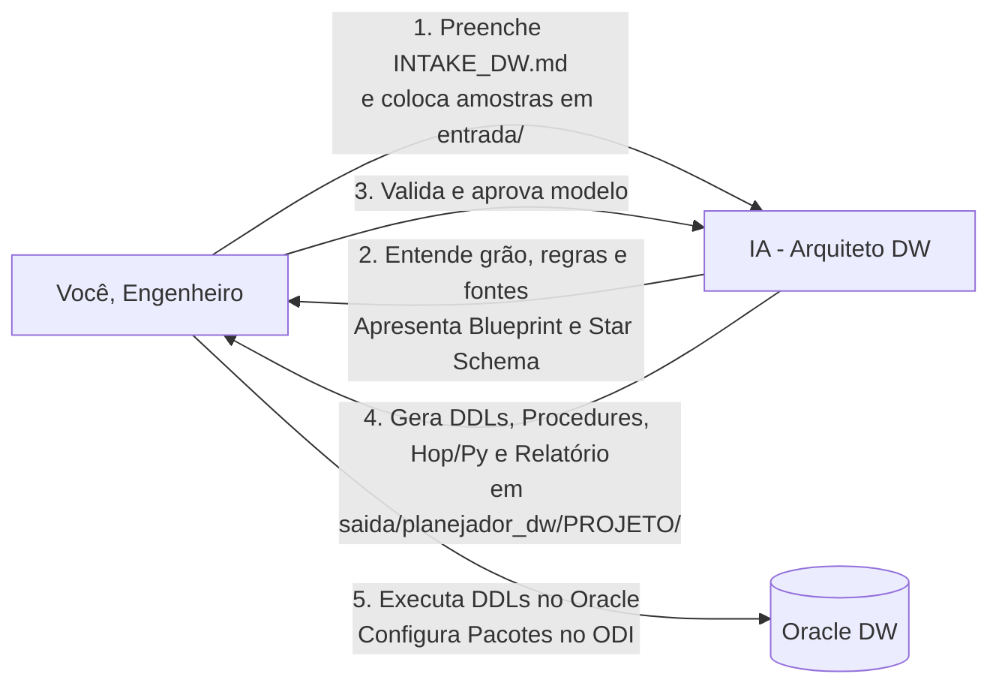

# Guia do Engenheiro de Dados — Planejador de Data Warehouses (DW)

Este guia orienta o **Engenheiro de Dados** a utilizar o **Planejador de DW** para projetar, modelar e estruturar novos Data Warehouses no Oracle a partir de fontes heterogêneas de dados (Bancos Relacionais OLTP, Arquivos/Planilhas via SFTP e APIs Web REST).

> **Público:** Engenheiro de dados responsável pela modelagem e esteiras de ETL/ELT.  
> **Objetivo:** Fornecer insumos completos para que a IA gere a arquitetura dimensional, DDLs de alta performance, esteiras de ingestão (ODI, Hop, Python) e a estratégia de carga ideal (Dual Strategy).  
> **Resultado:** DDLs prontos (`STG`, `ODI_DIM`, `DIM`, `FATO`, `TB_CONTROLE_CARGA`), procedure de manutenção (`PRC_POS_CARGA_FATO`), pipelines Hop (`.hpl`/`.hwf`), extratores Python, datasets Superset (`.yaml`) e relatório de linhagem (*"Como chegar em cada valor"*), salvos em `saida/planejador_dw/<NOME_PROJETO>/`.

---

## Sumário

- [1. Visão Geral do Processo](#1-visao-geral)
- [2. O que Entregar (Preparação dos Insumos)](#2-o-que-entregar)
  - [2.1 Fontes Banco de Dados (OLTP)](#21-fontes-banco)
  - [2.2 Fontes Arquivos e Planilhas em FTP/SFTP](#22-fontes-arquivos)
  - [2.3 Fontes APIs Web e Serviços Externos](#23-fontes-apis)
  - [2.4 Formulário INTAKE_DW.md](#24-formulario-intake)
- [3. Entendendo a Arquitetura Corporativa Híbrida & Dual Strategy](#3-arquitetura-hibrida)
  - [3.1 Estratégia A: Truncate & Load Massivo (Padrão SEI Bahia / OLTP)](#31-estrategia-a)
  - [3.2 Estratégia B: Incremental Idempotente via MERGE (Padrão FinOps / Telemetria)](#32-estrategia-b)
- [4. Ordem de Execução dos Scripts no Oracle](#4-ordem-execucao)
- [5. Configuração no Oracle Data Integrator (ODI)](#5-configuracao-odi)
  - [5.1 Configuração do OdiOSCommand (SSH)](#51-odioscommand)
  - [5.2 Módulo Dimensões e Cubos (ODI_DIM_*)](#52-dimensoes-cubos)
  - [5.3 Carga da Fato e Lookup com Fallback para -1](#53-carga-fato-controle)
  - [5.4 Execução da Procedure PRC_POS_CARGA_FATO](#54-procedure-tuning)
- [6. Consumo Analítico (Power BI & Superset)](#6-consumo-bi)
- [7. Biblioteca de Prompts Prontos (Copiar e Colar para a IA)](#7-prompts-prontos)
- [8. O que NÃO Fazer (Erros Comuns)](#8-o-que-nao-fazer)

---

<a id="1-visao-geral"></a>
## 1. Visão Geral do Processo



O processo é colaborativo e ágil:
1. **Você entrega os insumos** (schemas, amostras, arquivos e perguntas de negócio em `modulos/planejador_dw/entrada/`).
2. **A IA projeta o DW** (define grão, dimensões SCD2, esteira de ferramentas, estratégia de carga e sizing).
3. **Você valida a proposta técnica** através de checkpoints interativos.
4. **A IA gera os scripts DDL, procedures, pipelines Hop, extratores Python e relatório técnico**.
5. **Você executa no banco e configura os pacotes no ODI**.

> 💡 **Comandos Chaves de Interação com a IA:** Para não deixar a IA gerar código às cegas, utilize os comandos de diálogo recomendados (`/inspecionar-fontes`, `/desafiar-grao`, `/classificar-scd`, `/definir-estrategia-carga`, `/gerar-blueprint`, `/aprovar-blueprint`). Veja o catálogo completo e as queries de validação no [**Guia Central de Comandos Rápidos — Seção 7**](GUIA_COMANDOS_RAPIDOS.md#7-comandos-interacao-etapas).

---

<a id="2-o-que-entregar"></a>
## 2. O que Entregar (Preparação dos Insumos)

Para que a IA gere a arquitetura sem inventar regras, você deve preparar a pasta `modulos/planejador_dw/entrada/`:

### 2.1 Fontes Banco de Dados (OLTP)
Coloque em `modulos/planejador_dw/entrada/ddl/` o DDL das tabelas que contêm os dados na origem:
- **Query útil para extrair o DDL de uma tabela no Oracle:**
  ```sql
  SELECT DBMS_METADATA.GET_DDL('TABLE', 'TAB_ORIGEM', 'SCHEMA_ORIGEM') FROM DUAL;
  ```
- Coloque em `modulos/planejador_dw/entrada/amostras/` uma amostra de 10 a 50 linhas para a IA avaliar os dados reais:
  ```sql
  SELECT * FROM SCHEMA_ORIGEM.TAB_ORIGEM WHERE ROWNUM <= 20;
  ```

### 2.2 Fontes Arquivos e Planilhas em FTP/SFTP
Coloque em `modulos/planejador_dw/entrada/arquivos_ftp/`:
- Um arquivo de exemplo representativo (`.csv`, `.xlsx`, `.xls` ou `.txt`).
- No `INTAKE_DW.md`, especifique: frequência de chegada, delimitador, encoding e se possui cabeçalho.

### 2.3 Fontes APIs Web e Serviços Externos
Coloque em `modulos/planejador_dw/entrada/api_specs/`:
- Um exemplo real de payload JSON/XML retornado pelo endpoint ou especificação OpenAPI/Swagger.
- No `INTAKE_DW.md`, especifique: URL base, método de autenticação e tipo de paginação.

### 2.4 Formulário `INTAKE_DW.md`
Preencha o arquivo [`modulos/planejador_dw/INTAKE_DW.md`](../../modulos/planejador_dw/INTAKE_DW.md):
- **Identificação do Projeto:** Nome do projeto, schema alvo e tablespaces.
- **O que o Cliente Quer:** 5 a 15 perguntas de negócio que o DW deve responder.
- **Regras de Negócio:** Grão da Fato e como calcular as medidas.
- **Estratégia de Carga:** Seleção entre Estratégia A (Truncate & Load) ou Estratégia B (MERGE Incremental).
- **Volumetria:** Estimativa de linhas para cálculo de sizing e particionamento.

---

<a id="3-arquitetura-hibrida"></a>
## 3. Entendendo a Arquitetura Corporativa Híbrida & Dual Strategy

```mermaid
flowchart TD
    subgraph INGEST["1. Ingestão Híbrida Externa"]
        F_ARQ["Arquivos CSV/Excel (SFTP)"] -->|Apache Hop (.hpl / .hwf)| STG["Tabelas STG_*<br/>(Oracle Staging)"]
        F_API["APIs Web (REST/JSON)"] -->|Python Extractor (.py)| STG
        F_BANCO["Bancos OLTP"] -->|ODI Mapping Direto| STG
    end

    subgraph ODI_ORCH["2. Orquestração Centralizada no ODI"]
        CMD["OdiOSCommand (SSH)<br/>Chama Hop e Python no servidor remoto"]
        CMD -.->|Dispara| F_ARQ
        CMD -.->|Dispara| F_API
    end

    subgraph DW_CORE["3. Modelagem Dimensional In-Database (Oracle)"]
        STG -->|Módulo Dimensões & Cubos| ODI_DIM["Tabelas Auxiliares<br/>ODI_DIM_*"]
        ODI_DIM -->|IKM SCD Tipo 2| DIM["Dimensões Oficiais<br/>DIM_* (B-Tree + Linha -1)"]
        STG -->|Lookup com NVL(-1)| FATO["Fatos Oficiais<br/>FATO_* (Estratégia A ou B)"]
        FATO -.->|Truncate & Load| PRC["PRC_POS_CARGA_FATO<br/>(Rebuild NOLOGGING + Stats)"]
    end

    subgraph AUDIT["4. Auditoria"]
        FATO --> CTRL["TB_CONTROLE_CARGA<br/>(ID_CARGA, DATA_INICIO, DATA_FIM, STATUS)"]
    end
```

<a id="31-estrategia-a"></a>
### 3.1 Estratégia A: Truncate & Load Massivo (Padrão SEI Bahia / OLTP)
- **Quando usar:** Grandes janelas históricas (ex: últimos 3 meses ou ano fechado) recarregadas periodicamente em lote a partir de bancos OLTP sem DML concorrente durante a carga.
- **Indexação Física:**
  - **BITMAP INDEX** em todas as colunas de FK (`DIM_*`) e flags de baixa cardinalidade.
  - Habilita o plano **Star Transformation** do otimizador CBO no Oracle.
  - PK da fato utiliza B-Tree.
- **Manutenção Obrigatória:** Execução da procedure `PRC_POS_CARGA_FATO` para executar rebuild `NOLOGGING` e atualizar `DBMS_STATS(CASCADE => TRUE)`.

<a id="32-estrategia-b"></a>
### 3.2 Estratégia B: Incremental Idempotente via MERGE (Padrão FinOps / Telemetria)
- **Quando usar:** Cargas contínuas intra-dia ou diárias de APIs e telemetria onde novos dados e atualizações convivem sem truncar a tabela.
- **Lógica SQL:** `MERGE INTO ... USING (...) ON (...) WHEN MATCHED THEN UPDATE ... WHEN NOT MATCHED THEN INSERT ...`
- **Indexação Física:**
  - **B-TREE INDEX** em chaves compostas de busca.
  - **Índices Bitmap são terminantemente proibidos aqui** para evitar deadlocks e contenção de locks (`ORA-00060`).

---

<a id="4-ordem-execucao"></a>
## 4. Ordem de Execução dos Scripts no Oracle

Quando a IA gerar os scripts DDL em `saida/planejador_dw/<NOME_PROJETO>/`, execute-os no Oracle **estritamente nesta ordem**:

```sql
-- 1. Tabela corporativa de auditoria e controle de carga (apenas se não existir)
@01_controle_carga/01_tb_controle_carga.sql

-- 2. Tabelas de Staging (Aterrissagem com metadados de lote e extração)
@02_staging/02_create_stg_tables.sql

-- 3. Tabelas auxiliares do ODI para SCD Tipo 2
@03_dimensoes/03_create_odi_dim_tables.sql

-- 4. Dimensões oficiais com SCD Tipo 2, Sequences e índices B-Tree exclusivos
@03_dimensoes/04_create_dim_tables.sql

-- 5. Carga inicial do registro -1 (Não Informado) em todas as dimensões
@03_dimensoes/06_init_default_records.sql

-- 6. Tabelas Fato com FKs NOT NULL, medidas padronizadas e índices (Bitmap ou B-Tree)
@04_fatos/05_create_fato_tables.sql

-- 7. Procedure corporativa de manutenção pós-carga (se Estratégia A)
@05_procedimentos_manutencao/07_prc_pos_carga_fato.sql
```

> ⚠️ **Atenção:** O script `06_init_default_records.sql` (inserção da linha `-1`) DEVE ser executado **ANTES** de criar a tabela FATO com FKs ativas, garantindo que o registro padrão já exista.

---

<a id="5-configuracao-odi"></a>
## 5. Configuração no Oracle Data Integrator (ODI)

<a id="51-odioscommand"></a>
### 5.1 Configuração do `OdiOSCommand` (SSH)
Para orquestrar a ingestão de arquivos (Hop) ou APIs (Python) a partir do ODI:
1. Abra o **Package** do projeto no ODI Designer.
2. Arraste a ferramenta **`OdiOSCommand`** para o diagrama antes dos mappings de carga.
3. No painel de propriedades, cole o comando gerado no `RELATORIO_ESTRATEGIAS.md`:
   - **Exemplo para Apache Hop:**
     ```bash
     ssh usr_etl@srv-hop01 "/opt/hop/hop-run.sh -r local -f /opt/etl/hop/pipelines/pipe_stg_acao.hpl -l Basic"
     ```
   - **Exemplo para Python:**
     ```bash
     ssh usr_etl@srv-py01 "/usr/bin/python3 /opt/etl/python/extract_api_custo.py --start-date \$(date -d '1 day ago' +\%Y-\%m-\%d)"
     ```
4. Configure a opção **Synchronous** como `True` para que o ODI aguarde o script terminar antes de iniciar a carga das dimensões e fatos.

<a id="52-dimensoes-cubos"></a>
### 5.2 Módulo Dimensões e Cubos (`ODI_DIM_*`)
1. Importe a tabela `DIM_*` e a tabela `ODI_DIM_*` no Modelo do ODI via **Reverse Engineering**.
2. No componente de Dimensão do ODI:
   - Defina a tabela de armazenamento como `DIM_*`.
   - Defina a tabela de estágio como `ODI_DIM_*`.
   - Mapeie a coluna `ID_*` como **Natural Key**.
   - Mapeie as colunas descritivas como **Slowly Changing Dimension (Histórico)**.
   - Configure o IKM: `IKM Oracle Slowly Changing Dimension`.

<a id="53-carga-fato-controle"></a>
### 5.3 Carga da Fato e Lookup com Fallback para `-1`
1. No mapping da Fato, realize o lookup das chaves de negócio na dimensão buscando a versão vigente (`DTC_EXPIRACAO IS NULL`).
2. Adicione a expressão `NVL(LOOKUP.DIMENSION_KEY, -1)` para garantir que códigos não encontrados ou nulos recebam a chave `-1`.
3. Ao final do pacote no ODI, adicione uma etapa de inserção/atualização na `TB_CONTROLE_CARGA`:
   ```sql
   INSERT INTO TB_CONTROLE_CARGA (NOME_PROJETO, NOME_TABELA_ALVO, TIPO_CARGA, STATUS_EXECUCAO, DATA_INICIO, DATA_FIM, QTD_LINHAS_PROCESSADAS)
   VALUES ('<NOME_PROJETO>', 'FATO_<NOME>', 'TRUNCATE_LOAD', 'SUCESSO', SYSDATE, SYSDATE, :QTD_LINHAS);
   ```

<a id="54-procedure-tuning"></a>
### 5.4 Execução da Procedure `PRC_POS_CARGA_FATO`
Se a Fato adotou a **Estratégia A (Truncate & Load)**, adicione um passo de execução de procedimento SQL no ODI logo após o mapping da fato:
```sql
BEGIN
    "<SCHEMA_ALVO>"."PRC_POS_CARGA_FATO"(p_tabela_fato => 'FATO_<DOMINIO>_<EVENTO>');
END;
/
```

---

<a id="6-consumo-bi"></a>
## 6. Consumo Analítico (Power BI & Superset)

1. **Power BI:**
   - Modo de Conexão: **Import Mode**.
   - Cardinalidade: **1 para Muitos (1:*)** das Dimensões para a Fato.
   - Direção do Filtro Cruzado: **Única (Single)**.
   - Crie uma tabela dedicada `_Medidas` com cálculo explícito e tratamento via `DIVIDE()`.
2. **Apache Superset:**
   - Importe o arquivo YAML gerado em `saida/planejador_dw/<NOME_PROJETO>/08_datasets_bi/superset_dataset_<fato>.yaml`.
   - O dataset já vem configurado com métricas `count`, `sum` e dimensões formatadas.
3. **Módulo de Camada Semântica (Handoff Automático e Pipeline Contínuo):**
   - O trabalho de engenharia não para no DW! Para integrar diretamente com o módulo de Camada Semântica sem retrabalho manual de extração de DDLs ou preenchimento de formulários:
     - **No Chat com a IA:** Digite o comando `/concluir-dw` ou `/transicionar-semantica`.
     - **Ou via Terminal (CLI):** Execute:
       ```bash
       python core/scripts_comuns/transicionar_dw_para_semantica.py --projeto <NOME_PROJETO> --gerar-amostras
       ```
   - O transicionador automatizado realiza todo o trabalho pesado:
     1. Consolida os DDLs em `entrega/camada_semantica/ddl/DDL_COMPLETO_DW_<PROJETO>.sql`.
     2. Move as amostras reais ou gera dados sintéticos em `entrega/camada_semantica/amostras/`.
     3. Copia o relatório de estratégias e guias de BI para `entrega/camada_semantica/relatorios_etl/`.
     4. Preenche automaticamente todas as seções de `modulos/camada_semantica/INTAKE_SEMANTICA.md`.
     5. Atualiza o catálogo corporativo (`PROJETO_RESUMO.md` e `PROJETO_VERSION.md`).
     6. Executa a validação pré-voo da semântica (`validar_entrega.py semantica`).

---

<a id="7-prompts-prontos"></a>
## 7. Biblioteca de Prompts Prontos (Copiar e Colar para a IA)

Utilize os prompts abaixo para conduzir o agente durante o planejamento:

### Prompt 1 — Início do Planejamento do DW
```text
Olá! Preenchi o formulário modulos/planejador_dw/INTAKE_DW.md e coloquei as amostras e DDLs das fontes na pasta modulos/planejador_dw/entrada/. 

Por favor, inspecione todos os insumos, analise as perguntas de negócio e apresente o Documento de Entendimento Dimensional contendo:
1. Mapeamento da esteira híbrida (quais fontes vão para Hop, Python e ODI).
2. Definição da estratégia de carga da fato (Estratégia A ou Estratégia B com justificativa técnica).
3. Definição do grão da Fato e lista de medidas padronizadas (TOT_*, QTD_*, VAL_*).
4. Definição das Dimensões SCD Tipo 2 e tabelas auxiliares ODI_DIM_*.
5. Estimativa de sizing de storage anual em GB.

Não gere scripts DDL ainda, aguarde minha validação do modelo.
```

### Prompt 2 — Solicitação dos DDLs e Artefatos Otimizados
```text
O modelo dimensional e as regras foram validados e aprovados! 

Por favor, gere todos os artefatos estruturados na pasta saida/planejador_dw/<NOME_PROJETO>/, seguindo rigorosamente os padrões de CONVENCOES_DW.md:
1. 01_controle_carga/01_tb_controle_carga.sql (se necessário)
2. 02_staging/02_create_stg_tables.sql
3. 03_dimensoes/03_create_odi_dim_tables.sql
4. 03_dimensoes/04_create_dim_tables.sql (com B-Tree exclusivo e Sequences)
5. 03_dimensoes/06_init_default_records.sql (script da linha -1)
6. 04_fatos/05_create_fato_tables.sql (conforme a estratégia aprovada)
7. 05_procedimentos_manutencao/07_prc_pos_carga_fato.sql (se Estratégia A)
8. Pipelines Hop (.hpl/.hwf) ou Extrator Python (.py) conforme as fontes do projeto.
9. Datasets para Superset (.yaml).

Gere os arquivos com sintaxe Oracle validada e comentários completos.
```

### Prompt 3 — Solicitação do Relatório de Estratégias & Linhagem
```text
Os scripts e artefatos foram gerados. 

Agora, por favor, gere o RELATORIO_ESTRATEGIAS.md do projeto em saida/planejador_dw/<NOME_PROJETO>/09_relatorio_estrategias/ detalhando:
1. A topologia completa com o comando SSH para o OdiOSCommand.
2. A matriz De/Para campo a campo ("Como chegar em cada valor").
3. As regras de lookup de SKs no ODI com fallback para -1.
4. O roteiro de manutenção pós-carga e o cálculo de sizing para a equipe de DBA.
```

### Prompt 4 — Conclusão do DW e Handoff para a Camada Semântica
```text
/concluir-dw

(Ou alternativamente em linguagem natural):
O planejamento do DW está concluído e aprovado! Por favor, execute o handoff contínuo para a Camada Semântica:
1. Registre e atualize a documentação central no catálogo (PROJETO_RESUMO.md e PROJETO_VERSION.md).
2. Consolide e transfira todos os DDLs, amostras e relatórios de ETL para a pasta 'entrega/camada_semantica/'.
3. Pré-preencha o formulário 'modulos/camada_semantica/INTAKE_SEMANTICA.md' com o grão da fato, schema, métricas e perguntas de negócio do projeto.
4. Execute a auditoria pré-voo da semântica e me forneça o comando para iniciar a geração da Camada Semântica.
```

---

<a id="8-o-que-nao-fazer"></a>
## 8. O que NÃO Fazer (Erros Comuns)

1. **NÃO usar índices Bitmap em Dimensões:** Dimensões sofrem atualizações frequentes de vigência. Bitmaps em dimensões travam blocos inteiros gerando deadlocks severos (**`ORA-00060`**). Use apenas **B-Tree**.
2. **NÃO esquecer a tabela `ODI_DIM_*`:** O módulo de Dimensões e Cubos do ODI exige essa tabela auxiliar. Sem ela, o IKM falha.
3. **NÃO esquecer a carga da linha `-1`:** Se uma Fato tentar referenciar um ID que não existe na dimensão e não houver a chave `-1`, a carga noturna quebra por violação de Foreign Key (`ORA-02291`).
4. **NÃO deixar FKs da Fato permitirem NULL:** Toda FK na Fato deve ser `NOT NULL ENABLE`, convertendo valores nulos para `-1` via `NVL(LOOKUP.DIMENSION_KEY, -1)`.
5. **NÃO esquecer de rodar `PRC_POS_CARGA_FATO` em Truncate & Load:** Tabelas com índices Bitmap que sofrem recarga massiva precisam de rebuild `NOLOGGING` e atualização do `DBMS_STATS(CASCADE => TRUE)`.
6. **NÃO criar Foreign Keys na tabela `STG_*`:** A staging deve aceitar os dados brutos com velocidade máxima. Integridade referencial pertence à Camada Ouro (`DIM` e `FATO`).
7. **NÃO esquecer comentários:** Toda tabela e coluna deve ter `COMMENT ON`. Isso é essencial para governança e para os modelos de IA da camada semântica.
