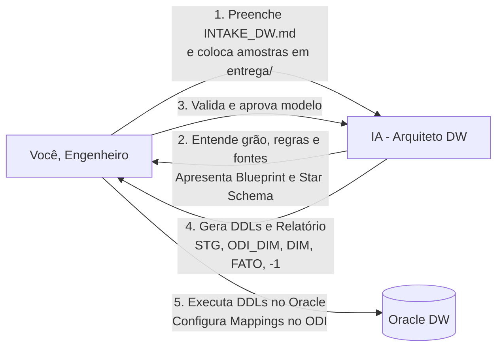
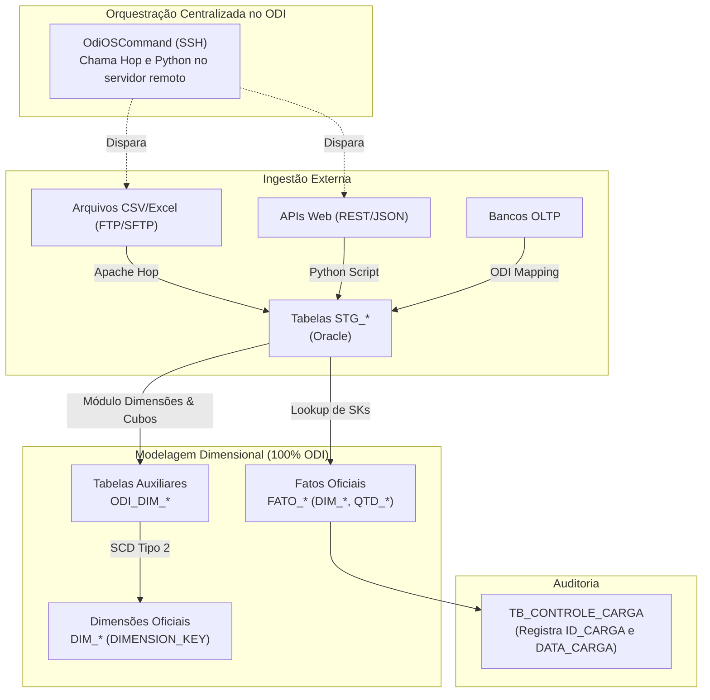

# Guia do Engenheiro de Dados — Planejador de Data Warehouses (DW)

Este guia orienta o **Engenheiro de Dados** a utilizar o **Planejador de DW** para projetar, modelar e estruturar novos Data Warehouses no Oracle a partir de fontes heterogêneas de dados (Bancos Relacionais OLTP, Arquivos/Planilhas via FTP/SFTP e APIs Web).

> **Público:** Engenheiro de dados responsável pela modelagem e esteiras de ETL/ELT.  
> **Objetivo:** Fornecer insumos completos para que a IA gere a arquitetura dimensional, DDLs de alta performance e a estratégia de carga híbrida.  
> **Resultado:** DDLs prontos (`STG`, `ODI_DIM`, `DIM`, `FATO`, `TB_CONTROLE_CARGA`), relatório de linhagem (*"Como chegar em cada valor"*), comandos SSH para o `OdiOSCommand` e estimativa de sizing para DBAs.

---

## Sumário

- [1. Visão Geral do Processo](#1-visao-geral)
- [2. O que Entregar (Preparação dos Insumos)](#2-o-que-entregar)
  - [2.1 Fontes Banco de Dados (OLTP)](#21-fontes-banco)
  - [2.2 Fontes Arquivos e Planilhas em FTP/SFTP](#22-fontes-arquivos)
  - [2.3 Fontes APIs Web e Serviços Externos](#23-fontes-apis)
  - [2.4 Formulário INTAKE_DW.md](#24-formulario-intake)
- [3. Entendendo a Arquitetura Corporativa Híbrida](#3-arquitetura-hibrida)
- [4. Ordem de Execução dos Scripts no Oracle](#4-ordem-execucao)
- [5. Configuração no Oracle Data Integrator (ODI)](#5-configuracao-odi)
  - [5.1 Configuração do OdiOSCommand (SSH)](#51-odioscommand)
  - [5.2 Módulo Dimensões e Cubos (ODI_DIM_*)](#52-dimensoes-cubos)
  - [5.3 Carga da Fato e TB_CONTROLE_CARGA](#53-carga-fato-controle)
- [6. Biblioteca de Prompts Prontos (Copiar e Colar para a IA)](#6-prompts-prontos)
- [7. O que NÃO Fazer (Erros Comuns)](#7-o-que-nao-fazer)

---

<a id="1-visao-geral"></a>
## 1. Visão Geral do Processo



O processo é colaborativo:
1. **Você entrega os insumos** (schemas, arquivos, regras e perguntas do cliente).
2. **A IA projeta o DW** (define fatos, dimensões SCD2, esteira de ferramentas e sizing).
3. **Você valida a proposta**.
4. **A IA gera os scripts DDL e o relatório técnico**.
5. **Você executa no banco e configura os pacotes no ODI**.

---

<a id="2-o-que-entregar"></a>
## 2. O que Entregar (Preparação dos Insumos)

Para que a IA gere a arquitetura sem inventar regras, você deve preparar a pasta `planejador_dw/entrega/`:

### 2.1 Fontes Banco de Dados (OLTP)
Coloque em `entrega/ddl/` o DDL das tabelas que contêm os dados na origem:
- **Query útil para extrair o DDL de uma tabela no Oracle:**
  ```sql
  SELECT DBMS_METADATA.GET_DDL('TABLE', 'TAB_ORIGEM', 'SCHEMA_ORIGEM') FROM DUAL;
  ```
- Coloque em `entrega/amostras/` uma amostra de 10 a 20 linhas para a IA avaliar os dados reais:
  ```sql
  SELECT * FROM SCHEMA_ORIGEM.TAB_ORIGEM WHERE ROWNUM <= 20;
  ```

### 2.2 Fontes Arquivos e Planilhas em FTP/SFTP
Coloque em `entrega/arquivos_ftp/`:
- Um arquivo de exemplo representativo (`.csv`, `.xlsx`, `.xls` ou `.txt`).
- No `INTAKE_DW.md`, especifique: frequência de chegada, delimitador e se possui cabeçalho.

### 2.3 Fontes APIs Web e Serviços Externos
Coloque em `entrega/api_specs/`:
- Um exemplo real de payload JSON/XML retornado pelo endpoint.
- No `INTAKE_DW.md`, especifique: URL base, método de autenticação e tipo de paginação.

### 2.4 Formulário `INTAKE_DW.md`
Preencha o arquivo [INTAKE_DW.md](INTAKE_DW.md) na raiz do módulo:
- **Nome do Projeto e Schema Alvo.**
- **O que o Cliente Quer:** 5 a 15 perguntas de negócio que o DW deve responder.
- **Regras de Negócio:** Grão da Fato e como calcular as medidas.
- **Volumetria:** Estimativa de linhas para cálculo de sizing e particionamento.

---

<a id="3-arquitetura-hibrida"></a>
## 3. Entendendo a Arquitetura Corporativa Híbrida

A arquitetura adota a esteira recomendada para a nossa infraestrutura:



### O papel de cada tabela:
1. **`STG_*`:** Tabela operacional de aterrissagem bruta no Oracle. Não possui FKs.
2. **`ODI_DIM_*`:** Clone estrutural da dimensão, sem constraints. Utilizada pelo componente de *Dimensões e Cubos* do ODI para realizar o SCD Tipo 2.
3. **`DIM_*`:** Dimensão oficial corporativa. Possui PK (`DIMENSION_KEY`), Unique em `(ID, DTC_EFETIVACAO)`, campos de vigência (`DTC_EFETIVACAO`, `DTC_EXPIRACAO`) e índices B-Tree e Bitmap.
4. **`FATO_*`:** Tabela analítica com chaves estrangeiras `DIM_*`, medidas `QTD_*` e auditoria `DTC_CARGA`.
5. **`TB_CONTROLE_CARGA`:** Tabela corporativa que registra a conclusão de cada carga do projeto com `IDENTITY`.

---

<a id="4-ordem-execucao"></a>
## 4. Ordem de Execução dos Scripts no Oracle

Quando a IA gerar os scripts DDL, execute-os no Oracle **estritamente nesta ordem**:

```sql
-- 1. Tabela corporativa de controle de carga (apenas se não existir no schema)
@01_tb_controle_carga.sql

-- 2. Tabelas de Staging (Aterrissagem)
@02_create_stg_tables.sql

-- 3. Tabelas auxiliares do ODI para Dimensões
@03_create_odi_dim_tables.sql

-- 4. Dimensões oficiais com SCD Tipo 2 e índices
@04_create_dim_tables.sql

-- 5. Carga inicial do registro -1 (Não Informado) em todas as dimensões
@06_init_default_records.sql

-- 6. Tabelas Fato com FKs, medidas e particionamento
@05_create_fato_tables.sql
```

> **Atenção:** O script `06_init_default_records.sql` (inserção da linha `-1`) DEVE ser executado **ANTES** de criar a tabela FATO com FKs ativas, garantindo que o registro padrão já exista.

---

<a id="5-configuracao-odi"></a>
## 5. Configuração no Oracle Data Integrator (ODI)

<a id="51-odioscommand"></a>
### 5.1 Configuração do `OdiOSCommand` (SSH)
Para orquestrar a ingestão de arquivos (Hop) ou APIs (Python) a partir do ODI:
1. Abra o **Package** do projeto no ODI Designer.
2. Arraste a ferramenta **`OdiOSCommand`** para o diagrama antes dos mappings de carga.
3. No painel de propriedades, cole o comando gerado no `RELATORIO_ESTRATEGIAS.md`:
   - **Exemplo para Apache Hop:**
     ```bash
     ssh usr_etl@srv-hop01 "/opt/hop/hop-run.sh -r local -f /opt/etl/hop/pipelines/pipe_deic.hpl -l Basic"
     ```
   - **Exemplo para Python:**
     ```bash
     ssh usr_etl@srv-py01 "/usr/bin/python3 /opt/etl/python/carga_api.py"
     ```
4. Configure a opção **Synchronous** como `True` para que o ODI aguarde o script terminar antes de iniciar a carga das dimensões e fatos.

<a id="52-dimensoes-cubos"></a>
### 5.2 Módulo Dimensões e Cubos (`ODI_DIM_*`)
1. Importe a tabela `DIM_*` e a tabela `ODI_DIM_*` no Modelo do ODI via **Reverse Engineering**.
2. No componente de Dimensão do ODI:
   - Defina a tabela de armazenamento como `DIM_*`.
   - Defina a tabela de estágio como `ODI_DIM_*`.
   - Mapeie a coluna `ID_*` como **Natural Key**.
   - Mapeie as colunas descritivas como **Slowly Changing Dimension (Histórico)**.
   - Configure o IKM: `IKM Oracle Slowly Changing Dimension`.

<a id="53-carga-fato-controle"></a>
### 5.3 Carga da Fato e `TB_CONTROLE_CARGA`
1. No mapping da Fato, realize o lookup das chaves de negócio na dimensão buscando a versão vigente (`DTC_EXPIRACAO IS NULL`).
2. Adicione a expressão `NVL(LOOKUP.DIMENSION_KEY, -1)` para garantir que códigos não encontrados recebam a chave `-1`.
3. Ao final do pacote no ODI, adicione uma etapa de inserção na `TB_CONTROLE_CARGA`:
   ```sql
   INSERT INTO TB_CONTROLE_CARGA (NOME_PROJETO, DATA_CARGA) VALUES ('<NOME_PROJETO>', SYSDATE);
   ```

---

<a id="6-prompts-prontos"></a>
## 6. Biblioteca de Prompts Prontos (Copiar e Colar para a IA)

Utilize os prompts abaixo para conduzir o agente durante o planejamento:

### Prompt 1 — Início do Planejamento do DW
```text
Olá! Preenchi o formulário planejador_dw/INTAKE_DW.md e coloquei as amostras e DDLs das fontes na pasta planejador_dw/entrega/. 

Por favor, inspecione todos os insumos, analise as perguntas de negócio e apresente o Documento de Entendimento Dimensional contendo:
1. Mapeamento da esteira híbrida (quais fontes vão para Hop, Python e ODI).
2. Definição do grão da Fato e lista de medidas QTD_*.
3. Definição das Dimensões SCD Tipo 2 e tabelas auxiliares ODI_DIM_*.
4. Estimativa de sizing de storage anual em GB.

Não gere scripts DDL ainda, aguarde minha validação do modelo.
```

### Prompt 2 — Solicitação dos DDLs Otimizados
```text
O modelo dimensional e as regras foram validados e aprovados! 

Por favor, gere os scripts DDL otimizados para Oracle na pasta planejador_dw/templates/ (ou pasta de saída do projeto), seguindo rigorosamente os padrões de CONVENCOES_DW.md:
1. 02_create_stg_tables.sql
2. 03_create_odi_dim_tables.sql
3. 04_create_dim_tables.sql (com B-Tree, Bitmaps e SCD2)
4. 06_init_default_records.sql (script da linha -1)
5. 05_create_fato_tables.sql (com PK composta e FKs)

Gere um arquivo por vez para que eu possa validar a sintaxe Oracle.
```

### Prompt 3 — Solicitação do Relatório de Estratégias & Linhagem
```text
Os DDLs estão validados e criados. 

Agora, por favor, gere o RELATORIO_ESTRATEGIAS.md do projeto detalhando:
1. A matriz De/Para campo a campo ("Como chegar em cada valor").
2. A linha de comando SSH para configurar no OdiOSCommand para disparar o Hop e Python.
3. As regras de lookup de SKs com fallback para -1.
4. O cálculo de sizing para eu repassar ao time de DBA.
```

### Prompt 4 — Conexão com o Módulo de Camada Semântica
```text
O planejamento do DW está concluído. 

Por favor, prepare o pacote de integração com o módulo de Camada Semântica:
1. Gere a definição das views analíticas (DIM vigentes, EVENTO e KPI baseadas nas perguntas do cliente).
2. Forneça o rascunho de preenchimento do INTAKE da Camada Semântica para criarmos as 8 tabelas META_*.
```

---

<a id="7-o-que-nao-fazer"></a>
## 7. O que NÃO Fazer (Erros Comuns)

1. **NÃO esquecer a tabela `ODI_DIM_*`:** O módulo de Dimensões e Cubos do ODI exige essa tabela auxiliar. Sem ela, o IKM falha.
2. **NÃO esquecer a carga da linha `-1`:** Se uma Fato tentar referenciar um ID que não existe na dimensão e não houver a chave `-1`, a carga noturna quebra por violação de Foreign Key (`ORA-02291`).
3. **NÃO criar Foreign Keys na tabela `STG_*`:** A staging deve aceitar os dados brutos com velocidade máxima. Chaves estrangeiras e integridade referencial são aplicadas apenas na Camada Ouro (`DIM` e `FATO`).
4. **NÃO usar SCD Tipo 1 em tudo:** Se o cliente precisa de análise histórica precisa (ex: saber em qual órgão o usuário estava na data em que assinou o documento), use sempre SCD Tipo 2 com `DTC_EFETIVACAO` e `DTC_EXPIRACAO`.
5. **NÃO esquecer comentários:** Toda tabela e coluna deve ter `COMMENT ON`. Isso é essencial para os analistas humanos e para os modelos de IA da camada semântica.
