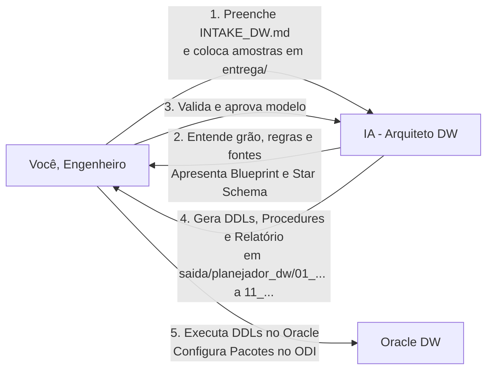
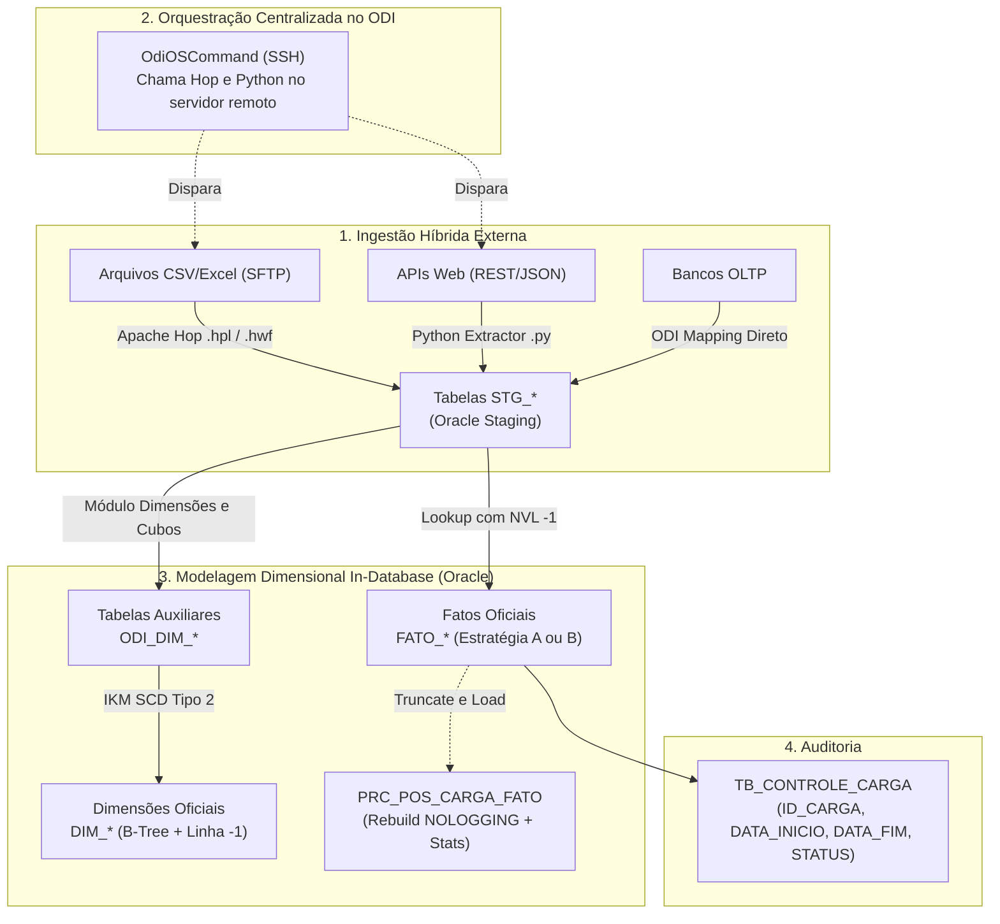

# Guia do Engenheiro de Dados — Planejador de Data Warehouses (DW)

Este guia orienta o **Engenheiro de Dados** a utilizar o **Planejador de DW** para projetar, modelar e estruturar novos Data Warehouses no Oracle a partir de fontes heterogêneas de dados (Bancos Relacionais OLTP, Arquivos/Planilhas via SFTP e APIs Web REST).

> **Público:** Engenheiro de dados responsável pela modelagem e esteiras de ETL/ELT.  
> **Objetivo:** Fornecer insumos completos para que a IA gere a arquitetura dimensional, DDLs de alta performance, esteiras de ingestão (ODI, Hop, Python) e a estratégia de carga ideal (Dual Strategy).  
> **Resultado:** DDLs prontos (`STG`, `ODI_DIM`, `DIM`, `FATO`, `TB_CONTROLE_CARGA`), procedure de manutenção (`PRC_POS_CARGA_FATO`), pipelines Hop (`.hpl`/`.hwf` - se solicitados), extratores Python (se solicitados), guia de handoff Power BI (`GUIA_ANALISTA_BI_<PROJETO>.md`) e relatório de linhagem (*"Como chegar em cada valor"*), salvos diretamente nas 11 pastas canônicas de `saida/planejador_dw/`.

---

## Sumário

- [1. Visão Geral do Processo](#1-visao-geral)
- [2. O que Entregar (Preparação dos Insumos)](#2-o-que-entregar)
  - [2.1 Fontes Banco de Dados (OLTP) e Queries Oracle de Extração](#21-fontes-banco)
  - [2.2 Fontes Arquivos e Planilhas em FTP/SFTP](#22-fontes-arquivos)
  - [2.3 Fontes APIs Web e Serviços Externos](#23-fontes-apis)
  - [2.4 Formulário INTAKE_DW.md e Gate 0 de Validação](#24-formulario-intake)
- [3. Entendendo a Arquitetura Corporativa Híbrida & Dual Strategy](#3-arquitetura-hibrida)
  - [3.1 Estratégia A: Truncate & Load Massivo (Padrão SEI Bahia / OLTP)](#31-estrategia-a)
  - [3.2 Estratégia B: Incremental Idempotente via MERGE (Padrão FinOps / Telemetria)](#32-estrategia-b)
- [4. Ordem de Execução dos Scripts no Oracle](#4-ordem-execucao)
- [5. Configuração no Oracle Data Integrator (ODI)](#5-configuracao-odi)
  - [5.1 Configuração do OdiOSCommand (SSH)](#51-odioscommand)
  - [5.2 Módulo Dimensões e Cubos (ODI_DIM_*)](#52-dimensoes-cubos)
  - [5.3 Carga da Fato e Lookup com Fallback para -1](#53-carga-fato-controle)
  - [5.4 Execução da Procedure PRC_POS_CARGA_FATO](#54-procedure-tuning)
- [6. Consumo Analítico (Power BI & Camada Semântica)](#6-consumo-bi)
- [7. Biblioteca de Prompts Prontos (Copiar e Colar para a IA)](#7-prompts-prontos)
- [8. Guia Anti-Erros do Engenheiro de Dados (Blindagem Operacional)](#8-anti-erros)

---

<a id="1-visao-geral"></a>
## 1. Visão Geral do Processo



O processo é colaborativo e ágil:
1. **Você entrega os insumos** (schemas, amostras, arquivos e perguntas de negócio em `entrega/planejador_dw/`).
2. **A IA projeta o DW** (define grão, dimensões SCD2, esteira de ferramentas estritamente conforme o INTAKE, estratégia de carga e sizing).
3. **Você valida a proposta técnica** através de checkpoints interativos (`/gerar-blueprint` com matriz De/Para 100% fiel).
4. **A IA gera os scripts DDL, procedures, pipelines (se solicitados) e relatório técnico** diretamente nas pastas canônicas de `saida/planejador_dw/`.
5. **Você executa no banco e configura os pacotes no ODI**.

> 💡 **Comandos Chaves de Interação com a IA:** Para não deixar a IA gerar código às cegas, utilize os comandos de diálogo recomendados (`/inspecionar-fontes`, `/desafiar-grao`, `/classificar-scd`, `/definir-estrategia-carga`, `/gerar-blueprint`, `/aprovar-blueprint`). Veja o catálogo completo e as queries de validação no [**Guia Central de Comandos Rápidos — Seção 7**](GUIA_COMANDOS_RAPIDOS.md#7-comandos-interacao-etapas).

---

<a id="2-o-que-entregar"></a>
## 2. O que Entregar (Preparação dos Insumos)

Para que a IA gere a arquitetura sem inventar regras, você deve preparar a pasta `entrega/planejador_dw/`:

<a id="21-fontes-banco"></a>
### 2.1 Fontes Banco de Dados (OLTP) e Queries Oracle de Extração
Coloque em `entrega/planejador_dw/ddl/` o DDL das tabelas que contêm os dados na origem:
- **1. Extração do DDL completo da tabela de origem:**
  ```sql
  SET LONG 200000 PAGESIZE 0 LINESIZE 200 FEEDBACK OFF;
  SELECT DBMS_METADATA.GET_DDL('TABLE', 'TAB_ORIGEM', 'SCHEMA_ORIGEM') FROM DUAL;
  ```
- **2. Extração da lista exata de colunas, tipos e nulabilidade (para evitar divergências):**
  ```sql
  SELECT column_name, data_type, data_length, data_precision, data_scale, nullable
  FROM all_tab_columns
  WHERE owner = 'SCHEMA_ORIGEM' AND table_name = 'TAB_ORIGEM'
  ORDER BY column_id;
  ```
- **3. Extração de amostra de dados reais (10 a 50 linhas em CSV ou formato tabular) para `entrega/planejador_dw/amostras/`:**
  ```sql
  SELECT * FROM SCHEMA_ORIGEM.TAB_ORIGEM WHERE ROWNUM <= 30;
  ```
- **4. Consulta de Tablespaces disponíveis e cotas do usuário no Oracle DW:**
  ```sql
  SELECT tablespace_name, bytes / 1024 / 1024 AS ocupado_mb, max_bytes / 1024 / 1024 AS cota_mb
  FROM user_ts_quotas;
  ```
- **5. Consulta de ocupação atual de tablespace por tipo de objeto (Dados vs Índices):**
  ```sql
  SELECT tablespace_name, segment_type, COUNT(*) AS qtd_objetos,
         ROUND(SUM(bytes) / 1024 / 1024, 2) AS ocupado_mb
  FROM user_segments
  GROUP BY tablespace_name, segment_type
  ORDER BY ocupado_mb DESC;
  ```

<a id="22-fontes-arquivos"></a>
### 2.2 Fontes Arquivos e Planilhas em FTP/SFTP
Coloque em `entrega/planejador_dw/arquivos_ftp/`:
- Um arquivo de exemplo representativo (`.csv`, `.xlsx`, `.xls` ou `.txt`).
- No `INTAKE_DW.md`, especifique: frequência de chegada, delimitador, encoding e se possui cabeçalho.

<a id="23-fontes-apis"></a>
### 2.3 Fontes APIs Web e Serviços Externos
Coloque em `entrega/planejador_dw/api_specs/`:
- Um exemplo real de payload JSON/XML retornado pelo endpoint ou especificação OpenAPI/Swagger.
- No `INTAKE_DW.md`, especifique: URL base, método de autenticação e tipo de paginação.

<a id="24-formulario-intake"></a>
### 2.4 Formulário `INTAKE_DW.md`, Flexibilidade de Entrega e Gate 0 de Validação
Preencha o arquivo [`modulos/planejador_dw/INTAKE_DW.md`](../../modulos/planejador_dw/INTAKE_DW.md):
- **Seção 1 (Pilha Tecnológica):** Marque obrigatoriamente com `[x]` as ferramentas que serão utilizadas (ODI, Hop, Python, PL/SQL). A IA utiliza skills modulares específicas (`gerador-etl-hop`, `extrator-api-python`) e **nunca** gerará scripts de ferramentas desmarcadas!
- **Identificação do Projeto:** Nome do projeto, schema alvo e tablespaces (`TABLESPACE_DATA` e `TABLESPACE_INDEX`).
- **O que o Cliente Quer & Regras de Negócio (2 Formas de Entrega):**
  - **Opção 1:** Digitar as perguntas e regras diretamente nas Seções 2 e 3 do `INTAKE_DW.md`.
  - **Opção 2 (Recomendada para Documentações Longas):** Depositar arquivos já existentes na pasta `entrega/planejador_dw/` (ex: `04_regras_negocio.md`, `05_perguntas_negocio.md`, `edital.md`, `documentacao.md`) e marcar a **Opção 2** na Seção 2.0 do Intake. A IA lerá diretamente esses documentos!
- **Estratégia de Carga:** Seleção entre Estratégia A (Truncate & Load) ou Estratégia B (MERGE Incremental).
- **Volumetria:** Estimativa de linhas para cálculo de sizing e particionamento.

> 🛑 **Gate 0 de Validação Obrigatória:**
> Quando você iniciar uma sessão solicitando o planejamento do DW, o agente inspecionará imediatamente o formulário [`INTAKE_DW.md`](../../modulos/planejador_dw/INTAKE_DW.md). Se o formulário estiver em branco ou se nenhuma tecnologia estiver marcada na Seção 1, a IA irá **interromper a execução** e devolver o link direto clicável para você preencher antes de continuar.  
> *Nota:* Se as perguntas/regras estiverem na pasta `entrega/planejador_dw/`, o Gate 0 não bloqueará por falta de perguntas digitadas no formulário.


---

<a id="3-arquitetura-hibrida"></a>
## 3. Entendendo a Arquitetura Corporativa Híbrida & Dual Strategy



<a id="31-estrategia-a"></a>
### 3.1 Estratégia A: Truncate & Load Massivo (Padrão SEI Bahia / OLTP)
- **Quando usar:** Grandes janelas históricas (ex: últimos 3 meses ou ano fechado) recarregadas periodicamente em lote a partir de bancos OLTP sem DML concorrente durante a carga.
- **Indexação Física:**
  - **BITMAP INDEX** em todas as colunas de FK (`DIM_*`) e flags de baixa cardinalidade.
  - Habilita o plano **Star Transformation** do otimizador CBO no Oracle.
  - PK da fato utiliza B-Tree.
- **Manutenção Obrigatória:** Execução da procedure `PRC_POS_CARGA_FATO` para executar rebuild `NOLOGGING` e atualizar `DBMS_STATS(CASCADE => TRUE)`.

<a id="32-estrategia-b"></a>
### 3.2 Estratégia B: Incremental Idempotente via MERGE (Padrão FinOps / Telemetria)
- **Quando usar:** Cargas contínuas intra-dia ou diárias de APIs e telemetria onde novos dados e atualizações convivem sem truncar a tabela.
- **Lógica SQL:** `MERGE INTO ... USING (...) ON (...) WHEN MATCHED THEN UPDATE ... WHEN NOT MATCHED THEN INSERT ...`
- **Indexação Física:**
  - **B-TREE INDEX** em chaves compostas de busca.
  - **Índices Bitmap são terminantemente proibidos aqui** para evitar deadlocks e contenção de locks (`ORA-00060`).

---

<a id="4-ordem-execucao"></a>
## 4. Ordem de Execução dos Scripts no Oracle

Quando a IA gerar os scripts DDL diretamente em `saida/planejador_dw/`, execute-os no Oracle **estritamente nesta ordem**:

```sql
-- 1. Tabela corporativa de auditoria e controle de carga (apenas se não existir)
@saida/planejador_dw/01_controle_carga/01_tb_controle_carga.sql

-- 2. Tabelas de Staging (Aterrissagem com metadados de lote e extração)
@saida/planejador_dw/02_staging/02_create_stg_tables.sql

-- 3. Tabelas auxiliares do ODI para SCD Tipo 2
@saida/planejador_dw/03_dimensoes/03_create_odi_dim_tables.sql

-- 4. Dimensões oficiais com SCD Tipo 2, Sequences e índices B-Tree exclusivos
@saida/planejador_dw/03_dimensoes/04_create_dim_tables.sql

-- 5. Carga inicial do registro -1 (Não Informado) em todas as dimensões
@saida/planejador_dw/03_dimensoes/06_init_default_records.sql

-- 6. Tabelas Fato com FKs NOT NULL, medidas padronizadas e índices (Bitmap ou B-Tree)
@saida/planejador_dw/04_fatos/05_create_fato_tables.sql

-- 7. Procedure corporativa de manutenção pós-carga (se Estratégia A)
@saida/planejador_dw/05_procedimentos_manutencao/07_prc_pos_carga_fato.sql
```

> ⚠️ **Atenção:** O script `06_init_default_records.sql` (inserção da linha `-1`) DEVE ser executado **ANTES** de criar a tabela FATO com FKs ativas, garantindo que o registro padrão já exista.

---

<a id="5-configuracao-odi"></a>
## 5. Configuração no Oracle Data Integrator (ODI)

<a id="51-odioscommand"></a>
### 5.1 Configuração do `OdiOSCommand` (SSH)
Para orquestrar a ingestão de arquivos (Hop) ou APIs (Python) a partir do ODI (quando habilitados):
1. Abra o **Package** do projeto no ODI Designer.
2. Arraste a ferramenta **`OdiOSCommand`** para o diagrama antes dos mappings de carga.
3. No painel de propriedades, cole o comando gerado no `RELATORIO_ESTRATEGIAS.md`:
   - **Exemplo para Apache Hop:**
     ```bash
     ssh usr_etl@srv-hop01 "/opt/hop/hop-run.sh -r local -f /opt/etl/hop/pipelines/pipe_stg_acao.hpl -l Basic"
     ```
   - **Exemplo para Python:**
     ```bash
     ssh usr_etl@srv-py01 "/usr/bin/python3 /opt/etl/python/extract_api_custo.py --start-date \$(date -d '1 day ago' +\%Y-\%m-\%d)"
     ```
4. Configure a opção **Synchronous** como `True` para que o ODI aguarde o script terminar antes de iniciar a carga das dimensões e fatos.

<a id="52-dimensoes-cubos"></a>
### 5.2 Módulo Dimensões e Cubos (`ODI_DIM_*`)
1. Importe a tabela `DIM_*` e a tabela `ODI_DIM_*` no Modelo do ODI via **Reverse Engineering**.
2. No componente de Dimensão do ODI:
   - Defina a tabela de armazenamento como `DIM_*`.
   - Defina a tabela de estágio como `ODI_DIM_*`.
   - Mapeie a coluna `ID_*` como **Natural Key**.
   - Mapeie as colunas descritivas como **Slowly Changing Dimension (Histórico)**.
   - Configure o IKM: `IKM Oracle Slowly Changing Dimension`.

<a id="53-carga-fato-controle"></a>
### 5.3 Carga da Fato e Lookup com Fallback para `-1`
1. No mapping da Fato, realize o lookup das chaves de negócio na dimensão buscando a versão vigente (`DTC_EXPIRACAO IS NULL`).
2. Adicione a expressão `NVL(LOOKUP.DIMENSION_KEY, -1)` para garantir que códigos não encontrados ou nulos recebam a chave `-1`.
3. Ao final do pacote no ODI, adicione uma etapa de inserção/atualização na `TB_CONTROLE_CARGA`:
   ```sql
   INSERT INTO TB_CONTROLE_CARGA (NOME_PROJETO, NOME_TABELA_ALVO, TIPO_CARGA, STATUS_EXECUCAO, DATA_INICIO, DATA_FIM, QTD_LINHAS_PROCESSADAS)
   VALUES ('<NOME_PROJETO>', 'FATO_<NOME>', 'TRUNCATE_LOAD', 'SUCESSO', SYSDATE, SYSDATE, :QTD_LINHAS);
   ```

<a id="54-procedure-tuning"></a>
### 5.4 Execução da Procedure `PRC_POS_CARGA_FATO`
Se a Fato adotou a **Estratégia A (Truncate & Load)**, adicione um passo de execução de procedimento SQL no ODI logo após o mapping da fato:
```sql
BEGIN
    "<SCHEMA_ALVO>"."PRC_POS_CARGA_FATO"(p_tabela_fato => 'FATO_<DOMINIO>_<EVENTO>');
END;
/
```

---

<a id="6-consumo-bi"></a>
## 6. Consumo Analítico (Power BI & Camada Semântica)

1. **Power BI:**
   - Modo de Conexão: **Import Mode**.
   - Cardinalidade: **1 para Muitos (1:*)** das Dimensões para a Fato.
   - Direção do Filtro Cruzado: **Única (Single)**.
   - Crie uma tabela dedicada `_Medidas` com cálculo explícito e tratamento via `DIVIDE()`.
2. **Módulo de Camada Semântica (Handoff Automático e Pipeline Contínuo):**
   - O trabalho de engenharia não para no DW! Para integrar diretamente com o módulo de Camada Semântica sem retrabalho manual de extração de DDLs ou preenchimento de formulários:
     - **No Chat com a IA:** Digite o comando `/concluir-dw` ou `/transicionar-semantica`.
     - **Ou via Terminal (CLI):** Execute:
       ```bash
       python core/scripts_comuns/transicionar_dw_para_semantica.py --projeto <NOME_PROJETO> --gerar-amostras
       ```
   - O transicionador automatizado realiza todo o trabalho pesado:
     1. Consolida os DDLs em `entrega/camada_semantica/ddl/DDL_COMPLETO_DW_<PROJETO>.sql`.
     2. Move as amostras reais ou gera dados sintéticos em `entrega/camada_semantica/amostras/`.
     3. Copia o relatório de estratégias e guias de BI para `entrega/camada_semantica/relatorios_etl/`.
     4. Preenche automaticamente todas as seções de `modulos/camada_semantica/INTAKE_SEMANTICA.md`.
     5. Atualiza o catálogo corporativo (`PROJETO_RESUMO.md` e `PROJETO_VERSION.md`).
     6. Executa a validação pré-voo da semântica (`validar_entrega.py semantica`).

---

<a id="7-prompts-prontos"></a>
## 7. Biblioteca de Prompts Prontos (Copiar e Colar para a IA)

Utilize os prompts abaixo para conduzir o agente durante o planejamento:

### Prompt 1 — Início do Planejamento do DW
```text
Olá! Preenchi o formulário modulos/planejador_dw/INTAKE_DW.md e coloquei as amostras e DDLs das fontes na pasta entrega/planejador_dw/. 

Por favor, inspecione todos os insumos, analise as perguntas de negócio e apresente o Documento de Entendimento Dimensional contendo:
1. Mapeamento da esteira híbrida estritamente com as tecnologias marcadas no INTAKE.
2. Definição da estratégia de carga da fato (Estratégia A ou Estratégia B com justificativa técnica).
3. Definição do grão da Fato e lista de medidas padronizadas (TOT_*, QTD_*, VAL_*).
4. Definição das Dimensões SCD Tipo 2 e tabelas auxiliares ODI_DIM_*.
5. Matriz De/Para detalhada campo a campo preservando os nomes exatos das colunas da origem.
6. Estimativa de sizing de storage anual em GB e verificação de tablespace.

Não gere scripts DDL ainda, aguarde minha validação do modelo.
```

### Prompt 2 — Solicitação dos DDLs e Artefatos Otimizados
```text
O modelo dimensional e as regras foram validados e aprovados! 

Por favor, gere todos os artefatos estruturados diretamente na pasta saida/planejador_dw/ (sem criar subpasta com o nome do projeto), seguindo rigorosamente os padrões de CONVENCOES_DW.md:
1. 01_controle_carga/01_tb_controle_carga.sql (se necessário)
2. 02_staging/02_create_stg_tables.sql
3. 03_dimensoes/03_create_odi_dim_tables.sql
4. 03_dimensoes/04_create_dim_tables.sql (com B-Tree exclusivo e Sequences)
5. 03_dimensoes/06_init_default_records.sql (script da linha -1)
6. 04_fatos/05_create_fato_tables.sql (conforme a estratégia aprovada)
7. 05_procedimentos_manutencao/07_prc_pos_carga_fato.sql (se Estratégia A)
8. Pipelines Hop (.hpl/.hwf) ou Extrator Python (.py) APENAS se tiverem sido marcados no INTAKE.
9. Guia de Handoff para Power BI (08_datasets_bi/GUIA_ANALISTA_BI_<PROJETO>.md).

Gere os arquivos com sintaxe Oracle validada, nomes fiéis à origem e comentários completos.
```

### Prompt 3 — Solicitação do Relatório de Estratégias & Linhagem
```text
Os scripts e artefatos foram gerados. 

Agora, por favor, gere o RELATORIO_ESTRATEGIAS.md do projeto em saida/planejador_dw/09_relatorio_estrategias/ detalhando:
1. A topologia completa com o comando SSH para o OdiOSCommand (se aplicável).
2. A matriz De/Para campo a campo ("Como chegar em cada valor").
3. As regras de lookup de SKs no ODI com fallback para -1.
4. O roteiro de manutenção pós-carga e o cálculo de sizing para a equipe de DBA.
```

### Prompt 4 — Conclusão do DW e Handoff para a Camada Semântica
```text
/concluir-dw

(Ou alternativamente em linguagem natural):
O planejamento do DW está concluído e aprovado! Por favor, execute o handoff contínuo para a Camada Semântica:
1. Registre e atualize a documentação central no catálogo (PROJETO_RESUMO.md e PROJETO_VERSION.md).
2. Consolide e transfira todos os DDLs, amostras e relatórios de ETL para a pasta 'entrega/camada_semantica/'.
3. Pré-preencha o formulário 'modulos/camada_semantica/INTAKE_SEMANTICA.md' com o grão da fato, schema, métricas e perguntas de negócio do projeto.
4. Execute a auditoria pré-voo da semântica e me forneça o comando para iniciar a geração da Camada Semântica.
```

---

<a id="8-anti-erros"></a>
## 8. Guia Anti-Erros do Engenheiro de Dados (Blindagem Operacional)

Este tópico reúne os principais erros que ocorrem durante o planejamento e execução de Data Warehouses no Oracle, acompanhados de suas soluções imediatas:

### 🛡️ Anti-Erro 1: Geração Indevida de Scripts de API (Hop / Python)
- **Problema:** A IA gera pipelines `.hpl` do Hop ou scripts Python mesmo que seu projeto utilize apenas ODI ou procedure interna de banco.
- **Causa Raiz:** O formulário [`INTAKE_DW.md`](../../modulos/planejador_dw/INTAKE_DW.md) foi deixado sem marcar as checkboxes da Seção 1 (Pilha Tecnológica).
- **Como Evitar:**
  - Se seu projeto é 100% banco de dados relacional: marque `[x] Oracle Data Integrator (ODI 12c)` e `[x] PL/SQL Puro / Stored Procedures`. Deixe desmarcadas as opções de Hop e Python.
  - Lembre-se: o Gate 0 do agente bloqueia o início se nenhuma tecnologia for marcada.

### 🛡️ Anti-Erro 2: Ignorar Pastas Canônicas e Criar Subpastas com Nome do Projeto
- **Problema:** Scripts são gerados em `saida/planejador_dw/MEU_PROJETO/` em vez de popularem as pastas `saida/planejador_dw/01_...` a `11_...`.
- **Causa Raiz:** O agente ou o engenheiro tentou encapsular os arquivos em uma subpasta com o nome do projeto.
- **Como Evitar:** A raiz de saída oficial do Planejador de DW é sempre `saida/planejador_dw/`. Os 11 diretórios canônicos (`01_controle_carga`, `02_staging`, ..., `11_dicionario_dados`) já existem e contêm `.gitkeep`. Nunca crie subpastas intermediárias.

### 🛡️ Anti-Erro 3: Alucinação ou Divergência em Nomes de Coluna da Origem
- **Problema:** A tabela de origem tem `ID_CHAMADO`, mas a staging ou dimensão foi gerada com `NUM_CHAMADO`. A origem tem `INDICADOR`, mas a IA gerou `IND_STATUS`.
- **Causa Raiz:** A IA tentou "embelezar" ou padronizar nomes de colunas que vieram do negócio, ou o DDL fornecido em `entrada/ddl/` estava incompleto.
- **Como Evitar:**
  1. Forneça o DDL completo da origem extraído via `DBMS_METADATA.GET_DDL` ou um arquivo `ddl_completo.csv` com a lista exata de colunas.
  2. Na etapa `/gerar-blueprint`, exija a **Matriz De/Para Campo a Campo**. Inspecione se os nomes originais foram mantidos 100% idênticos antes de aprovar com `/aprovar-blueprint`.

### 🛡️ Anti-Erro 4: Estouro de Tablespace de Dados ou de Índices
- **Problema:** Durante a carga ou na criação de índices, o banco retorna erro `ORA-01653: unable to extend table` ou `ORA-01654: unable to extend index`.
- **Causa Raiz:**
  - Ambiente com tablespace única (ex: `SEIMUNICIPIO_DATA`) onde índices competem pela mesma cota dos dados.
  - Índices Bitmap criados indevidamente em colunas de alta cardinalidade ou em tabelas Dimensão.
  - Rebuild de índices sem `NOLOGGING`, estourando a tablespace de Undo ou Redo.
- **Como Evitar:**
  - **Segregação:** Se tiver tablespace de índices dedicada (`<SCHEMA>_INDEX`), declare-a explicitamente no `INTAKE_DW.md`.
  - **Dimensões:** NUNCA crie índice Bitmap em Dimensões. Dimensões aceitam **apenas B-Tree**.
  - **Fatos (Estratégia A):** Índices Bitmap apenas nas FKs das dimensões e colunas com poucos valores distintos (status, flags). Em colunas de alta cardinalidade, use B-Tree.
  - **Fatos (Estratégia B - MERGE):** Índices Bitmap são terminantemente proibidos para não causar deadlock (`ORA-00060`).
  - **Manutenção:** Sempre execute o rebuild via `ALTER INDEX ... REBUILD NOLOGGING;` para economizar espaço de redo log.

### 🛡️ Anti-Erro 5: Reexecução Segura em Schemas com Objetos Pré-Existentes
- **Problema:** Scripts falham ao serem reexecutados porque tabelas, sequences ou constraints já existem (`ORA-00955: name is already used by an existing object`).
- **Como Evitar:**
  - O script `01_tb_controle_carga.sql` e a procedure `07_prc_pos_carga_fato.sql` utilizam `CREATE OR REPLACE`.
  - Para as tabelas e sequences, se você estiver reconstruindo o modelo em ambiente de desenvolvimento, faça o drop seguro antes:
    ```sql
    DROP TABLE "<SCHEMA>"."FATO_<NOME>" CASCADE CONSTRAINTS PURGE;
    DROP TABLE "<SCHEMA>"."DIM_<NOME>" CASCADE CONSTRAINTS PURGE;
    DROP SEQUENCE "<SCHEMA>"."SEQ_DIM_<NOME>";
    ```

### 🛡️ Anti-Erro 6: Violar a Ordem de Execução (Esquecer a Linha `-1` ou `ODI_DIM_*`)
- **Problema:** A carga da Fato quebra no ETL com erro de integridade referencial `ORA-02291: integrity constraint violated - parent key not found`.
- **Causa Raiz:** O script `06_init_default_records.sql` (inserção da chave `-1`) não foi executado antes de habilitar as constraints da Fato.
- **Como Evitar:** Siga rigorosamente a sequência da [Seção 4](#4-ordem-execucao). A carga das dimensões e da linha `-1` é pré-requisito mandatório antes de qualquer inserção na Fato.

### 🛡️ Anti-Erro 7: Esquecer de Executar a Validação Pré-Voo
- **Problema:** Acionar o agente no chat sem que os insumos estejam completos, gerando idas e vindas desnecessárias.
- **Como Evitar:** Antes de enviar mensagens à IA, execute no seu terminal:
  ```bash
  python core/scripts_comuns/validar_entrega.py dw
  ```
  O script validará o preenchimento do formulário, a presença dos DDLs e a conformidade sintática em menos de 3 segundos!

### 🛡️ Anti-Erro 8: Redigitar Perguntas e Regras de Negócio que Já Existem em Arquivos
- **Problema:** O engenheiro perde tempo copiando e colando dezenas de perguntas de editais ou documentações internas para dentro do `INTAKE_DW.md`.
- **Causa Raiz:** Acreditar que a IA só é capaz de ler o formulário de intake.
- **Como Evitar:**
  - Se você já possui arquivos de negócio (ex: `04_regras_negocio.md`, `05_perguntas_negocio.md`, `edital.md`, `documentacao.md`), basta depositá-los na pasta `entrega/planejador_dw/`.
  - No `INTAKE_DW.md` (Seção 2.0 e 3.1), marque **Opção 2**.
  - A IA e o script `validar_entrega.py` reconhecerão os arquivos automaticamente, extraindo 100% das regras e perguntas diretamente da pasta de entrega sem travar o Gate 0!


