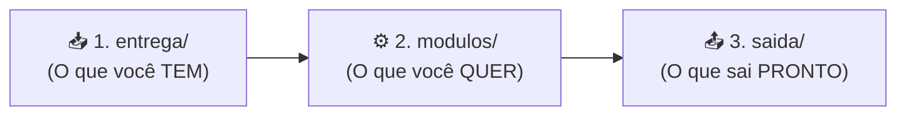

# 👋 Guia Inicial do Engenheiro — Bem-vindo ao NINHO!

> **Nunca usou o NINHO antes? Comece por aqui!**  
> Este guia foi escrito em linguagem direta e acessível para que qualquer pessoa da equipe entenda, em poucos minutos, **como o projeto funciona**, **o que cada ferramenta faz** e **como executar sua primeira tarefa passo a passo**.

---

## 📌 Sumário Rápido

1. [A Ideia Central em 1 Minuto (Como o NINHO Funciona)](#1-ideia-central)
2. [O Que o NINHO Pode Fazer por Você? (Os 6 Cenários do Dia a Dia)](#2-seis-cenarios)
3. [Mapa Explicado: O Que Cada Pasta, Script, Skill e Comando Faz](#3-mapa-explicado)
   - [🛠️ 3.1 Os 9 Scripts Python (`core/scripts_comuns/`)](#31-scripts-python)
   - [🧩 3.2 As 10 Skills da IA (`.agents/skills/`)](#32-skills-ia)
   - [💬 3.3 Dicionário Completo de Comandos Rápidos do Chat (`/comando`)](#33-dicionario-comandos-chat)
4. [Passo a Passo: Sua Primeira Vez Usando o Projeto (5 Passos)](#4-passo-a-passo)
5. [Perguntas Frequentes de Quem Está Começando (FAQ)](#5-faq)

---

<a id="1-ideia-central"></a>
## 1. A Ideia Central em 1 Minuto (Como o NINHO Funciona)

O **NINHO** é uma plataforma corporativa criada para **Engenheiros de Dados**. O objetivo dele é eliminar o trabalho braçal, padronizar entregas da equipe e auditar códigos legados usando uma combinação de **Scripts Python Determinísticos** (que leem arquivos pesados sem errar) + **Agentes de IA Especializados** (que projetam modelos, escrevem SQL/Python/ Documentação e sugerem melhorias).

Para usar o NINHO, você só precisa entender a **Regra das 3 Pastas**:



1. **📥 Pasta [`entrega/`](../../entrega/README.md) (Entrada):** É onde você solta os arquivos brutos do seu projeto (tabelas SQL/DDL de origem, planilhas Excel/CSV, arquivos `.pbix` do Power BI, XMLs do ODI ou pipelines `.hpl`/`.hwf` do Apache Hop).
2. **⚙️ Pasta [`modulos/`](../../modulos/README.md) (Formulário de Pedido):** É onde ficam os formulários simples de checklist (`INTAKE_DW.md`, `INTAKE_SEMANTICA.md`, `INTAKE_GOVERNANCA.md`). Neles você marca com um `[x]` quais ferramentas vai usar (ex: `[x] ODI`, `[x] Apache Hop`, `[x] Python`).
3. **📤 Pasta [`saida/`](../../saida/README.md) (Resultado Final):** É onde o NINHO grava todos os scripts SQL, procedures, extratores, relatórios de auditoria e guias de Power BI prontos para você implantar.

### 🛡️ Por que o NINHO é seguro e não "inventa moda"?
Diferente de um chat de IA comum que tenta adivinhar coisas e gera código errado, o NINHO trabalha com **3 travas de segurança**:
- **Leitura Exata via Python:** Antes da IA falar qualquer coisa, scripts em Python leem os seus arquivos (DDL, Excel, XML do ODI, Hop, Power BI) e extraem 100% das colunas, tipos e problemas reais.
- **Não Gera no Escuro (Blueprint Primeiro):** Para criar um DW ou Camada Semântica, a IA **sempre para antes de gerar código** e te mostra um plano detalhado (**Blueprint**) + sugestões extras (**💡 Radar Consultivo**). Ela só cria os arquivos em `saida/` depois que você aprovar.
- **Só Gera o que Você Marcou:** Se você marcou apenas `[x] ODI` no formulário, o NINHO **nunca** vai gerar arquivos de Apache Hop ou Python sem necessidade.

---

<a id="2-seis-cenarios"></a>
## 2. O Que o NINHO Pode Fazer por Você? (Os 6 Cenários do Dia a Dia)

Você **não precisa** usar o projeto inteiro de uma vez! Dependendo da sua tarefa no dia, você pode usar o NINHO de **6 formas diferentes**:

---

### 🏗️ Cenário 1: Criar ou Reformular um Data Warehouse (DW) no Oracle
- **Para que serve:** Você tem tabelas de um sistema transacional (OLTP), planilhas via SFTP ou uma API REST, e precisa criar o modelo Star Schema (Kimball) completo no Oracle (`STG_*`, `DIM_*` com histórico SCD Tipo 2, `FATO_*`, índices, sequences, procedure pós-carga e guia para o time de Power BI).
- **Onde colocar os arquivos:** [`entrega/planejador_dw/`](../../entrega/planejador_dw/) (pastas `ddl/`, `amostras/`, `arquivos_ftp/` ou `api_specs/`).
- **Qual formulário preencher:** [`modulos/planejador_dw/INTAKE_DW.md`](../../modulos/planejador_dw/INTAKE_DW.md).
- **Como acionar:**
  - No terminal (opcional para inspecionar rápido): `python core/scripts_comuns/inspecionar_ddl_origem.py`
  - No chat da IA: `/inspecionar-fontes` $\rightarrow$ `/gerar-blueprint` $\rightarrow$ `/aprovar-blueprint`
- **O que sai pronto:** Todos os scripts numerados e organizados nas 11 pastas de [`saida/planejador_dw/`](../../saida/planejador_dw/README.md), incluindo o guia do analista de BI (`08_datasets_bi/`) e o dicionário de dados (`11_dicionario_dados/`).

---

### 🦅 Cenário 2: Auditar e Fazer Tuning de Projetos no ODI 12c (Legado ou Novo)
- **Para que serve:** Você tem um projeto no **Oracle Data Integrator (ODI 12c)** que está lento, dando erro ou precisa passar por revisão de qualidade antes de ir para produção. O motor lê pastas inteiras de exportação XML do ODI (`Mapas/`, `Cenas/`, `Pacotes/`, `Procedures/`, `Variaveis/`).
- **O que ele descobre sozinho (Heurísticas `H1` a `H9`):**
  - Tabelas sem filtro incremental (Full Scan), falta de chave primária na Staging, joins com dimensões SCD2 que esqueceram de filtrar o registro vigente (`FLG_ATUAL = 1`), falso SCD2 com valores fixos `'X'`, uso de `TRUNC(data)` que anula índices no Oracle, procedures com `COMMIT` dentro de loop e variáveis com `select *`.
- **Como rodar (direto no terminal ou pelo chat):**
  ```bash
  python core/scripts_comuns/auditar_mapa_odi.py <caminho_da_pasta_ou_xml_do_odi>
  ```
  *(Ou digite `/auditar-mapa-odi` no chat da IA para que ela analise o relatório e já escreva os SQLs corrigidos para você).*

---

### 🐝 Cenário 3: Auditar Esteiras Apache Hop 2.x, FTPS e Extratores Python
- **Para que serve:** Você ou alguém da equipe construiu um projeto no **Apache Hop** (arquivos `.hpl`, `.hwf`, `.json`), scripts Shell de FTPS (`.sh`) ou extratores Python (`.py`), e quer verificar se há falhas graves antes do deploy.
- **O que ele descobre sozinho (Heurísticas `HOP-H1` a `HOP-H8`):**
  - **Segurança (`HOP-H1`):** Senhas do banco/FTP/API salvas em texto aberto em vez de criptografadas ou via `HopPassword`.
  - **Esquecimento de Copy-Paste (`HOP-H2`):** Quando alguém clona um projeto (ex: copia o projeto `CFPC` para criar o `DHPP`) e esquece nomes da tabela antiga ou do e-mail antigo escondidos dentro do código.
  - **Setas Invertidas (`HOP-H3`):** Hops vermelhos (`evaluation=N`) no workflow apontando para etapas que deveriam rodar no sucesso.
  - **Caminhos Quebrados e Duplicatas (`HOP-H4` a `HOP-H8`):** Arquivos `.hpl` que não existem mais, variáveis coladas sem barra (`${DIR}${ARQ}`), `PipelineExecutor` que não herda variáveis (`inherit_all_vars=N`) e `TableOutput` sem `use_batch`.
  - **Checklist Corporativo:** Confere se o projeto usa a tabela de telemetria `ETA_ETAPAS_CARGA`, controle de arquivos `CONTROLE_MODIFICACAO_ARQUIVOS`, `WorkflowLogging` e quarentena de erros `TAB_*_ERRO`.
- **Como rodar:**
  ```bash
  python core/scripts_comuns/auditar_esteira_hop.py <caminho_da_pasta_do_projeto_hop>
  ```
  *(Ou digite `/auditar-hop` no chat da IA).*

---

### 📊 Cenário 4: Engenharia Reversa de Dashboards Power BI Legados (`.pbix`)
- **Para que serve:** O cliente ou setor de negócio tem um painel `.pbix` antigo (muitas vezes lento, puxando dados direto de tabelas transacionais ou planilhas soltas) e pede para migrar esse painel para um Data Warehouse oficial.
- **O que ele faz sozinho:**
  - Você não precisa abrir o Power BI Desktop para caçar medidas! O script abre o arquivo `.pbix` nativo, extrai todas as tabelas, colunas, relacionamentos, medidas DAX, parâmetros M e **traduz todos os filtros escondidos nos visuais e páginas**.
  - Detecta os 5 anti-padrões clássicos (`PBIX-H1` a `PBIX-H5`: relacionamentos Muitos-para-Muitos, filtro bidirecional, falta de `DIM_TEMPO`, colunas numéricas sem medida DAX explícita e `AutoDateTime` ativado).
- **Como rodar:**
  ```bash
  python core/scripts_comuns/inspecionar_pbix.py <caminho_do_arquivo_ou_pasta_pbix>
  ```
  *(Ou digite `/inspecionar-pbix` no chat da IA para gerar o modelo Star Schema do DW a partir do `.pbix`).*

---

### 🧠 Cenário 5: Criar a Camada Semântica Oracle e Metadados Ativos (`META_*`)
- **Para que serve:** Depois que o DW está pronto, você precisa expor os dados de forma limpa para o Power BI e para agentes de IA (Text-to-SQL / Chatbots Analíticos), além de aplicar segurança por linha (**RLS / VPD** para que cada secretaria/órgão veja apenas seus próprios dados).
- **Como funciona:**
  - Se você acabou de criar o DW no Cenário 1, basta digitar `/concluir-dw` (ou rodar `python core/scripts_comuns/transicionar_dw_para_semantica.py`). Ele copia os DDLs do DW e já preenche o formulário da Camada Semântica sozinho!
  - Se o DW já existia no banco, coloque os DDLs dele em [`entrega/camada_semantica/ddl/`](../../entrega/camada_semantica/) e preencha [`modulos/camada_semantica/INTAKE_SEMANTICA.md`](../../modulos/camada_semantica/INTAKE_SEMANTICA.md).
- **O que sai pronto em [`saida/camada_semantica/`](../../saida/camada_semantica/):**
  - **Views em 3 Camadas:** `VW_DIM_*_ATUAL` (apenas registros vigentes da SCD2), `VW_EVENTO_*` (fato enriquecida com descrições) e `VW_KPI_*` (indicadores pré-calculados).
  - **As 8 Tabelas `META_*`:** Scripts DDL e `INSERT` com dicionário semântico, sinônimos de negócio, métricas certificadas e 36 regras para guiar agentes Text-to-SQL.

---

### 🛡️ Cenário 6: Governança de Dados, MongoDB PRODEB & AWS SageMaker Catalog
- **Para que serve:** Receber planilhas de dicionário de dados (`.xlsx`) e amostras (`.csv`) enviadas pelo cliente/órgão, validar a qualidade, gerar as coleções de metadados no **MongoDB Enterprise (Padrão PRODEB)** e publicar no **AWS Glue / Amazon SageMaker Catalog**.
- **Destaque — O "Porteiro" Automático (Gate 0.5):**
  - Na governança, preencher dicionário e classificação LGPD/LAI é **obrigação do cliente**.
  - Ao rodar o inspetor sobre a pasta [`entrega/governanca_dados/`](../../entrega/governanca_dados/), se o cliente tiver deixado descrições vazias, classificação LGPD em branco ou CSV com colunas fantasmas (`;;;`), o NINHO **bloqueia o processo na hora** e gera automaticamente um **Relatório Formal de Devolução ao Cliente** listando exatamente quais linhas o cliente precisa corrigir!
- **Como rodar:**
  ```bash
  python core/scripts_comuns/inspecionar_insumos_governanca.py
  ```
  *(Ou digite `/inspecionar-governanca` no chat da IA).*

---

<a id="3-mapa-explicado"></a>
## 3. Mapa Explicado: O Que Cada Pasta, Script, Skill e Comando Faz

Para você nunca se perder navegando nas pastas do projeto, aqui está o dicionário completo de cada componente:

<a id="31-scripts-python"></a>
### 🛠️ 3.1 Os 9 Scripts Python em [`core/scripts_comuns/`](../../core/scripts_comuns/)
Estes scripts são seus melhores amigos. Eles podem ser executados diretamente no seu terminal a qualquer momento:

| Script Python | Para que serve? | Comando para rodar no terminal |
| :--- | :--- | :--- |
| **[`validar_entrega.py`](../../core/scripts_comuns/validar_entrega.py)** | **Checklist Pré-Voo e Pós-Entrega:** Verifica se o formulário `INTAKE` foi preenchido, se os arquivos estão na pasta certa e se a pasta `saida/` gerada está completa. | `python core/scripts_comuns/validar_entrega.py all` |
| **[`inspecionar_ddl_origem.py`](../../core/scripts_comuns/inspecionar_ddl_origem.py)** | **Leitor de Tabelas SQL (DDL):** Lê os arquivos `.sql` da origem, lista todas as colunas/tipos/PKs e sugere KPIs automaticamente. | `python core/scripts_comuns/inspecionar_ddl_origem.py` |
| **[`auditar_mapa_odi.py`](../../core/scripts_comuns/auditar_mapa_odi.py)** | **Auditor de ODI 12c:** Analisa XMLs ou pastas completas do ODI e aponta gargalos de performance e erros (`H1` a `H9`). | `python core/scripts_comuns/auditar_mapa_odi.py <pasta_odi>` |
| **[`auditar_esteira_hop.py`](../../core/scripts_comuns/auditar_esteira_hop.py)** | **Auditor de Apache Hop, FTPS e Python:** Analisa `.hpl`, `.hwf`, `.json`, `.py` e `.sh`, detectando senhas abertas e bugs (`HOP-H1` a `HOP-H8`). | `python core/scripts_comuns/auditar_esteira_hop.py <pasta_hop>` |
| **[`inspecionar_pbix.py`](../../core/scripts_comuns/inspecionar_pbix.py)** | **Desconstrutor de Power BI:** Abre arquivos `.pbix`, extrai DAX, relacionamentos, filtros visuais e aponta anti-padrões (`PBIX-H1` a `PBIX-H5`). | `python core/scripts_comuns/inspecionar_pbix.py <caminho_pbix>` |
| **[`inspecionar_insumos_governanca.py`](../../core/scripts_comuns/inspecionar_insumos_governanca.py)** | **Fiscal da Governança (Gate 0.5):** Audita planilhas `.xlsx` e `.csv` do cliente. Se houver falhas, gera o Relatório de Devolução; se aprovado, gera o DE/PARA MongoDB. | `python core/scripts_comuns/inspecionar_insumos_governanca.py` |
| **[`transicionar_dw_para_semantica.py`](../../core/scripts_comuns/transicionar_dw_para_semantica.py)** | **Ponte Automática DW $\rightarrow$ Semântica:** Pega tudo que foi gerado no DW e prepara automaticamente a entrada da Camada Semântica. | `python core/scripts_comuns/transicionar_dw_para_semantica.py --projeto <NOME>` |
| **[`gerar_mock_dados.py`](../../core/scripts_comuns/gerar_mock_dados.py)** | **Gerador de Dados de Teste:** Cria arquivos CSV sintéticos respeitando as chaves do DW para testar painéis antes da carga real. | `python core/scripts_comuns/gerar_mock_dados.py` |
| **[`gerenciar_projeto.py`](../../core/scripts_comuns/gerenciar_projeto.py)** | **Empacotador e Limpador:** Mostra o status do workspace, exporta tudo em um arquivo `.zip` para entrega e limpa as pastas para o próximo projeto. | `python core/scripts_comuns/gerenciar_projeto.py --status` |

---

<a id="32-skills-ia"></a>
### 🧩 3.2 As 10 Skills da IA em [`.agents/skills/`](../../.agents/skills/)
Você **não precisa mexer** nessa pasta, mas é ótimo saber como ela funciona: em vez de a IA tentar saber tudo ao mesmo tempo e se confundir, o arquivo central [`AGENTS.md`](../../AGENTS.md) funciona como um **coordenador** que chama apenas o "especialista" (Skill) necessário para o seu pedido:

1. **`planejador-dw-oracle`:** Especialista em modelagem Kimball Star Schema, SCD Tipo 2, linha `-1`, índices Bitmap/B-Tree e tablespaces no Oracle.
2. **`gerador-consultas-odi`:** Especialista em ODI 12c (IKM, LKM, pacotes, procedures, cenários e tuning das heurísticas `H1` a `H9`).
3. **`gerador-etl-hop`:** Especialista em Apache Hop 2.x (`.hpl`, `.hwf`, telemetria `ETA_ETAPAS_CARGA`, `WorkflowLogging`, `TAB_*_ERRO` e heurísticas `HOP-H1` a `HOP-H8`).
4. **`extrator-api-python`:** Especialista em scripts Python para consumir APIs REST (OAuth2, paginação, escrita atômica `.tmp` $\rightarrow$ `.csv` e higienização de planilhas com quarentena `_REJEITADOS.csv`).
5. **`extrator-ftps-lote-hop`:** Especialista em buscar arquivos via FTPS/SFTP usando `curl` seguro e controlar modificação via `CONTROLE_MODIFICACAO_ARQUIVOS`.
6. **`engenharia-reversa-pbix`:** Especialista em traduzir relatórios `.pbix` legados em modelos Star Schema de DW e guias para analistas de BI.
7. **`camada-semantica-oracle`:** Especialista nas 3 camadas de Views semânticas e nas 8 tabelas `META_*` para IA e BI.
8. **`seguranca-rls-oracle`:** Especialista em segurança de linha no Oracle (`DBMS_RLS` / VPD e `SYS_CONTEXT`).
9. **`governanca-dados-corporativa`:** Especialista no padrão MongoDB PRODEB (`tb_dataset`, `tb_sem_dominios`, `tb_sem_conceitos`), LGPD/LAI e AWS SageMaker Catalog.
10. **`validador-qualidade-entrega`:** Especialista em rodar testes pré-voo e garantir que nenhum arquivo saia incompleto.

---

<a id="33-dicionario-comandos-chat"></a>
### 💬 3.3 Dicionário Completo de Comandos Rápidos do Chat (`/comando`)

Estes são todos os **17 comandos rápidos** que você pode digitar diretamente no chat com a IA. Você pode mandar **apenas o comando** (ex: `/inspecionar-fontes`) ou **o comando seguido de uma instrução/caminho** (ex: `/auditar-hop ideias/DGO`):

#### 🔍 Grupo A — Inspeção de Fontes, Engenharia Reversa e Auditoria de Legado
*(Não exigem preenchimento prévio de formulário para diagnósticos pontuais)*

| Comando no Chat | Quando Usar | O que a IA Executa por Trás | O que Você Recebe no Chat | Exemplo Prático de Uso no Chat |
| :--- | :--- | :--- | :--- | :--- |
| **`/inspecionar-fontes`** | Assim que você colocar DDLs (`.sql`), CSVs ou JSONs em `entrega/planejador_dw/`. | Roda `inspecionar_ddl_origem.py` e analisa amostras e regras depositadas. | Inventário de tabelas, colunas, PKs, FKs, sugestão de CDC incremental e prévia do Radar de KPIs. | `/inspecionar-fontes` |
| **`/inspecionar-pbix`** | Quando você receber um arquivo `.pbix` do Power BI e quiser extrair medidas/regras ou migrá-lo para um DW. | Roda `inspecionar_pbix.py` e ativa a skill `engenharia-reversa-pbix`. | Todas as tabelas, medidas DAX, relacionamentos, filtros ocultos traduzidos e anti-padrões (`PBIX-H1` a `PBIX-H5`). | `/inspecionar-pbix entrega/planejador_dw/Painel.pbix` |
| **`/auditar-mapa-odi`** | Quando quiser revisar performance ou achar bugs em projetos do **ODI 12c** (`Mapas`, `Cenas`, `Pacotes`, `Procedures`, `Variaveis`). | Roda `auditar_mapa_odi.py` e ativa a skill `gerador-consultas-odi`. | Relatório das heurísticas `H1` a `H9` (Full scan, falta de PK, falso SCD2 `'X'`, `TRUNC` em datas) + SQL corrigido. | `/auditar-mapa-odi entrega/planejador_dw/mapas_odi` |
| **`/auditar-hop`** | Quando quiser revisar segurança e qualidade de esteiras **Apache Hop 2.x** (`.hpl`, `.hwf`, `.json`), scripts FTPS (`.sh`) e Python (`.py`). | Roda `auditar_esteira_hop.py` e ativa a skill `gerador-etl-hop`. | Diagnóstico das heurísticas `HOP-H1` a `HOP-H8` (senhas vazadas, copy-paste entre projetos, setas invertidas, caminhos sem `/`). | `/auditar-hop caminho/do/projeto_hop` |
| **`/inspecionar-governanca`** | Assim que você depositar a planilha `.xlsx` e amostras `.csv` do cliente em `entrega/governanca_dados/`. | Roda `inspecionar_insumos_governanca.py` (Fiscal do **Gate 0.5**). | Se houver campos/LGPD em branco, gera o **Relatório de Devolução ao Cliente**; se 100% preenchido, gera a Matriz DE/PARA MongoDB. | `/inspecionar-governanca` |

#### 🏛️ Grupo B — Modelagem Dimensional e Construção do Data Warehouse (DW)
*(Usados durante o planejamento e geração do DW em `saida/planejador_dw/`)*

| Comando no Chat | Quando Usar | O que a IA Executa por Trás | O que Você Recebe no Chat | Exemplo Prático de Uso no Chat |
| :--- | :--- | :--- | :--- | :--- |
| **`/desafiar-grao`** | Quando você estiver em dúvida sobre qual deve ser o nível de detalhe (grão) da tabela Fato. | Ativa `planejador-dw-oracle` e cruza as tabelas de origem com as perguntas de negócio. | 2 a 3 opções de grão (ex: transacional por item vs snapshot mensal) com prós, contras e query SQL para testar duplicidade. | `/desafiar-grao para a tabela de processos` |
| **`/classificar-scd`** | Para decidir quais colunas das Dimensões devem guardar histórico (SCD Tipo 2) e quais apenas sobrescrevem (SCD Tipo 1). | Analisa os atributos das dimensões e propõe a matriz de versionamento. | Tabela classificando cada coluna como Chave Natural (`ID_*`), SCD1 ou SCD2, evitando explosão desnecessária de linhas. | `/classificar-scd` |
| **`/definir-estrategia-carga`** | Para escolher entre **Estratégia A** (Truncate & Load + Bitmap) ou **Estratégia B** (MERGE Incremental + B-Tree). | Avalia volumetria, janela de carga e presença de coluna de data de atualização (CDC). | Recomendação técnica justificada entre Estratégia A ou B, estratégia de particionamento e índices ideais. | `/definir-estrategia-carga` |
| **`/gerar-blueprint`** | **Comando Principal de Planejamento:** Após inspecionar as fontes e preencher o `INTAKE_DW.md`. | Compila a arquitetura completa sem gerar arquivos físicos ainda. | **Blueprint Técnico Completo:** Diagrama Star Schema, Matriz De/Para 100% fiel à origem, sizing e o **💡 Radar Consultivo da IA** (novos KPIs sugeridos). | `/gerar-blueprint` |
| **`/aprovar-blueprint`** | **Ponto de Disparo:** Depois que você leu o Blueprint, ajustou o que queria e deu o "OK". | Libera o Gate de aprovação e aciona as skills marcadas no Intake (`planejador-dw-oracle`, `gerador-consultas-odi`, `gerador-etl-hop`, etc.). | Grava todos os scripts DDL, procedures, esteiras ETL, dicionário HTML e o `GUIA_ANALISTA_BI_<PROJETO>.md` nas 11 pastas de `saida/planejador_dw/`. | `/aprovar-blueprint pode incluir também os KPIs 1 e 3 do Radar Consultivo` |
| **`/auditar-ddl`** | Logo após a IA gerar os scripts SQL em `saida/planejador_dw/`. | Revisa sintaxe Oracle, presença de linha `-1`, sequences, proibição de Bitmap em dimensões e nomes em MAIÚSCULAS. | Checklist de conformidade dos DDLs e instruções da ordem exata de execução no banco Oracle. | `/auditar-ddl` |

#### 🧠 Grupo C — Handoff Contínuo, Camada Semântica e Governança Cloud
*(Usados para avançar do DW para a Camada Semântica ou gerar os pacotes de Governança)*

| Comando no Chat | Quando Usar | O que a IA Executa por Trás | O que Você Recebe no Chat | Exemplo Prático de Uso no Chat |
| :--- | :--- | :--- | :--- | :--- |
| **`/concluir-dw`** *(ou `/transicionar-semantica`)* | Assim que o DW estiver pronto e validado, para não precisar copiar arquivos manualmente para a Camada Semântica. | Roda `transicionar_dw_para_semantica.py`, consolida os DDLs, move amostras, preenche o `INTAKE_SEMANTICA.md` e atualiza o catálogo do projeto. | Confirmação de que toda a pasta `entrega/camada_semantica/` e o formulário já foram preparados automaticamente. | `/concluir-dw` |
| **`/iniciar-semantica`** | Quando os insumos do DW já estiverem em `entrega/camada_semantica/` e o `INTAKE_SEMANTICA.md` estiver pronto. | Ativa `camada-semantica-oracle` (e `seguranca-rls-oracle` se RLS estiver marcado). | Gera as Views em 3 camadas (`VW_DIM_*_ATUAL`, `VW_EVENTO_*`, `VW_KPI_*`), políticas RLS/VPD e os scripts DDL/INSERT das **8 tabelas `META_*`** em `saida/camada_semantica/`. | `/iniciar-semantica` |
| **`/gerar-governanca`** | Após os insumos do cliente passarem sem erros pelo `/inspecionar-governanca` (Gate 0.5 aprovado). | Ativa `governanca-dados-corporativa` e lê o `INTAKE_GOVERNANCA.md`. | Gera os scripts das 5 coleções MongoDB padrão PRODEB (`tb_dataset`, `tb_sem_dominios`, `tb_sem_conceitos`, etc.), matriz LGPD/LAI e artefatos para **AWS Glue & SageMaker Catalog** em `saida/governanca_dados/`. | `/gerar-governanca` |

#### ✅ Grupo D — Qualidade, Operação em Produção e Empacotamento Final
*(Usados para validar entregas, investigar erros de carga no banco e exportar o `.zip` final)*

| Comando no Chat | Quando Usar | O que a IA Executa por Trás | O que Você Recebe no Chat | Exemplo Prático de Uso no Chat |
| :--- | :--- | :--- | :--- | :--- |
| **`/validar-entrega`** | Antes de começar (pré-voo) ou depois que a IA gerou todos os arquivos em `saida/`. | Roda `validar_entrega.py all` e `validar_entrega.py saida`. | Relatório de auditoria confirmando `[SUCESSO] 0 erros` ou apontando exatamente qual arquivo/regra precisa de ajuste. | `/validar-entrega` |
| **`/diagnosticar-erro-carga`** | Quando uma carga falhar em produção/homologação no Oracle, ODI ou Hop e você tiver a mensagem de erro (`ORA-xxxxx` ou log). | Analisa o erro contra as convenções do DW e esteiras ETL. | Causa raiz explicada, comando SQL/ETL de correção e passo a passo para reprocessar sem duplicar dados. | `/diagnosticar-erro-carga ORA-01654: unable to extend index` |
| **`/empacotar-projeto`** | Ao finalizar o projeto, para gerar o arquivo `.zip` de entrega e/ou limpar o workspace para o próximo cliente. | Roda `gerenciar_projeto.py --exportar` (e `--resetar` se solicitado). | Caminho do pacote `.zip` gerado em `pacotes_exportados/` e confirmação do status do workspace. | `/empacotar-projeto PROJETO_SSP` |

---

<a id="4-passo-a-passo"></a>
## 4. Passo a Passo: Sua Primeira Vez Usando o Projeto (5 Passos)

Quer fazer seu primeiro projeto agora sem errar? Siga este roteiro de **5 passos**:

### Passo 1: Verifique se a bancada está limpa
Antes de começar um projeto novo, rode no terminal:
```bash
python core/scripts_comuns/gerenciar_projeto.py --status
```
*(Se houver arquivos de um projeto antigo nas pastas `entrega/` ou `saida/`, você pode arquivar o antigo e limpar a bancada com `python core/scripts_comuns/gerenciar_projeto.py --limpar`).*

### Passo 2: Coloque seus arquivos na pasta `entrega/` correspondente
- Vai fazer **DW**? Coloque seus DDLs/CSVs/PBIX em [`entrega/planejador_dw/`](../../entrega/planejador_dw/).
- Vai fazer **Camada Semântica**? Coloque os DDLs do DW em [`entrega/camada_semantica/`](../../entrega/camada_semantica/).
- Vai fazer **Governança**? Coloque a planilha `.xlsx` e amostras `.csv` do cliente em [`entrega/governanca_dados/`](../../entrega/governanca_dados/).

### Passo 3: Preencha o formulário `INTAKE` do módulo (leva 2 minutos!)
Abra o formulário do módulo que você vai usar:
- DW: [`modulos/planejador_dw/INTAKE_DW.md`](../../modulos/planejador_dw/INTAKE_DW.md)
- Semântica: [`modulos/camada_semantica/INTAKE_SEMANTICA.md`](../../modulos/camada_semantica/INTAKE_SEMANTICA.md)
- Governança: [`modulos/governanca_dados/INTAKE_GOVERNANCA.md`](../../modulos/governanca_dados/INTAKE_GOVERNANCA.md)

> 💡 **Dica de Ouro:** Se o cliente não mandou perguntas de negócio ou você quer que a IA analise as tabelas e sugira os melhores indicadores sozinha, basta marcar `[x] Opção 3 (Radar Consultivo da IA)` no formulário!

### Passo 4: Peça o Diagnóstico e o Blueprint no Chat da IA
Não peça para a IA "gerar os códigos" direto. Use os comandos rápidos no chat:
1. Digite `/inspecionar-fontes` (para DW) ou `/inspecionar-governanca` (para Governança).
2. Digite `/gerar-blueprint` para a IA montar a proposta completa de tabelas, colunas De/Para e o **💡 Radar Consultivo** com sugestões de novos indicadores.
3. Revise a proposta. Se quiser mudar alguma regra ou incluir um KPI sugerido, avise a IA no chat.
4. Quando estiver 100% de acordo, digite `/aprovar-blueprint`.

### Passo 5: Valide e Empacote sua Entrega
Assim que a IA terminar de gravar os arquivos na pasta `saida/`, confira se está tudo perfeito e gere o pacote `.zip` final:
```bash
# 1. Valida se todos os artefatos obrigatórios foram gerados sem erros
python core/scripts_comuns/validar_entrega.py saida

# 2. Empacota tudo em um arquivo .zip limpo dentro da pasta pacotes_exportados/
python core/scripts_comuns/gerenciar_projeto.py --exportar MEU_PROJETO
```

---

<a id="5-faq"></a>
## 5. Perguntas Frequentes de Quem Está Começando (FAQ)

**1. "Eu quero apenas auditar um mapa do ODI, uma esteira do Hop ou um arquivo `.pbix`. Preciso preencher o formulário `INTAKE_DW.md`?"**
> **Não!** Para auditorias técnicas pontuais, basta colocar os arquivos em uma pasta e rodar diretamente o script correspondente (`auditar_mapa_odi.py`, `auditar_esteira_hop.py` ou `inspecionar_pbix.py`) ou chamar os comandos `/auditar-mapa-odi`, `/auditar-hop` ou `/inspecionar-pbix` no chat. O formulário `INTAKE_DW.md` só é exigido quando você vai pedir para a IA **projetar e gerar** os arquivos de um Data Warehouse em `saida/planejador_dw/`.

**2. "Por que a IA parou e me devolveu o link do `INTAKE_DW.md` quando pedi para criar um DW?"**
> Isso é o **Gate 0 de Segurança**. Se nenhuma tecnologia estiver marcada com `[x]` na Seção 1 do `INTAKE_DW.md`, a IA trava para não correr o risco de gerar scripts para ferramentas que você não usa. Basta marcar as checkboxes das suas ferramentas no arquivo, salvar e pedir para ela continuar.

**3. "O Analista de Power BI também usa o NINHO?"**
> **Não.** O NINHO é exclusivo para a equipe de **Engenharia de Dados e Governança**. Porém, quando você gera um DW no NINHO, ele cria automaticamente o arquivo `saida/planejador_dw/08_datasets_bi/GUIA_ANALISTA_BI_<PROJETO>.md` contendo todas as medidas DAX prontas, o desenho do Star Schema e como configurar a `DIM_TEMPO`. Você envia esse único arquivo para o Analista de BI montar o painel sem precisar tirar dúvidas toda hora.

**4. "Onde encontro uma cola rápida de todos os comandos SQL, Python, Hop e ODI?"**
> Acesse o [**Guia Central de Comandos Rápidos & Cheat Sheet (`GUIA_COMANDOS_RAPIDOS.md`)**](GUIA_COMANDOS_RAPIDOS.md). Ele tem comandos prontos para copiar e colar para todas as situações do dia a dia.

---

### 🔗 Próximas Leituras Recomendadas (Aprofundamento por Módulo)

Quando quiser se aprofundar nos detalhes técnicos de cada módulo específico, consulte:
- 📘 [**Guia Detalhado do Engenheiro de DW**](GUIA_ENGENHEIRO_DW.md)
- 🧠 [**Guia Detalhado da Camada Semântica**](GUIA_ENGENHEIRO_SEMANTICA.md)
- 🛡️ [**Manual de Governança de Dados (MongoDB & SageMaker)**](../../modulos/governanca_dados/README.md)
- ⚡ [**Cheat Sheet de Comandos Rápidos**](GUIA_COMANDOS_RAPIDOS.md)
- 📖 [**Glossário de Termos Técnicos (SCD2, Linha -1, Star Schema)**](../GLOSSARIO.md)

