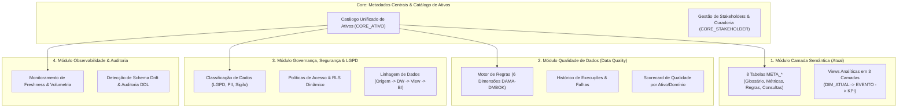

# Proposta de Arquitetura — Plataforma Unificada de Governança de Dados

Este documento consolida a proposta de evolução do projeto atual (focado em Camada Semântica para DW Oracle) para uma **plataforma completa, modular e in-database de Governança de Dados**, fundamentada nos princípios do **DAMA-DMBOK** e no conceito de **Metadados Ativos (Active Metadata)**.

---

## 1. Visão Estratégica

O trabalho já desenvolvido solucionou um dos maiores gargalos da governança de dados: a **camada semântica** e a **contextualização de negócio** para usuários e modelos de IA (as 8 tabelas `META_*` e a modelagem analítica em 3 camadas: `DIM_ATUAL` → `EVENTO` → `KPI`).

A meta agora é transformar essa estrutura em um **framework modular corporativo** composto por 4 pilares:



---

## 2. Estrutura de Diretórios Proposta

Para desacoplar a camada semântica já existente e permitir a expansão gradual dos novos módulos:

```text
governance-framework/
├── README.md                          # Visão geral da plataforma e guia de inicialização
├── docs/                              # Documentações conceituais e guias de referência
│   ├── ARQUITETURA.md                 # Este documento de especificação
│   ├── CONVENCOES_GLOBAIS.md          # Padrões de nomenclatura, maiúsculas e tipos
│   └── GUIA_IMPLANTACAO.md            # Passo a passo de deploy dos módulos
│
├── core/                              # Metadados centrais (Ativos e Pessoas)
│   ├── ddl/
│   │   └── 01_create_core_tables.sql  # CORE_ATIVO, CORE_STAKEHOLDER
│   └── inserts/
│
├── modules/
│   ├── 01_camada_semantica/           # [Módulo Existente]
│   │   ├── README.md
│   │   ├── AGENTS.md                  # Protocolo de condução do agente IA
│   │   ├── INTAKE.md                  # Checklist de insumos de negócio
│   │   ├── CONVENCOES.md              # Padrões da camada semântica
│   │   ├── ddl/                       # 8 tabelas META_* + Triggers
│   │   ├── views/                     # Templates DIM_ATUAL, EVENTO, KPI, MV
│   │   └── inserts/                   # Scripts de carga META_01 a 08
│   │
│   ├── 02_qualidade_dados/            # [Novo Módulo]
│   │   ├── README.md                  # Guia das 6 dimensões de qualidade
│   │   ├── ddl/                       # Tabelas DQ_REGRA, DQ_EXECUCAO, DQ_SCORECARD
│   │   ├── engine/                    # Procedures e Packages PL/SQL de validação automática
│   │   ├── templates/                 # Testes pré-configurados (Nulls, Regex, Range, FKs)
│   │   └── reports/                   # Views de auditoria e scorecard de qualidade
│   │
│   ├── 03_governanca_seguranca/       # [Novo Módulo]
│   │   ├── README.md                  # Políticas de LGPD, PII e Segurança
│   │   ├── ddl/                       # Tabelas GOV_CLASSIFICACAO, GOV_LINHAGEM, GOV_POLITICA
│   │   ├── lgpd/                      # Catálogo de dados sensíveis e anonimização
│   │   ├── rls/                       # Motor dinâmico de Row Level Security
│   │   └── linhagem/                  # Grafo de dependências (Origem -> DW -> Consumo)
│   │
│   └── 04_observabilidade/            # [Novo Módulo]
│       ├── README.md                  # Monitoramento de freshness e volume
│       ├── ddl/                       # Tabelas OBS_METRICA_EXECUCAO, OBS_ALERTA
│       └── jobs/                      # Jobs Oracle (DBMS_SCHEDULER) para verificação diária
```

---

## 3. Especificação dos Módulos

### 3.1. Core: Metadados Centrais
Objetivo: Servir como ponto único de registro para todos os objetos do ecossistema e seus responsáveis.

* **`CORE_ATIVO`**: Catálogo físico/lógico unificado (schemas, tabelas, views, colunas).
* **`CORE_STAKEHOLDER`**: Mapeamento de papéis de governança (*Data Owner*, *Data Steward*, *Tech Lead*, *Data Custodian*).

---

### 3.2. Módulo 1: Camada Semântica (Semantic Layer)
Objetivo: Traduzir dados técnicos em conceitos de negócio e viabilizar Text-to-SQL / ChatBI com precisão.

* **Estado Atual**: Concluído e operacional.
* **Componentes**:
  - Modelagem em 3 Camadas (`VW_*_DIM_*_ATUAL` → `VW_*_EVENTO` → `VW_*_KPI_*`).
  - 8 Tabelas de Metadados:
    - `META_GLOSSARIO`: Sinônimos e definições funcionais.
    - `META_METRICA`: Fórmulas SQL e regras de aditividade (ADITIVA, SEMI_ADITIVA, NAO_ADITIVA).
    - `META_OBJETO`: Governança e grão dos objetos semânticos.
    - `META_RELACIONAMENTO`: Mapeamento de joins e cardinalidades.
    - `META_REGRA_NEGOCIO`: Restrições e validações funcionais.
    - `META_CONSULTA_NEGOCIO`: Catálogo de perguntas com SQL de referência validado.
    - `META_ORIENTACAO_IA`: Prompting e heurísticas para assistentes inteligentes.
    - `META_VALOR_DOMINIO`: Domínios válidos e filtros de linhas sintéticas.
  - **Suporte Multi-Projeto & Herança Global:**
    Todas as 8 tabelas possuem a coluna `PROJETO VARCHAR2(50) DEFAULT 'GLOBAL' NOT NULL`. Quando múltiplos projetos residem no mesmo schema, diretrizes corporativas utilizam `'GLOBAL'`, metadados de projeto usam `'<PROJETO>'`, e qualquer mecanismo de RLS por projeto filtra com herança: `WHERE PROJETO IN ('GLOBAL', '<PROJETO>')`.

---

### 3.3. Módulo 2: Qualidade de Dados (Data Quality - DQ)
Objetivo: Automatizar a checagem de integridade, validade e confiabilidade dos dados diretamente no banco.

* **Dimensões DAMA-DMBOK Suportadas**:
  1. **Completude (Completeness)**: Ausência de nulos indevidos em campos mandatórios.
  2. **Unicidade (Uniqueness)**: Ausência de duplicações indesejadas em chaves primárias/de negócio.
  3. **Validade (Validity)**: Conformidade com formatos esperados (regex, faixas numéricas, listas de domínio).
  4. **Tempestividade (Timeliness / Freshness)**: Verificação se a carga foi realizada no prazo esperado.
  5. **Acurácia (Accuracy)**: Conformidade com regras de negócio e limites aceitáveis.
  6. **Consistência (Consistency)**: Integridade referencial entre tabelas fato e dimensão (ausência de órfãos).

* **Modelo de Dados Proposto**:
  - `DQ_REGRA`:
    - `ID_REGRA` (PK)
    - `NOME_REGRA`, `DESCRICAO`
    - `NOME_OBJETO`, `NOME_COLUNA`
    - `DIMENSAO` (COMPLETUDE, UNICIDADE, VALIDADE, etc.)
    - `TIPO_TESTE` (SQL_ASSERTION, NOT_NULL, REGEX, RANGE, FK_LOOKUP)
    - `CONDICAO_SQL`: Expressão ou subquery de validação.
    - `THRESHOLD_FALHA`: Percentual ou quantidade tolerável antes de disparar erro (ex: `0.00%`).
    - `SEVERIDADE`: `CRITICA`, `ALTA`, `MEDIA`, `BAIXA`.
    - `IND_ATIVO`: `S` / `N`.
  - `DQ_EXECUCAO`:
    - `ID_EXECUCAO` (PK), `ID_REGRA` (FK), `DT_EXECUCAO`.
    - `QT_REGISTROS_AVALIADOS`, `QT_REGISTROS_FALHA`.
    - `PCT_FALHA`, `STATUS` (`PASS`, `FAIL`, `WARN`).
    - `TEMPO_EXECUCAO_SEGUNDOS`.
  - `DQ_FALHA_DETALHE`:
    - Armazena as chaves de identificação dos registros que violaram a regra, facilitando o saneamento.
  - `DQ_SCORECARD_HIST`:
    - Histórico do índice de qualidade (0 a 100%) por tabela e domínio analítico.

* **Mecanismo de Execução**:
  - Package PL/SQL (`PKG_DATA_QUALITY`) contendo procedure de execução em lote.
  - Agendamento via `DBMS_SCHEDULER` após a finalização do processo diário de ETL/ELT.

---

### 3.4. Módulo 3: Governança, Segurança e LGPD (Data Governance & Compliance)
Objetivo: Garantir conformidade jurídica, proteção de dados pessoais e controle de acesso granular.

* **Modelo de Dados Proposto**:
  - `GOV_CLASSIFICACAO`:
    - `NOME_OBJETO`, `NOME_COLUNA`.
    - `CLASSIFICACAO_SIGILO` (`PUBLICO`, `INTERNO`, `CONFIDENCIAL`, `RESTRITO`).
    - `IND_LGPD_PII` (`S` / `N`).
    - `TIPO_DADO_PESSOAL` (`IDENTIFICADOR`, `SENSIVEL_SAUDE`, `FINANCEIRO`, `BIOMETRICO`).
    - `BASE_LEGAL_TRATAMENTO` (ex: Cumprimento de obrigação legal, Execução de contrato, Legítimo interesse).
    - `MASCARA_EXIBICAO`: Padrão de anonimização (ex: `***.XXX.XXX-**`).
  - `GOV_LINHAGEM`:
    - `OBJETO_ORIGEM`, `COLUNA_ORIGEM`.
    - `OBJETO_DESTINO`, `COLUNA_DESTINO`.
    - `CAMADA` (`STAGING`, `DW_RAW`, `DW_TRUSTED`, `SEMANTICA_VIEW`, `REPORT_POWERBI`).
    - `TRANSFORMACAO_APLICADA`: Lógica ou fórmula de derivação.
  - `GOV_POLITICA_ACESSO`:
    - Integração direta com a estratégia de **Row-Level Security (RLS)** já desenhada em `02_rls_template.sql`, associando papéis e contextos de sessão aos dados permitidos.

---

### 3.5. Módulo 4: Observabilidade & Auditoria (Data Observability)
Objetivo: Prover visão em tempo real da saúde operacional do Data Warehouse.

* **Componentes**:
  - Monitor de **Freshness**: Alerta se `MAX(DATA_ATUALIZACAO)` de uma fato estiver defasada em relação ao SLA.
  - Monitor de **Volumetria**: Comparação de quantidade de linhas inseridas com médias móveis (ex: detectar quedas abruptas de 80% no volume diário).
  - Monitor de **Schema Drift**: Comparação contínua de `USER_TAB_COLUMNS` para detectar alterações estruturais não homologadas (novas colunas, remoção de colunas ou alteração de tipo).

---

## 4. O Poder dos "Metadados Ativos" (Active Metadata)

A grande vantagem de reunir esses módulos em uma base unificada é o comportamento coordenado entre eles:

```
[ Usuário / Agente de IA ]
            │
            ▼
    [ Pergunta de Negócio ]
            │
            ├─► 1. Consulta MOD_SEM (Camada Semântica):
            │      Identifica métricas, joins e gera o SQL correto.
            │
            ├─► 2. Valida no MOD_DQ (Qualidade de Dados):
            │      Verifica se o Score da tabela está verde (>98%).
            │      Se houver teste falho recente, alerta o usuário:
            │      "Nota: 3% dos registros de ontem possuem duplicidade de chave."
            │
            └─► 3. Aplica MOD_GOV (Governança & LGPD):
                   Aplica mascaramento dinâmico em colunas de CPF/E-mail.
                   Garante que o RLS filtre apenas o órgão/secretaria do usuário.
```

---

## 5. Roteiro de Implementação Sugerido

| Etapa | Foco | Entregáveis | Complexidade |
|---|---|---|:---:|
| **Fase 1** | **Modularização do Repositório** | Reorganizar a raiz criando a pasta `modules/01_camada_semantica/` e preservando histórico. | Baixa |
| **Fase 2** | **Design & DDL de Qualidade (DQ)** | Criar DDL de `DQ_REGRA`, `DQ_EXECUCAO`, `DQ_SCORECARD` e pacote básico de testes PL/SQL. | Média |
| **Fase 3** | **Design & DDL de Governança (GOV)** | Criar DDL de `GOV_CLASSIFICACAO` (LGPD) e `GOV_LINHAGEM` com matriz de papéis (*Stewardship*). | Média |
| **Fase 4** | **Observabilidade & Dashboards** | Views analíticas de monitoramento consolidado e integração com gatilhos de alerta. | Média-Alta |

