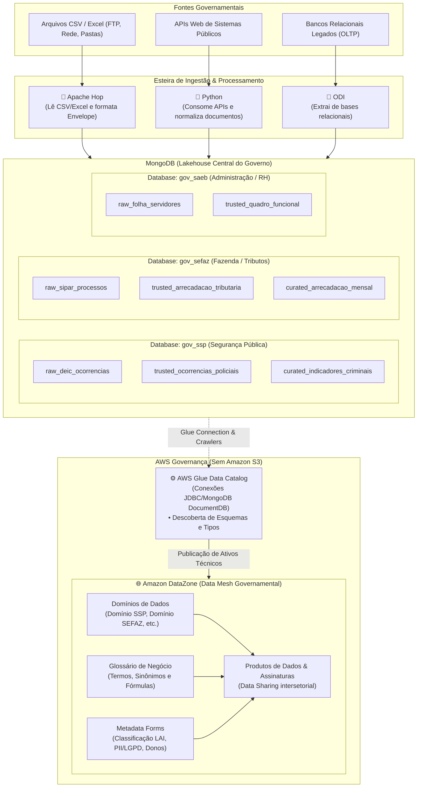

# Arquitetura de Governança de Dados para Governo
## MongoDB Lakehouse + AWS Glue Data Catalog + Amazon DataZone

> **Status:** Documento de Planejamento & Arquitetura  
> **Data de Criação:** 28/09/2026  
> **Contexto:** Ecossistema Governamental Multi-Órgão, Multi-Diretoria e Multi-Unidade  
> **Storage Central:** MongoDB (Data Lakehouse)  
> **Catálogo e Governança:** AWS Glue Data Catalog & Amazon DataZone (sem uso do Amazon S3)  
> **Ferramentas de Ingestão:** Apache Hop, Python e ODI (Oracle Data Integrator)

---

## 1. Visão Geral e Diretrizes Arquiteturais

Este planejamento estabelece a estratégia de governança para consolidar e governar dados provenientes de fontes heterogêneas (CSV, Excel, APIs REST e Bancos de Dados) em um ambiente público estadual/municipal.

### Premissas e Restrições Fixadas:
1. **Sem Amazon S3:** O armazenamento de objetos S3 não será utilizado por requisitos contratuais e de compliance local.
2. **MongoDB como Data Lakehouse Central:** O MongoDB atua como a camada de persistência flexível, raw, staging e curadoria documental.
3. **Desacoplamento do DW Relacional (Oracle):** A modelagem dimensional e os bancos Oracle pertencem a outro projeto/contrato e não fazem parte deste escopo na nuvem.
4. **Governança Ativa via AWS:** A catalogação técnica é realizada pelo **AWS Glue Data Catalog** e a governança de negócio, conformidade LAI/LGPD e publicação de produtos de dados ocorrem no **Amazon DataZone**.
5. **Esteira de Ferramentas Híbridas:**
   - **Apache Hop:** Ingestão de arquivos (CSV, TXT, planilhas Excel) e push para o Mongo.
   - **Python:** Consumo de APIs REST, transformações complexas e automação de metadados na AWS via `boto3`.
   - **ODI:** Extração de bancos relacionais legados e carregamento nas coleções do Mongo.

---

## 2. Topologia da Arquitetura



---

## 3. Organização dos Projetos no MongoDB

Para suportar a complexidade da administração pública (Secretarias, Diretorias e Unidades) sem gerar dispersão descontrolada de coleções (*Collection Sprawl*), adotou-se o modelo **Domain-Driven com Tagging Organizacional**.

### 3.1 Nível 1: Databases por Órgão / Secretaria
A divisão física no MongoDB ocorre por Órgão. Isso permite:
- **RBAC e Isolamento:** Usuários e serviços de um órgão só acessam seu próprio banco.
- **Gestão de Quota:** Alocação e medição de recursos por secretaria.
- **Correspondência Direta no DataZone:** Cada banco vira um **Data Domain** no DataZone.

Exemplos de Databases:
- `gov_ssp`: Secretaria da Segurança Pública
- `gov_sefaz`: Secretaria da Fazenda
- `gov_saeb`: Secretaria da Administração
- `gov_sesab`: Secretaria da Saúde

### 3.2 Nível 2: Camadas em Prefixos de Coleções
Dentro de cada database, as coleções representam as camadas do Lakehouse:
1. `raw_<entidade>` (Camada Bronze): Aterrissagem bruta do dado conforme extraído pela fonte.
2. `trusted_<entidade>` (Camada Prata): Dado limpo, deduplicado, tipado e validado.
3. `curated_<visao>` (Camada Ouro): Agregações prontas para consumo de relatórios e painéis.

### 3.3 Nível 3: Diretorias e Unidades dentro do Envelope Canônico
Diretorias, Coordenações, Delegacias, Postos e Escolas **não viram coleções separadas**. Elas residem obrigatoriamente dentro do bloco canônico `_org` em cada documento.

#### Estrutura do Documento Padrão:
```json
{
  "_id": ObjectId("66f82c4e1a2b3c4d5e6f7a8b"),
  
  "_org": {
    "cod_orgao": 23,
    "sigla_orgao": "SSP",
    "nome_orgao": "SECRETARIA DA SEGURANCA PUBLICA",
    "cod_diretoria": 104,
    "sigla_diretoria": "DEIC",
    "nome_diretoria": "DEPARTAMENTO DE REPRESSAO A CRIMES ORGANIZADOS",
    "cod_unidade": 5012,
    "sigla_unidade": "DRFR",
    "nome_unidade": "1A DELEGACIA DE REPRESSAO A FURTOS E ROUBOS",
    "municipio_ibge": 2927408,
    "nome_municipio": "SALVADOR"
  },

  "_governance": {
    "classificacao_sigilo": "RESERVADO",
    "grau_lai": "RESERVADO_5_ANOS",
    "possui_pii_lgpd": true,
    "base_legal": "SEGURANCA_PUBLICA_ART_4_LGPD",
    "data_carga": ISODate("2026-09-28T12:00:00Z"),
    "lote_execucao": "LOTE_20260928_01",
    "ferramenta_ingestao": "APACHE_HOP",
    "pipeline_origem": "pipe_deic_ocorrencias_excel",
    "versao_schema": "1.0"
  },

  "dados": {
    "NUMERO_BOLETIM": "2026-003491",
    "DATA_FATO": ISODate("2026-09-20T14:30:00Z"),
    "NATUREZA_DELITO": "ROUBO A ESTABELECIMENTO COMERCIAL",
    "HOUVE_FLAGRANTE": "S",
    "VALOR_ESTIMADO": 12500.00
  }
}
```

---

## 4. Estratégia de Índices no MongoDB

Para manter consultas por diretoria, unidade ou município performáticas em coleções com milhões de registros:

```javascript
// 1. Consultas analíticas por Diretoria e Data
db.trusted_ocorrencias_policiais.createIndex(
  { "_org.cod_diretoria": 1, "dados.DATA_FATO": -1 },
  { name: "idx_org_diretoria_data" }
);

// 2. Consultas por Unidade Operacional e Sigilo LAI
db.trusted_ocorrencias_policiais.createIndex(
  { "_org.cod_unidade": 1, "_governance.classificacao_sigilo": 1 },
  { name: "idx_org_unidade_sigilo" }
);

// 3. Consultas Geográficas / IBGE
db.trusted_ocorrencias_policiais.createIndex(
  { "_org.municipio_ibge": 1, "dados.NATUREZA_DELITO": 1 },
  { name: "idx_org_ibge_natureza" }
);

// 4. Auditoria de Carga e Rastreabilidade
db.trusted_ocorrencias_policiais.createIndex(
  { "_governance.lote_execucao": 1, "_governance.data_carga": -1 },
  { name: "idx_gov_lote_data" }
);
```

---

## 5. Integração com a AWS (Glue Catalog & Amazon DataZone)

### 5.1 AWS Glue Data Catalog (Sem S3)
- **Glue Connection:** Criação de conexões de rede do tipo **DocumentDB / MongoDB** via VPC / VPN conectando diretamente ao cluster MongoDB.
- **Glue Crawlers:**
  - Varrem as coleções `trusted_*` e `curated_*` de cada database do MongoDB.
  - Inferem o esquema estruturado dos documentos (campos de `dados.*`, `_org.*` e `_governance.*`).
  - Registram tabelas virtuais no Glue Data Catalog (ex.: `gov_ssp.trusted_ocorrencias_policiais`).

### 5.2 Amazon DataZone (Governança & Negócio)
- **Data Domains:** Cada órgão é configurado como um Domínio no DataZone (`Domínio Segurança Pública`, `Domínio Fazenda`, etc.).
- **Domain Units / Projetos:** As Diretorias (ex.: DEIC, PM, DPT) são mapeadas como Projetos ou Domain Units para restringir curadoria e publicações.
- **Business Glossary (Glossário de Negócio):** Termos técnicos do MongoDB são vinculados a definições claras para o cidadão e gestores públicos.
- **Metadata Forms Específicos para Governo:**
  - *Formulário LAI:* Classificação de sigilo (Ostensivo, Reservado, Secreto, Ultrassecreto).
  - *Formulário LGPD:* Indicação de campos com PII (CPF, Nome, Endereço, Biometria).
  - *Formulário de Custódia:* Identificação do Data Owner (gestor da pasta) e Data Steward (técnico responsável).
- **Data Sharing (Assinatura de Dados):** Mecanismo de solicitação e aprovação formal para cruzamento de dados entre secretarias distintas.

---

## 6. Matriz de Responsabilidade das Ferramentas

| Ferramenta | Entrada | Saída | Papel no Framework |
| :--- | :--- | :--- | :--- |
| **Apache Hop** | Arquivos CSV, TXT, Excel (via FTP/Rede) | MongoDB (`raw_*` ou `trusted_*`) | Ingestão em lote de arquivos, injeção dos blocos `_org` e `_governance`, carga no Mongo via `MongoDB Output`. |
| **Python** | APIs REST, Swagger, Webhooks | MongoDB (`raw_*` ou `trusted_*`) | Consumo de endpoints dinâmicos, tratamento de JSONs aninhados e automação AWS (`boto3`). |
| **ODI** | Tabelas de bancos relacionais legados | MongoDB (`trusted_*`) | Extração massiva de sistemas transacionais e carga no MongoDB via conector JDBC. |
| **MongoDB** | Payloads de Hop, Python e ODI | Storage Lakehouse central | Persistência NoSQL, particionamento lógico por órgão/diretoria e camada de dados para a AWS. |
| **AWS Glue** | Coleções do MongoDB | Tabelas do Catálogo Técnico | Catalogação contínua de esquemas, tipos de dados e partições sem depender do S3. |
| **Amazon DataZone** | Tabelas do Glue Catalog | Catálogo de Governança Ativa | Gestão de Domínios, Glossário de Negócio, conformidade LAI/LGPD e produtos de dados. |

---

## 7. Próximos Passos para Implementação

1. **Definição dos Schemas JSON Schema / BSON:** Criar os validadores para as coleções do MongoDB garantindo que nenhum documento entre sem o bloco `_org` e `_governance`.
2. **Pipelines Modelo no Apache Hop e Python:** Construir os fluxos de exemplo que leem Excel/API e gravam com o Envelope Canônico no MongoDB.
3. **Modelos de Metadata Forms para o DataZone:** Escrever as especificações em JSON dos formulários de LAI, LGPD e Data Ownership para importação no DataZone via script `boto3`.
