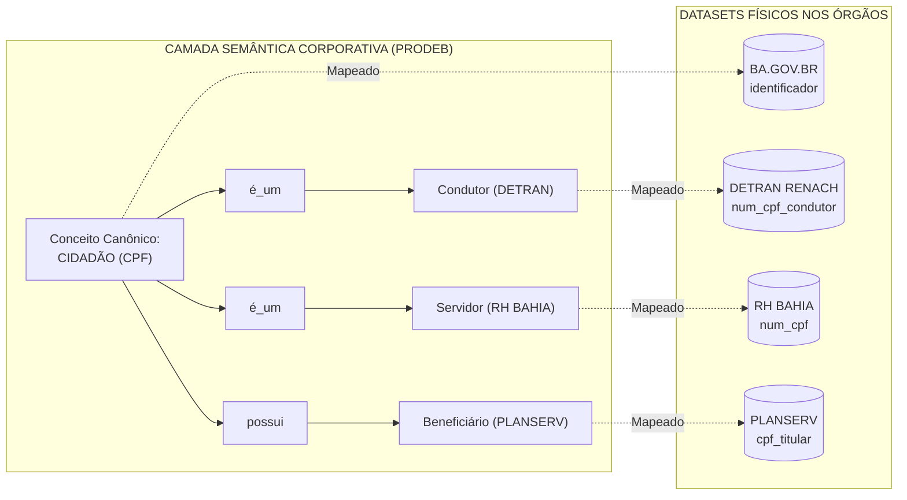

# MODELO CONCEITUAL E ESTRUTURA DA CAMADA SEMÂNTICA
## Governança de Dados, Interoperabilidade e Catálogo Semântico Governamental
### Repositório NoSQL MongoDB — Estado da Bahia (SAEB / PRODEB)

> **Status:** Proposta Arquitetural e Especificação Técnica  
> **Órgãos Envolvidos:** SAEB, PRODEB, DETRAN, PLANSERV, RH BAHIA, SUPREV, SESAB, SEFAZ  
> **Público-Alvo:** Coordenadores de Governança, Arquitetos de Solução e Engenheiros de Dados  
> **Versão:** 1.0  
> **Data:** Outubro de 2026  

---

### Sumário Executivo

A **Camada Semântica** representa o elo fundamental entre o mundo das regras de negócio governamentais e a infraestrutura física de bancos de dados, data lakes e APIs do Estado da Bahia.

Historicamente, cada secretaria estadual desenvolveu seus sistemas de forma autônoma, gerando uma verdadeira "Torre de Babel" informacional:
* No **BA.GOV.BR**, o indivíduo é identificado como `Cidadão Usuário` no dataset de Identidade (`identificador`).
* No **DETRAN**, ele é o `Condutor Habilitado` (`RENACH`) ou `Proprietário` (`RENAVAM`).
* No **PLANSERV**, ele é o `Beneficiário Titular` ou `Dependente`.
* No **RH BAHIA**, ele é o `Servidor Público Ativo` (`num_matricula`).
* Na **SUPREV**, ele é o `Aposentado` ou `Pensionista`.
* Na **SESAB**, ele é o `Paciente do SUS` (`num_cns`).

Este documento define formalmente:
1. **O Modelo Conceitual da Camada Semântica:** Conceitos de negócio, termos padronizados, atributos, relacionamentos e mapeamentos para datasets.
2. **A Resposta Arquitetural sobre o MongoDB:** Análise técnica aprofundada sobre **Coleção Única Aninhada vs. Coleção Centrada no Conceito (Abordagem Recomendada)**.
3. **Estrutura Física dos Documentos (JSON Schemas e Exemplos Reais):** Aplicação estrita dos padrões de nomenclatura corporativos da PRODEB (`tb_sem_*`, prefixos `cod_`, `nom_`, `des_`, `lst_`).
4. **Casos Práticos de Interoperabilidade Governamental:** Como o Estado consulta e correlaciona informações entre órgãos a partir de conceitos canônicos.
5. **Roadmap de Evolução:** Diretrizes para transformar o catálogo em um **Grafo de Conhecimento Semântico Governamental** (*Government Knowledge Graph*).

---

## 1. O Modelo Conceitual da Camada Semântica

A arquitetura semântica organiza o conhecimento institucional em uma árvore hierárquica e relacional composta por 6 componentes interdependentes:

```
sem_dominios (Macrodomínios de Negócio do Estado)
      │
      └────< sem_conceitos (Entidades Canônicas de Negócio)
                    │
                    ├────< sem_termos (Glossário Corporativo e Sinônimos)
                    │
                    ├────< sem_atributos (Propriedades Conceituais de Negócio)
                    │
                    ├────< sem_relacionamentos (Ontologia e Vínculos entre Conceitos)
                    │
                    └────< sem_dataset_conceitos (Mapeamento Técnico com Datasets)
                                         │
                                         └────< sem_campos (Mapeamento DE/PARA Físico)
```

### 1.1. Definição Detalhada de Cada Componente

| Componente | Papel no Catálogo Semântico | Exemplo no Contexto Bahia |
| :--- | :--- | :--- |
| **`sem_dominios`** | Agrupamento de alto nível que reflete áreas temáticas de atuação pública e responsabilidades estratégicas. | *Cidadania e Identificação*, *Segurança no Trânsito*, *Saúde Pública*, *Gestão de Pessoas / RH*. |
| **`sem_conceitos`** | A representação canônica e abstrata de uma entidade do mundo real governamental, independente de sistemas físicos. | *Cidadão*, *Veículo*, *Servidor Público*, *Beneficiário de Saúde*, *Estabelecimento de Saúde*. |
| **`sem_termos`** | Vocabulário controlado, termos preferenciais, siglas, verbetes do glossário corporativo e sinônimos utilizados pelos órgãos. | *Termo Preferencial:* "Cidadão"; *Sinônimos:* "Usuário do Serviço Público", "Pessoa Natural", "Munícipe". |
| **`sem_atributos`** | Propriedades conceituais essenciais que definem o conceito de negócio, com significado padronizado e regras semânticas. | *CPF*, *Nome Civil*, *Nome Social*, *Data de Nascimento*, *Sexo/Gênero Biológico*, *Deficiência Clínica*. |
| **`sem_relacionamentos`** | Vínculos ontológicos que explicam como os conceitos se conectam entre si (*é_um*, *possui*, *vinculado_a*, *depende_de*). | *Condutor é_um Cidadão*, *Servidor Público é_um Cidadão*, *Cidadão reside_em Endereço*, *Cidadão possui Veículo*. |
| **`sem_dataset_conceitos`** | A ponte concreta entre a abstração de negócio e os ativos físicos de dados (tabelas, coleções, arquivos do Data Lake). | Mapeamento que conecta o conceito *Cidadão* ao dataset `SAEB_SGI_IDENTIDADE_CIDADAO_V1` e ao `DETRAN_HABILITACAO_RENACH_V1`. |
| **`sem_campos`** | Associação campo a campo: liga o atributo conceitual ao campo físico do dataset, indicando transformações e regras de conversão. | Atributo Semântico *CPF* ↔ Campo Físico `identificador` (no BA.GOV.BR) ou `num_cpf` (no DETRAN). |

---

## 2. Análise Arquitetural no MongoDB: Objetos Aninhados ou Coleção Dedicada?

> **Pergunta Estratégica do Usuário:**  
> *"Pensar numa coleção pro MongoDB com os objetos aninhados?"*

A resposta técnica definitiva é: **Depende da granularidade de aninhamento adotada.**  
Abaixo comparamos as 3 abordagens arquiteturais possíveis para o MongoDB:

```
┌─────────────────────────────────────────────────────────────────────────────────────────┐
│ CENÁRIO A: UMA COLEÇÃO ÚNICA (sem_dominios com tudo aninhado)                           │
│  Dominio ──> [lst_conceitos ──> [lst_termos, lst_atributos, lst_datasets ──> [campos]]]  │
│  ⚠️ Risco: Inchaço do documento, limite de 16MB e bloqueio concorrente de escrita.       │
├─────────────────────────────────────────────────────────────────────────────────────────┤
│ CENÁRIO B: TOTALMENTE NORMALIZADO (6 coleções relacionais no MongoDB)                   │
│  tb_dominios + tb_conceitos + tb_termos + tb_atributos + tb_relacionamentos + tb_map   │
│  ⚠️ Risco: Anti-pattern NoSQL. Exige 5 a 6 $lookups, alta latência em consultas.        │
├─────────────────────────────────────────────────────────────────────────────────────────┤
│ CENÁRIO C (RECOMENDADO): COLEÇÃO CORE CENTRADA NO CONCEITO (tb_sem_conceitos)           │
│  1. tb_sem_dominios (Cadastro leve de domínios)                                         │
│  2. tb_sem_conceitos (Documento autocontido por conceito com termos, atributos,          │
│     relacionamentos e mapeamentos físicos aninhados)                                    │
│  ✅ Vantagem: Escalabilidade perfeita, leitura sem joins, isolamento de escrita.        │
└─────────────────────────────────────────────────────────────────────────────────────────┘
```

### 2.1. Avaliação Crítica das Opções

#### Opção A: Coleção Única de Domínio com Tudo Aninhado (`tb_sem_dominios`)
* **Vantagens:** Uma única requisição recupera o domínio completo.
* **Limitações Severas no Governo da Bahia:**
  1. *Limite de 16MB do BSON:* Domínios transversais (como *Cidadania* ou *Administração Pública*) possuem dezenas de conceitos e centenas de tabelas associadas. O documento ultrapassará limites e degradará a performance de memória (*working set*).
  2. *Concorrência de Escrita (*Write Contention*):* Se a equipe do DETRAN atualizar o mapeamento de um campo de condutor e a equipe do PLANSERV atualizar os dependentes ao mesmo tempo, ambas disputam a gravação no mesmo documento do domínio de cidadania.
  3. *Atualizações Complexas de Arrays:* Alterar um campo físico exige operadores posicionais aninhados complexos no MongoDB (`arrayFilters: [ {"c.cod_conceito": ...}, {"d.cod_dataset": ...} ]`), aumentando a propensão a falhas no pipeline.
  4. *Relacionamentos Interdomínios:* O conceito *Servidor Público* (Domínio RH) é um *Cidadão* (Domínio Cidadania). Em uma coleção aninhada por domínio, relacionamentos entre domínios diferentes ficam truncados ou redundantes.

#### Opção C: O Modelo Ideal — Coleção Centrada no Conceito (`tb_sem_conceitos`)
Adota o padrão da indústria de catálogos modernos de metadados (*Modern Data Catalogs* como OpenMetadata, Apache Atlas e Collibra):
* **O Conceito de Negócio é o Cidadão de Primeira Classe:** Criamos a coleção central `tb_sem_conceitos`.
* **Aninhamento Inteligente (*Embedding* Controlado):** Dentro de cada conceito, aninhamos:
  * O array `lst_termos` (sinônimos e glossário);
  * O array `lst_atributos` (atributos conceituais do conceito);
  * O array `lst_relacionamentos` (vínculos ontológicos com outros conceitos);
  * O array `lst_dataset_conceitos` com seus `lst_campos` (o mapeamento físico para os datasets governados).
* **Coleção de Apoio Leve `tb_sem_dominios`:** Mantém o cadastro e a governança dos macrodomínios.

---

## 3. Especificação Física da Coleção `tb_sem_conceitos` no MongoDB

Em total conformidade com o documento oficial `Padrao_Nomenclatura_MongoDB.docx` e `Padroes_Governanca_MongoDB_Final_v2.xlsx`, definimos os prefixos corporativos:
* Coleção: `tb_sem_conceitos`
* Prefixos: `ide_` (identificador), `cod_` (código), `des_` (descrição textual), `num_` (número), `tip_` (tipo), `sts_` (status), `ind_` (indicador booleano), `ref_` (referência), `lst_` (listas/arrays), `dtc_` (data), `dth_` (data e hora).

### 3.1. MongoDB JSON Schema de Validação

```json
{
  "$jsonSchema": {
    "bsonType": "object",
    "required": [
      "cod_conceito",
      "des_nome_conceito",
      "des_definicao",
      "ref_dominio",
      "sts_conceito",
      "dth_criacao"
    ],
    "properties": {
      "_id": {
        "bsonType": "objectId",
        "description": "ID exclusivo físico gerenciado pelo MongoDB."
      },
      "cod_conceito": {
        "bsonType": "string",
        "pattern": "^CNC_[A-Z0-9_]+$",
        "description": "Código de negócio canônico do conceito (ex: CNC_CIDADAO)."
      },
      "des_nome_conceito": {
        "bsonType": "string",
        "description": "Nome formal padronizado do conceito corporativo."
      },
      "des_definicao": {
        "bsonType": "string",
        "description": "Definição de negócio clara e inteligível por qualquer órgão."
      },
      "ref_dominio": {
        "bsonType": "object",
        "required": ["cod_dominio", "des_nome_dominio"],
        "properties": {
          "cod_dominio": { "bsonType": "string" },
          "des_nome_dominio": { "bsonType": "string" },
          "des_orgao_gestor_dominio": { "bsonType": "string" }
        }
      },
      "sts_conceito": {
        "bsonType": "string",
        "enum": ["HOMOLOGADO", "EM_REVISAO", "OBSOLETO"],
        "description": "Status de governança do conceito."
      },
      "lst_termos": {
        "bsonType": "array",
        "description": "Glossário de termos corporativos e sinônimos associados."
      },
      "lst_atributos": {
        "bsonType": "array",
        "description": "Atributos conceituais de negócio."
      },
      "lst_relacionamentos": {
        "bsonType": "array",
        "description": "Relacionamentos ontológicos com outros conceitos."
      },
      "lst_dataset_conceitos": {
        "bsonType": "array",
        "description": "Mapeamentos técnicos com os datasets físicos nos órgãos."
      }
    }
  }
}
```

---

## 4. Exemplo Físico Real Completo: Conceito Canônico `CIDADÃO`

Abaixo está o documento JSON real que integra o Portal **BA.GOV.BR**, o **DETRAN**, o **PLANSERV** e o **RH BAHIA** sob o mesmo conceito semântico unificado:

```json
{
  "_id": "6701bb12f8e123456789abcd",
  "cod_conceito": "CNC_CIDADAO",
  "des_nome_conceito": "Cidadão",
  "des_definicao": "Pessoa natural titular de direitos e deveres perante o Estado da Bahia, usuária de serviços públicos ou registrada em cadastros governamentais.",
  "sts_conceito": "HOMOLOGADO",
  "num_versao": "1.0",
  "dth_criacao": "2026-10-01T08:00:00.000Z",
  "des_usuario_criacao": "comite.governanca@prodeb.ba.gov.br",
  
  "ref_dominio": {
    "cod_dominio": "DOM_CIDADANIA_IDENTIFICACAO",
    "des_nome_dominio": "Cidadania e Identificação Civil",
    "des_orgao_gestor_dominio": "Secretaria da Administração do Estado da Bahia (SAEB)"
  },

  "lst_termos": [
    {
      "cod_termo": "TRM_CIDADAO_01",
      "des_termo": "Cidadão",
      "tip_termo": "PREFERENCIAL",
      "des_sigla": null,
      "des_descricao": "Termo oficial corporativo utilizado nas comunicações e serviços ao cidadão."
    },
    {
      "cod_termo": "TRM_CIDADAO_02",
      "des_termo": "Usuário de Serviço Público",
      "tip_termo": "SINONIMO",
      "des_sigla": "USP",
      "des_descricao": "Designação utilizada na Carta de Serviços e no Portal BA.GOV.BR."
    },
    {
      "cod_termo": "TRM_CIDADAO_03",
      "des_termo": "Pessoa Natural",
      "tip_termo": "TECNICO_JURIDICO",
      "des_sigla": "PF",
      "des_descricao": "Termo formal adotado para conformidade com a LGPD e Direito Civil."
    }
  ],

  "lst_atributos": [
    {
      "cod_atributo": "ATB_CID_CPF",
      "des_nome_atributo": "Número de Inscrição no CPF",
      "des_definicao_negocio": "Identificador unívoco do cidadão junto à Receita Federal do Brasil.",
      "tip_dado_semantico": "NUMERO_IDENTIFICADOR",
      "ind_identificador_principal": true,
      "ind_obrigatorio": true,
      "classificacao_lgpd": {
        "ind_dado_pessoal": true,
        "ind_dado_sensivel": false,
        "des_base_legal_padrao": "Execução de Políticas Públicas (Art. 7º, III da LGPD)"
      }
    },
    {
      "cod_atributo": "ATB_CID_NOME_CIVIL",
      "des_nome_atributo": "Nome Civil do Cidadão",
      "des_definicao_negocio": "Nome registrado na certidão de nascimento ou documento de identidade oficial.",
      "tip_dado_semantico": "TEXTO_NOMINATIVO",
      "ind_identificador_principal": false,
      "ind_obrigatorio": true,
      "classificacao_lgpd": {
        "ind_dado_pessoal": true,
        "ind_dado_sensivel": false
      }
    },
    {
      "cod_atributo": "ATB_CID_NOME_SOCIAL",
      "des_nome_atributo": "Nome Social",
      "des_definicao_negocio": "Designação pela qual a pessoa travesti ou transexual se identifica e é socialmente reconhecida.",
      "tip_dado_semantico": "TEXTO_NOMINATIVO",
      "ind_identificador_principal": false,
      "ind_obrigatorio": false,
      "classificacao_lgpd": {
        "ind_dado_pessoal": true,
        "ind_dado_sensivel": true
      }
    },
    {
      "cod_atributo": "ATB_CID_DEFICIENCIA",
      "des_nome_atributo": "Condição de Pessoa com Deficiência",
      "des_definicao_negocio": "Registro que comprova impedimento de longo prazo para fins de acessibilidade e atendimento prioritário.",
      "tip_dado_semantico": "BOOLEANO_CLINICO",
      "ind_identificador_principal": false,
      "ind_obrigatorio": false,
      "classificacao_lgpd": {
        "ind_dado_pessoal": true,
        "ind_dado_sensivel": true,
        "des_base_legal_padrao": "Tutela da Saúde e Políticas Públicas de Acessibilidade (Art. 11 LGPD)"
      }
    }
  ],

  "lst_relacionamentos": [
    {
      "cod_relacionamento": "REL_CID_CONDUTOR",
      "tip_relacionamento": "ESPECIALIZACAO_DE",
      "des_verbo_relacao": "é_um",
      "ref_conceito_destino": {
        "cod_conceito": "CNC_CONDUTOR",
        "des_nome_conceito": "Condutor de Veículo Habilitado",
        "des_orgao_competente": "DETRAN"
      },
      "des_regra_negocio": "Todo condutor registrado no DETRAN é obrigatoriamente um Cidadão portador de CPF."
    },
    {
      "cod_relacionamento": "REL_CID_SERVIDOR",
      "tip_relacionamento": "ESPECIALIZACAO_DE",
      "des_verbo_relacao": "é_um",
      "ref_conceito_destino": {
        "cod_conceito": "CNC_SERVIDOR_PUBLICO",
        "des_nome_conceito": "Servidor Público Estadual",
        "des_orgao_competente": "SAEB / RH BAHIA"
      },
      "des_regra_negocio": "Todo servidor público com vínculo ativo no Estado é um Cidadão."
    },
    {
      "cod_relacionamento": "REL_CID_BENEFICIARIO",
      "tip_relacionamento": "VINCULADO_A",
      "des_verbo_relacao": "possui_cobertura",
      "ref_conceito_destino": {
        "cod_conceito": "CNC_BENEFICIARIO_SAUDE",
        "des_nome_conceito": "Beneficiário PLANSERV",
        "des_orgao_competente": "PLANSERV"
      },
      "des_regra_negocio": "O cidadão pode usufruir de assistência médica como titular ou dependente."
    }
  ],

  "lst_dataset_conceitos": [
    {
      "cod_dataset": "SAEB_SGI_IDENTIDADE_CIDADAO_V1",
      "des_nome_tecnico_dataset": "tb_cidadao_identidade",
      "des_orgao_proprietario": "SAEB",
      "des_sistema_origem": "Portal BA.GOV.BR",
      "des_camada_data_lake": "RAW / REPOSITORIO_GOVERNADO",
      "sts_mapeamento": "HOMOLOGADO",
      "lst_campos": [
        {
          "nom_campo_fisico": "identificador",
          "tip_campo_fisico": "String",
          "ref_cod_atributo": "ATB_CID_CPF",
          "ind_chave_primaria_fisica": true,
          "des_regra_transformacao": "Limpeza de pontuação e zeros à esquerda (apenas 11 dígitos numéricos)."
        },
        {
          "nom_campo_fisico": "nome",
          "tip_campo_fisico": "String",
          "ref_cod_atributo": "ATB_CID_NOME_CIVIL",
          "des_regra_transformacao": "Conversão para caixa alta e remoção de espaços duplicados."
        },
        {
          "nom_campo_fisico": "nomeSocial",
          "tip_campo_fisico": "String",
          "ref_cod_atributo": "ATB_CID_NOME_SOCIAL",
          "des_regra_transformacao": "Null caso não informado."
        },
        {
          "nom_campo_fisico": "possuiDeficiencia",
          "tip_campo_fisico": "Boolean",
          "ref_cod_atributo": "ATB_CID_DEFICIENCIA",
          "des_regra_transformacao": "Mapeamento direto booleano (true/false)."
        }
      ]
    },
    {
      "cod_dataset": "DETRAN_HABILITACAO_RENACH_V1",
      "des_nome_tecnico_dataset": "tb_condutor_renach",
      "des_orgao_proprietario": "DETRAN",
      "des_sistema_origem": "Sistema Central de Habilitação",
      "des_camada_data_lake": "INGESTAO_DETRAN",
      "sts_mapeamento": "HOMOLOGADO",
      "lst_campos": [
        {
          "nom_campo_fisico": "num_cpf_condutor",
          "tip_campo_fisico": "String",
          "ref_cod_atributo": "ATB_CID_CPF",
          "ind_chave_primaria_fisica": false,
          "des_regra_transformacao": "Padronização para 11 dígitos numéricos."
        },
        {
          "nom_campo_fisico": "nom_condutor",
          "tip_campo_fisico": "String",
          "ref_cod_atributo": "ATB_CID_NOME_CIVIL",
          "des_regra_transformacao": "Conversão para UPPERCASE."
        }
      ]
    },
    {
      "cod_dataset": "SAEB_DRH_FOLHA_PAGAMENTO_V1",
      "des_nome_tecnico_dataset": "tb_servidor_rhbahia",
      "des_orgao_proprietario": "SAEB",
      "des_sistema_origem": "RH BAHIA",
      "des_camada_data_lake": "TRUSTED_RH",
      "sts_mapeamento": "HOMOLOGADO",
      "lst_campos": [
        {
          "nom_campo_fisico": "num_cpf",
          "tip_campo_fisico": "String",
          "ref_cod_atributo": "ATB_CID_CPF",
          "ind_chave_primaria_fisica": false,
          "des_regra_transformacao": "Remover traços e pontos."
        },
        {
          "nom_campo_fisico": "nom_servidor",
          "tip_campo_fisico": "String",
          "ref_cod_atributo": "ATB_CID_NOME_CIVIL",
          "des_regra_transformacao": "Trim e formatação de caracteres especiais."
        }
      ]
    }
  ]
}
```

---

## 5. Como a Camada Semântica Viabiliza a Interoperabilidade Governamental

A grande entrega de valor para o Estado da Bahia é transformar buscas técnicas e isoladas em **consultas federadas orientadas ao significado**:



### 5.1. Consultas Poderosas Habilitadas no MongoDB

Com a coleção `tb_sem_conceitos` estruturada desta forma, qualquer analista ou coordenador pode responder perguntas cruciais com uma única linha de consulta MQL:

1. **Localizar todos os datasets do Estado que armazenam dados de um Conceito:**
   ```javascript
   // Em quais tabelas/datasets do Estado temos informações sobre 'Cidadão'?
   db.tb_sem_conceitos.aggregate([
     { $match: { "cod_conceito": "CNC_CIDADAO" } },
     { $unwind: "$lst_dataset_conceitos" },
     { $project: {
         "orgao": "$lst_dataset_conceitos.des_orgao_proprietario",
         "sistema": "$lst_dataset_conceitos.des_sistema_origem",
         "dataset": "$lst_dataset_conceitos.cod_dataset"
       }
     }
   ]);
   ```

2. **Rastreabilidade de Dados Sensíveis da LGPD na Camada Física:**
   ```javascript
   // Quais campos físicos em quais datasets correspondem a atributos de dados sensíveis?
   db.tb_sem_conceitos.find(
     { "lst_atributos.classificacao_lgpd.ind_dado_sensivel": true },
     { "cod_conceito": 1, "lst_atributos.$": 1, "lst_dataset_conceitos": 1 }
   );
   ```

3. **Busca Semântica por Sinônimos no Catálogo de Dados:**
   ```javascript
   // Usuário busca por "Pessoa Natural" e o catálogo encontra o conceito "Cidadão"
   db.tb_sem_conceitos.find(
     { "lst_termos.des_termo": { $regex: "Pessoa Natural", $options: "i" } },
     { "des_nome_conceito": 1, "ref_dominio": 1 }
   );
   ```

---

## 6. Estratégia de Indexação para a Camada Semântica

Para suportar alta performance na interface web do Catálogo Corporativo e buscas de linhagem em milissegundos:

```javascript
// 1. Chave Única Canônica do Conceito
db.tb_sem_conceitos.createIndex(
  { "cod_conceito": 1 },
  { unique: true, name: "uk_cod_conceito" }
);

// 2. Busca por Domínio de Negócio
db.tb_sem_conceitos.createIndex(
  { "ref_dominio.cod_dominio": 1, "sts_conceito": 1 },
  { name: "idx_dominio_status" }
);

// 3. Índice Multikey para Busca por Termos e Sinônimos (Glossário)
db.tb_sem_conceitos.createIndex(
  { "lst_termos.des_termo": 1 },
  { name: "idx_termos_glossario" }
);

// 4. Índice Multikey para Rastreamento Reverso (Do Dataset para o Conceito)
db.tb_sem_conceitos.createIndex(
  { "lst_dataset_conceitos.cod_dataset": 1, "lst_dataset_conceitos.lst_campos.nom_campo_fisico": 1 },
  { name: "idx_dataset_campo_reverso" }
);
```

---

## 7. Roteiro de Implantação e Evolução para o Catálogo Semântico

A implementação da Camada Semântica no Estado da Bahia deve seguir 3 etapas progressivas:

* **Fase 1: Fundação e Homologação Semântica (Mês 1 a 2)**
  * Criar as coleções `tb_sem_dominios` e `tb_sem_conceitos` no MongoDB corporativo.
  * Cadastrar os 3 primeiros macrodomínios prioritários: *Cidadania & Identificação*, *Gestão de Pessoas (RH)* e *Trânsito*.
  * Homologar o mapeamento semântico da base de Identidade do **Portal BA.GOV.BR**.

* **Fase 2: Expansão Interinstitucional (Mês 3 a 5)**
  * Mapear os datasets de **DETRAN (RENACH/RENAVAM)**, **PLANSERV** e **RH BAHIA**.
  * Instituir o *Comitê Semântico de Dados*, composto por *Data Stewards* de cada órgão, para arbitrar nomenclaturas e sinônimos oficiais.

* **Fase 3: Catálogo Semântico Ativo e Grafo de Conhecimento (Mês 6 em diante)**
  * Expor a Camada Semântica via API GraphQL / REST para os desenvolvedores de sistemas do Estado.
  * Habilitar busca semântica inteligente no portal de dados abertos e no ambiente interno de analytics da PRODEB.
  * Evolução para consultas federadas em grafo (*Knowledge Graph*), permitindo que políticas públicas cruzem dados de saúde, trânsito e previdência de forma 100% interoperável e aderente à LGPD.

