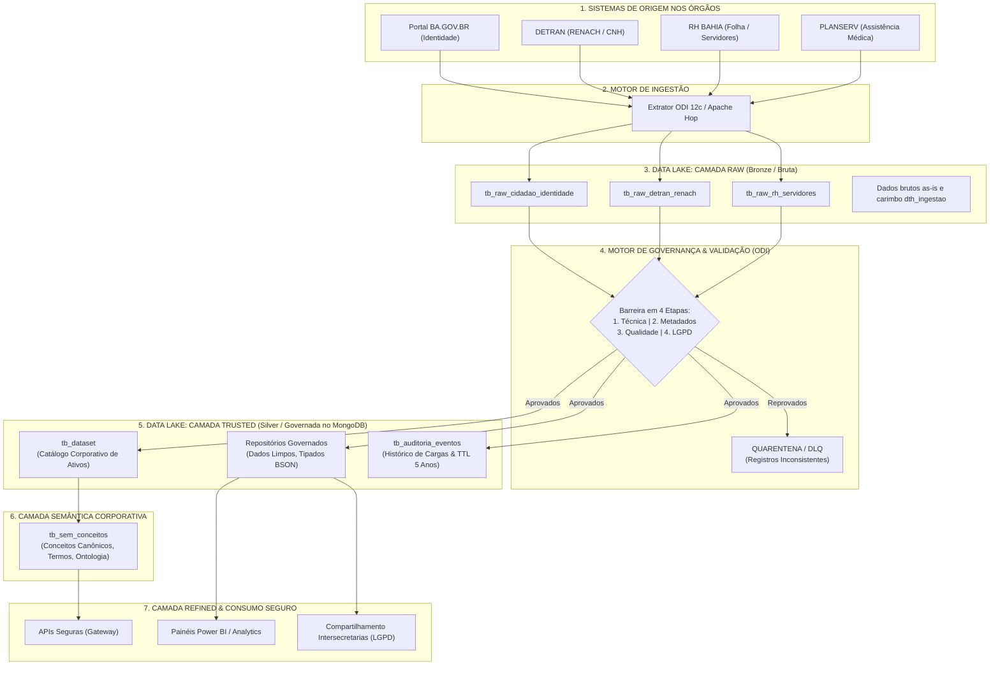
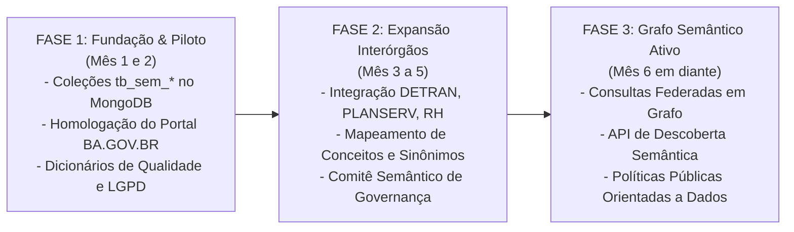

# PROJETO DE GOVERNANÇA DE DADOS — ESTADO DA BAHIA
## Documento Integrado de Diretrizes, Arquitetura, Camada Semântica e Modelo Operacional

> **Status:** Proposta Técnica Consolidada (Versão Integrada com Camada Semântica)  
> **Órgão Responsável:** Secretaria da Administração do Estado da Bahia (SAEB) / Companhia de Processamento de Dados do Estado da Bahia (PRODEB)  
> **Órgãos Cooperados:** DETRAN, PLANSERV, RH BAHIA, SUPREV, SESAB, SEFAZ  
> **Público-Alvo:** Coordenação de Governança, Arquitetura de Dados e Engenharia de Integração  
> **Versão:** 2.0 (Consolidação Corporativa Completa)  
> **Data:** Outubro de 2026  

---

### Sumário Executivo

Este documento consolida em um único guia estratégico, técnico e operacional todos os componentes da **Governança de Dados da Administração Pública do Estado da Bahia**.

A solução estabelece a espinha dorsal corporativa para superar a histórica fragmentação de dados entre as secretarias estaduais através de:
1. **Modelo de Data Lake em Múltiplas Camadas (RAW e TRUSTED):** Segregação arquitetural formal entre a ingestão bruta e imutável das fontes de origem (**Camada RAW**) e o repositório governado, higienizado, tipado e auditado no MongoDB (**Camada TRUSTED**), servindo de base para a camada analítica e de consumo (**Camada REFINED**).
2. **Camada Semântica Governamental:** Catálogo unificado de conceitos canônicos, termos de negócio, atributos e ontologia que viabilizam a interoperabilidade semântica entre órgãos (BA.GOV.BR, DETRAN, PLANSERV, RH BAHIA, SUPREV, SESAB).
3. **Arquitetura Híbrida em MongoDB (NoSQL):** Modelagem orientada a domínios que combina documentos aninhados (*embedding*) para leitura instantânea de metadados de datasets e conceitos de negócio, e coleções desacopladas (*referencing*) para séries operacionais de auditoria e ETL.
4. **Pipeline de Ingestão e Barreira de Qualidade (ODI):** Processamento automatizado de dados via Oracle Data Integrator / Apache Hop com validação em 4 etapas (Técnica, Metadados, Qualidade e Governança/LGPD) e isolamento em quarentena de falhas parciais.
5. **Padronização Corporativa PRODEB:** Adoção estrita de prefixos de nomenclatura (`tb_`, `cod_`, `nom_`, `des_`, `num_`, `sts_`, `ind_`, `ref_`, `lst_`, `dtc_`, `dth_`) e validação estrutural via MongoDB JSON Schema.
6. **Conformidade Nativa com a LGPD:** Rastreabilidade automatizada de dados pessoais e sensíveis, bases legais do Art. 7º e 11, mapeamento de termos de compartilhamento e anonimização/mascaramento no consumo.
7. **Casos Reais Homologados:** Aplicação na base de Identidade do **Portal BA.GOV.BR** (20 GB, 250 mil registros diários) e integração semântica com **RENACH/DETRAN**, **PLANSERV** e **RH BAHIA**.

---

## 1. Visão Geral e Macrofluxo do Processo de Governança

O modelo conecta os órgãos produtores de dados ao catálogo corporativo e ao repositório governado por meio de um fluxo padronizado de extração, auditoria de qualidade e publicação através das camadas do Data Lake governamental.

### 1.1. Diagrama de Fluxo Operacional Ponta a Ponta com Camadas do Data Lake



---

### 1.2. O Modelo de Data Lake em Múltiplas Camadas: RAW e TRUSTED

Para garantir a rastreabilidade total desde a fonte original até o usuário de negócio, a arquitetura de dados do Estado da Bahia estrutura o armazenamento físico em **múltiplas camadas funcionais bem delimitadas**:

```
┌────────────────────────────────────────────────────────────────────────────────────────┐
│                        ARQUITETURA DE CAMADAS DO DATA LAKE                             │
│                                                                                        │
│   [ ORIGEM ] ──────>  [ CAMADA RAW ]  ──────>  [ CAMADA TRUSTED ]  ──────> [ REFINED ] │
│   Transacionais       Dados Brutos            Dados Higienizados            Consumo    │
│   dos Órgãos          Imutáveis (as-is)       Governados no MongoDB         APIs & BI  │
│   (Oracle, APIs)      Histórico Fiel          Tipagem BSON & LGPD           Analytics  │
└────────────────────────────────────────────────────────────────────────────────────────┘
```

#### 1.2.1. Camada RAW (Bronze / Ingestão Bruta)
* **Objetivo:** Ingerir e persistir os dados exatamente como foram extraídos dos sistemas legados e fontes de dados dos órgãos emissores (*as-is*), sem qualquer transformação, máscara ou filtro de negócio.
* **Características e Diretrizes Técnicas:**
  * **Imutabilidade Absoluta:** Uma vez gravados, os registros na RAW nunca são atualizados ou apagados por processos de negócio; qualquer nova extração é armazenada como um novo evento de ingestão com carimbo temporal.
  * **Metadados Técnicos Obrigatórios:** Cada registro na RAW recebe atributos de auditoria técnica da carga:
    * `dth_ingestao`: Data e hora precisa em que o registro foi recebido.
    * `cod_job_ingestao`: Identificador do pipeline no ODI responsável pela coleta.
    * `des_arquivo_origem` ou `des_tabela_origem`: Nome exato da fonte extraída.
  * **Tolerância a Esquemas Heterogêneos:** Preserva tipos originais da fonte, campos nulos, formatos inconsistentes e valores inválidos para permitir reprocessamentos retroativos sem dependência dos sistemas transacionais de produção dos órgãos.
  * **Controle Estrito de Acesso:** Camada de uso exclusivo de engenheiros de dados e rotinas de ETL/ELT. **Nenhum usuário de negócio, analista de BI ou sistema consumidor tem permissão de leitura na RAW**, evitando vazamento de dados não saneados.

#### 1.2.2. O Motor de Transição e Validação (ODI 12c / Apache Hop)
Entre a Camada RAW e a Camada TRUSTED atua a **Barreira Automatizada de Qualidade do ODI**, aplicando:
1. **Limpeza e Padronização:** Remoção de pontuações, caracteres especiais, normalização de textos em maiúsculas e espaços duplicados.
2. **Tipagem Oficial BSON:** Conversão de strings para tipos nativos (`date`, `int`, `double`, `bool`) conforme o padrão PRODEB.
3. **Validação de Regras de Negócio e LGPD:** Checagem de CPF, preenchimento de obrigatórios e marcação de sensibilidade.
4. **Mecanismo de Quarentena (*Dead Letter Queue*):** Registros inconsistentes não são descartados silenciosamente nem paralisam a carga; são desviados para uma tabela de quarentena com emissão de alerta automático para o *Data Steward* do órgão.

#### 1.2.3. Camada TRUSTED (Silver / Repositório Governado no MongoDB)
* **Objetivo:** Armazenar os dados devidamente tratados, padronizados, validados e enriquecidos com metadados de governança, tornando-se a **Fonte Oficial e Única da Verdade (*Single Source of Truth*)** para a Administração Pública Estadual.
* **Onde o MongoDB se Encaixa:**
  * **O MongoDB corporativo da PRODEB é o repositório central da Camada TRUSTED.**
  * Todos os ativos nesta camada são governados e catalogados pela coleção `tb_dataset`.
  * Os dados físicos obedecem estritamente aos prefixos PRODEB (`tb_*`, `cod_`, `nom_`, `des_`, `num_`, `sts_`, `ind_`, etc.) e são validados pelo MongoDB JSON Schema.
  * Registros duplicados são unificados e vinculados a chaves canônicas de identificação (ex: CPF higienizado em 11 dígitos).
  * Classificação de dados pessoais e sensíveis da LGPD é formalmente atrelada aos campos físicos.
  * Histórico de execuções de carga e métricas de transformação são registrados na coleção desacoplada `tb_auditoria_eventos`.

#### 1.2.4. Integração com a Camada Semântica e Camada REFINED (Gold / Consumo)
* A **Camada Semântica (`tb_sem_dominios` e `tb_sem_conceitos`)** opera diretamente conectada à **Camada TRUSTED**, associando os campos físicos higienizados aos conceitos canônicos de negócio (*Cidadão*, *Condutor*, *Servidor*, *Paciente*).
* A partir da TRUSTED, o Estado disponibiliza a **Camada REFINED (Analítica / Gold)**:
  * Agregações desnormalizadas para dashboards de tomada de decisão (Power BI da SEFAZ, SAEB e SESAB).
  * Visões anonimizadas e pseudonimizadas para atendimento à Lei de Acesso à Informação (Portal da Transparência / Dados Abertos).
  * APIs REST com aplicação de **máscara dinâmica de dados (*Dynamic Data Masking*)** para consumo seguro entre secretarias com base legal homologada.

---

### 1.3. Matriz Comparativa de Governança das Camadas do Data Lake

| Critério de Comparação | Camada RAW (Bronze) | Camada TRUSTED (Silver / MongoDB PRODEB) | Camada REFINED / Consumo (Gold) |
| :--- | :--- | :--- | :--- |
| **Origem dos Dados** | Bancos transacionais, arquivos e APIs dos órgãos. | Processamento e validação da Camada RAW via ODI. | Consultas e agregações sobre a Camada TRUSTED. |
| **Formato e Tecnologia** | Arquivos brutos (JSON, Parquet, CSV) e coleções brutas. | **Coleções BSON no MongoDB Enterprise** padronizadas PRODEB. | Data Marts analíticos, coleções agregadas e APIs REST. |
| **Tratamento de Dados** | Nenhum (*as-is* imutável com carimbo temporal). | Higienizado, tipado, deduplicado e validado por JSON Schema. | Regras de negócio analíticas, KPIs e agregações temáticas. |
| **Nível de Qualidade** | Desconhecido / Conforme gerado na origem. | **Certificado pelas 4 barreiras de qualidade do catálogo.** | Alta / Otimizado para decisões gerenciais. |
| **Proteção e LGPD** | Contém dados brutos; isolamento total de acesso. | Dados classificados com rastreabilidade de base legal. | **Anonimização e máscaras dinâmicas aplicadas.** |
| **Público Consumidor** | Engenheiros de dados e rotinas internas de ETL. | **Aplicações transacionais integradas e Camada Semântica.** | Gestores, painéis de BI, cientistas de dados e cidadãos. |

---

## 2. Arquitetura de Coleções no MongoDB (Topologia Híbrida Completa)

A arquitetura no NoSQL MongoDB adota uma modelagem orientada a domínios que equilibra alta velocidade de consulta no catálogo corporativo e estabilidade operacional para dados volumosos.

### 2.1. Topologia das 5 Coleções Corporativas

```
┌────────────────────────────────────────────────────────────────────────┐
│                   CAMADA SEMÂNTICA DE NEGÓCIO                          │
│   1. tb_sem_dominios                  2. tb_sem_conceitos              │
│   (Taxonomia de Macrodomínios)        (Conceitos Canônicos, Termos,    │
│                                        Atributos e Mapeamentos)        │
└───────────────────────────────────┬────────────────────────────────────┘
                                    │ Relacionamento Semântico
                                    ▼
┌────────────────────────────────────────────────────────────────────────┐
│                   CATÁLOGO TÉCNICO DE METADADOS                        │
│   3. tb_dataset (Coleção Core de Ativos Físicos)                       │
│                                                                        │
│   ├─ Identificação: cod_dataset, des_nome_dataset, versao              │
│   ├─ Órgão e Sistema: cod_orgao_origem, cod_sistema                    │
│   ├─ Papéis: des_data_owner, des_data_steward, tip_criticidade         │
│   ├─ metadados_campos (embedded: nomes, tipos BSON, chaves)            │
│   ├─ classificacao_lgpd (embedded: dado pessoal, sensível, base legal) │
│   ├─ regras_qualidade (embedded: algoritmos, metas, conformidade)      │
│   ├─ linhagem_origem (embedded: banco, tabela, rotina ODI, camada)     │
│   └─ consumo_autorizado (embedded: secretarias autorizadas, APIs, BI)  │
└───────────────────────────────────┬────────────────────────────────────┘
                                    │ 1 : N (Referência por cod_dataset)
                                    ▼
┌────────────────────────────────────────────────────────────────────────┐
│                   OBSERVABILIDADE E AUDITORIA                          │
│   4. tb_auditoria_eventos (Write-Heavy / Time Series)                  │
│                                                                        │
│   ├─ cod_auditoria, cod_dataset, dth_evento, des_categoria_evento      │
│   ├─ detalhes_execucao: lidos, inseridos, atualizados, rejeitados      │
│   ├─ métricas de tempo, tabelas de quarentena e alertas emitidos       │
│   └─ retenção automática via Índice TTL de 5 anos                      │
└────────────────────────────────────────────────────────────────────────┘
```

### 2.2. Justificativas Arquiteturais de Design NoSQL

1. **Documentos Aninhados (*Embedding*) em `tb_dataset`:**
   Metadados de campos, regras de qualidade, termos de consumo e classificação LGPD residem dentro do próprio documento do dataset. Uma busca de catálogo responde em **uma única leitura de milissegundos**, sem nenhum *join* (`$lookup`).
2. **Isolamento de Escrita (*Write-Heavy Separation*) em `tb_auditoria_eventos`:**
   Execuções diárias de ETL (ODI) gravam milhares de eventos operacionais ao longo dos anos. Manter a auditoria desacoplada impede o inchaço do catálogo e afasta o risco de atingir o limite físico de **16MB por documento do BSON**.
3. **Coleção Centrada no Conceito em `tb_sem_conceitos`:**
   Cada conceito de negócio (ex: *Cidadão*, *Veículo*, *Servidor*) é autocontido, carregando seus sinônimos, atributos lógicos, relações ontológicas e links para as tabelas físicas dos órgãos.

---

## 3. Padrão Corporativo de Nomenclatura e Tipagem (PRODEB → MongoDB)

Conforme formalizado nos documentos oficiais `Padrao_Nomenclatura_MongoDB.docx`, `Padrao_Nomenclatura_Datasets_Orgaos.docx` e `Padrao_Mapeamento_Tipos_MongoDB_Qualidade.docx`, a padronização assegura homogeneidade entre secretarias:

### 3.1. Regras Gerais de Nomenclatura
* Nomes físicos de coleções e atributos **sempre em letras minúsculas**.
* Sem caracteres especiais, acentos, pontuações ou espaços; palavras separadas exclusivamente por *underscore* (`_`).
* Coleções recebem o prefixo obrigatório `tb_` (ou `tb_sem_` na camada semântica).

### 3.2. Prefixos Oficiais de Atributos

| Prefixo | Significado | Regra / Exemplo de Aplicação |
| :--- | :--- | :--- |
| **`ide_`** | Identificador | Chaves primárias físicas ou IDs de sistema (`ide_registro`, `ide_execucao`). |
| **`cod_`** | Código | Códigos padronizados de negócio (`cod_dataset`, `cod_orgao`, `cod_conceito`). |
| **`des_`** | Descrição / Texto | Qualquer campo textual (`des_nome`, `des_email`, `des_observacao`). |
| **`num_`** | Numérico Identificador | Campos compostos predominantemente por números (`num_cpf`, `num_matricula`, `num_versao`). |
| **`tip_`** | Tipo / Classificação | Classificadores categóricos (`tip_criticidade`, `tip_termo`, `tip_relacionamento`). |
| **`sts_`** | Status | Estados de processamento ou governança (`sts_registro`, `sts_evento`, `sts_conceito`). |
| **`ind_`** | Indicador Booleano | Flags lógicas de verdadeiro/falso (`ind_chave_primaria`, `ind_dado_sensivel`, `ind_obrigatorio`). |
| **`ref_`** | Referência | Relacionamentos ou objetos aninhados com metadados de outra entidade (`ref_dominio`, `ref_orgao`). |
| **`qtd_`** | Quantidade | Contadores inteiros (`qtd_registros_lidos`, `qtd_rejeitados`). |
| **`val_`** | Valor Financeiro / Numérico | Medidas quantitativas decimais (`val_tempo_segundos`, `val_orcamento`). |
| **`dtc_`** | Data | Datas sem componente de hora (`dtc_nascimento`, `dtc_criacao`). |
| **`dth_`** | Data e Hora | Carimbos temporais completos UTC / ISODate (`dth_evento`, `dth_execucao`). |
| **`lst_`** | Lista / Array | Coleções de subdocumentos ou itens (`lst_termos`, `lst_campos`, `lst_atributos`). |

### 3.3. Padrão de Nomenclatura de Datasets dos Órgãos
A identificação física do dataset nos órgãos fornecedores adota o padrão:
$$\text{SIGLA\_ORGAO\_UNIDADE\_TEMA\_VERSAO}$$
*Exemplos:*
* `SAEB_SGI_IDENTIDADE_CIDADAO_V1`
* `DETRAN_HABILITACAO_RENACH_V1`
* `PLANSERV_BENEFICIARIOS_ASSISTENCIA_V1`
* `SAEB_DRH_FOLHA_PAGAMENTO_V1`

### 3.4. Mapeamento de Tipos de Origem para BSON no MongoDB

| Tipo de Origem (Oracle, SQL, CSV) | Tipo BSON MongoDB | Validação JSON Schema | Justificativa / Regra |
| :--- | :--- | :--- | :--- |
| `VARCHAR`, `CHAR`, `TEXT` | `string` | `"bsonType": "string"` | Textos em geral, identificadores com máscara. |
| `NUMBER(p,0)`, `INTEGER`, `BIGINT` | `int` ou `long` | `"bsonType": "int"` | Contadores e chaves inteiras. |
| `NUMBER(p,s)`, `DECIMAL`, `FLOAT` | `double` ou `decimal` | `"bsonType": "double"` | Valores financeiros e taxas. |
| `DATE`, `TIMESTAMP` | `date` | `"bsonType": "date"` | Armazenamento nativo UTC (ISODate). |
| `BOOLEAN`, `CHAR(1) [S/N]` | `bool` | `"bsonType": "bool"` | Flags lógicas padronizadas (`true`/`false`). |
| `ARRAY`, `LIST` | `array` | `"bsonType": "array"` | Listas de subdocumentos estruturados. |

---

## 4. A Camada Semântica: Modelo Conceitual e Interoperabilidade Governamental

A **Camada Semântica** resolve o desafio fundamental da "Torre de Babel" informacional do Estado da Bahia, onde cada secretaria nomeou os mesmos conceitos do mundo real com terminologias e formatos técnicos discrepantes:

```
┌──────────────────────────────────────────────────────────────────────────────────┐
│                   O PROBLEMA HISTÓRICO: TORRE DE BABEL ENTRE ÓRGÃOS             │
│                                                                                  │
│   • Portal BA.GOV.BR : Cidadão Usuário   ───> Campo: identificador (String, 11)   │
│   • DETRAN           : Condutor Habilitado ─> Campo: num_cpf_condutor (String, 14) │
│   • PLANSERV         : Beneficiário Titular ─> Campo: cpf_titular (Number)         │
│   • RH BAHIA         : Servidor Público    ───> Campo: num_cpf (String, 11)       │
│   • SUPREV           : Segurado Previdência ─> Campo: cpf_beneficiario (String)   │
│   • SESAB            : Paciente SUS         ───> Campo: num_cns / num_cpf          │
└──────────────────────────────────────────────────────────────────────────────────┘
```

A Camada Semântica cria um **Catálogo Conceitual Canônico** onde o conceito *Cidadão* unifica todas essas visões setoriais através de um modelo em árvore orientado a grafos.

### 4.1. Estrutura da Árvore Semântica

A estrutura da camada organiza o conhecimento institucional em 6 níveis complementares:

```
sem_dominios (Macrodomínios de Negócio do Estado da Bahia)
      │
      └────< sem_conceitos (Entidades Canônicas de Negócio)
                    │
                    ├────< sem_termos (Glossário Corporativo, Siglas e Sinônimos)
                    │
                    ├────< sem_atributos (Propriedades Conceituais de Negócio)
                    │
                    ├────< sem_relacionamentos (Ontologia: Vínculos e Especializações)
                    │
                    └────< sem_dataset_conceitos (Mapeamento Técnico de Datasets)
                                         │
                                         └────< sem_campos (Mapeamento Físico DE/PARA)
```

### 4.2. Decisão Arquitetural NoSQL: Por que a Coleção Centrada no Conceito?

> **Análise Técnica:**  
> A pergunta essencial de arquitetura é: *Devemos criar uma única coleção de domínios aninhando conceitos, termos, atributos, relacionamentos e mapeamentos físicos?*

A decisão formal para o Governo do Estado da Bahia estabelece a **Coleção Core Centrada no Conceito (`tb_sem_conceitos`)**:

| Dimensão de Análise | Opção A: Tudo Aninhado no Domínio (`tb_sem_dominios`) | Opção B: 6 Coleções Normalizadas | Opção C (Adotada): Core no Conceito (`tb_sem_conceitos`) |
| :--- | :--- | :--- | :--- |
| **Limite de 16MB (BSON)** | ⚠️ **Alto Risco:** Domínios amplos com dezenas de tabelas estouram o limite. | Baixo | ✅ **Zero Risco:** Cada conceito consome de 10 a 60 KB. |
| **Desempenho de Leitura** | Rápido para o domínio, lento para buscas específicas. | ⚠️ **Lento:** Exige de 4 a 5 `$lookup`. | ✅ **Instantâneo:** Leitura direta de 1 documento sem *joins*. |
| **Concorrência de Escrita** | ⚠️ **Crítico:** DETRAN e PLANSERV bloqueiam o mesmo documento. | Isolado | ✅ **Isolado:** Cada órgão atualiza o seu conceito ou mapeamento. |
| **Relacionamentos Interdomínio** | ⚠️ **Complexo:** Vínculos entre domínios diferentes ficam truncados. | Normalizado | ✅ **Nativo em Grafo:** Suporta vínculos diretos entre conceitos. |

---

### 4.3. Especificação do MongoDB JSON Schema para `tb_sem_conceitos`

A coleção de conceitos de negócio valida estruturalmente cada entrada contra esquemas rigorosos:

```json
{
  "$jsonSchema": {
    "bsonType": "object",
    "required": [
      "cod_conceito",
      "des_nome_conceito",
      "des_definicao",
      "ref_dominio",
      "sts_conceito",
      "dth_criacao"
    ],
    "properties": {
      "_id": { "bsonType": "objectId" },
      "cod_conceito": {
        "bsonType": "string",
        "pattern": "^CNC_[A-Z0-9_]+$",
        "description": "Código de negócio exclusivo do conceito (ex: CNC_CIDADAO)."
      },
      "des_nome_conceito": { "bsonType": "string" },
      "des_definicao": { "bsonType": "string" },
      "sts_conceito": {
        "bsonType": "string",
        "enum": ["HOMOLOGADO", "EM_REVISAO", "OBSOLETO"]
      },
      "num_versao": { "bsonType": "string" },
      "dth_criacao": { "bsonType": "date" },
      "des_usuario_criacao": { "bsonType": "string" },
      "ref_dominio": {
        "bsonType": "object",
        "required": ["cod_dominio", "des_nome_dominio"],
        "properties": {
          "cod_dominio": { "bsonType": "string" },
          "des_nome_dominio": { "bsonType": "string" },
          "des_orgao_gestor_dominio": { "bsonType": "string" }
        }
      },
      "lst_termos": {
        "bsonType": "array",
        "items": {
          "bsonType": "object",
          "required": ["cod_termo", "des_termo", "tip_termo"],
          "properties": {
            "cod_termo": { "bsonType": "string" },
            "des_termo": { "bsonType": "string" },
            "tip_termo": { "bsonType": "string", "enum": ["PREFERENCIAL", "SINONIMO", "TECNICO_JURIDICO"] },
            "des_sigla": { "bsonType": ["string", "null"] },
            "des_descricao": { "bsonType": "string" }
          }
        }
      },
      "lst_atributos": {
        "bsonType": "array",
        "items": {
          "bsonType": "object",
          "required": ["cod_atributo", "des_nome_atributo", "tip_dado_semantico", "ind_identificador_principal"],
          "properties": {
            "cod_atributo": { "bsonType": "string" },
            "des_nome_atributo": { "bsonType": "string" },
            "des_definicao_negocio": { "bsonType": "string" },
            "tip_dado_semantico": { "bsonType": "string" },
            "ind_identificador_principal": { "bsonType": "bool" },
            "ind_obrigatorio": { "bsonType": "bool" },
            "classificacao_lgpd": { "bsonType": "object" }
          }
        }
      },
      "lst_relacionamentos": {
        "bsonType": "array",
        "items": {
          "bsonType": "object",
          "required": ["cod_relacionamento", "tip_relacionamento", "des_verbo_relacao", "ref_conceito_destino"],
          "properties": {
            "cod_relacionamento": { "bsonType": "string" },
            "tip_relacionamento": { "bsonType": "string", "enum": ["ESPECIALIZACAO_DE", "VINCULADO_A", "COMPONENTE_DE"] },
            "des_verbo_relacao": { "bsonType": "string" },
            "ref_conceito_destino": { "bsonType": "object" },
            "des_regra_negocio": { "bsonType": "string" }
          }
        }
      },
      "lst_dataset_conceitos": {
        "bsonType": "array",
        "items": {
          "bsonType": "object",
          "required": ["cod_dataset", "des_orgao_proprietario", "lst_campos"],
          "properties": {
            "cod_dataset": { "bsonType": "string" },
            "des_nome_tecnico_dataset": { "bsonType": "string" },
            "des_orgao_proprietario": { "bsonType": "string" },
            "des_sistema_origem": { "bsonType": "string" },
            "sts_mapeamento": { "bsonType": "string" },
            "lst_campos": {
              "bsonType": "array",
              "items": {
                "bsonType": "object",
                "required": ["nom_campo_fisico", "tip_campo_fisico", "ref_cod_atributo"],
                "properties": {
                  "nom_campo_fisico": { "bsonType": "string" },
                  "tip_campo_fisico": { "bsonType": "string" },
                  "ref_cod_atributo": { "bsonType": "string" },
                  "ind_chave_primaria_fisica": { "bsonType": "bool" },
                  "des_regra_transformacao": { "bsonType": "string" }
                }
              }
            }
          }
        }
      }
    }
  }
}
```

---

### 4.4. Exemplo Real Completo da Camada Semântica: Conceito `CNC_CIDADAO`

```json
{
  "_id": "6701bb12f8e123456789abcd",
  "cod_conceito": "CNC_CIDADAO",
  "des_nome_conceito": "Cidadão",
  "des_definicao": "Pessoa natural titular de direitos e obrigações perante o Estado da Bahia, usuária de serviços públicos ou registrada em cadastros governamentais.",
  "sts_conceito": "HOMOLOGADO",
  "num_versao": "1.0",
  "dth_criacao": "2026-10-01T08:00:00.000Z",
  "des_usuario_criacao": "comite.governanca@prodeb.ba.gov.br",

  "ref_dominio": {
    "cod_dominio": "DOM_CIDADANIA_IDENTIFICACAO",
    "des_nome_dominio": "Cidadania e Identificação Civil",
    "des_orgao_gestor_dominio": "Secretaria da Administração do Estado da Bahia (SAEB)"
  },

  "lst_termos": [
    {
      "cod_termo": "TRM_CID_01",
      "des_termo": "Cidadão",
      "tip_termo": "PREFERENCIAL",
      "des_sigla": null,
      "des_descricao": "Termo oficial corporativo para comunicação e prestação de serviços públicos."
    },
    {
      "cod_termo": "TRM_CID_02",
      "des_termo": "Usuário de Serviço Público",
      "tip_termo": "SINONIMO",
      "des_sigla": "USP",
      "des_descricao": "Designação adotada na Carta de Serviços do BA.GOV.BR."
    },
    {
      "cod_termo": "TRM_CID_03",
      "des_termo": "Pessoa Natural",
      "tip_termo": "TECNICO_JURIDICO",
      "des_sigla": "PF",
      "des_descricao": "Termo formal para enquadramento no Código Civil e LGPD."
    }
  ],

  "lst_atributos": [
    {
      "cod_atributo": "ATB_CID_CPF",
      "des_nome_atributo": "Número de Inscrição no CPF",
      "des_definicao_negocio": "Identificador unívoco do cidadão junto à Receita Federal do Brasil.",
      "tip_dado_semantico": "NUMERO_IDENTIFICADOR",
      "ind_identificador_principal": true,
      "ind_obrigatorio": true,
      "classificacao_lgpd": {
        "ind_dado_pessoal": true,
        "ind_dado_sensivel": false,
        "des_base_legal_padrao": "Execução de Políticas Públicas (Art. 7º, III da LGPD)"
      }
    },
    {
      "cod_atributo": "ATB_CID_NOME_CIVIL",
      "des_nome_atributo": "Nome Civil do Cidadão",
      "des_definicao_negocio": "Nome registrado na certidão de nascimento ou documento oficial de identificação.",
      "tip_dado_semantico": "TEXTO_NOMINATIVO",
      "ind_identificador_principal": false,
      "ind_obrigatorio": true,
      "classificacao_lgpd": {
        "ind_dado_pessoal": true,
        "ind_dado_sensivel": false
      }
    },
    {
      "cod_atributo": "ATB_CID_DEFICIENCIA",
      "des_nome_atributo": "Condição de Pessoa com Deficiência (PCD)",
      "des_definicao_negocio": "Impedimento de longo prazo para fins de acessibilidade, inclusão e atendimento prioritário.",
      "tip_dado_semantico": "BOOLEANO_CLINICO",
      "ind_identificador_principal": false,
      "ind_obrigatorio": false,
      "classificacao_lgpd": {
        "ind_dado_pessoal": true,
        "ind_dado_sensivel": true,
        "des_base_legal_padrao": "Tutela da Saúde e Políticas Públicas de Acessibilidade (Art. 11, II da LGPD)"
      }
    }
  ],

  "lst_relacionamentos": [
    {
      "cod_relacionamento": "REL_CID_CONDUTOR",
      "tip_relacionamento": "ESPECIALIZACAO_DE",
      "des_verbo_relacao": "é_um",
      "ref_conceito_destino": {
        "cod_conceito": "CNC_CONDUTOR",
        "des_nome_conceito": "Condutor de Veículo Habilitado",
        "des_orgao_competente": "DETRAN"
      },
      "des_regra_negocio": "Todo condutor com CNH no DETRAN é obrigatoriamente um Cidadão com CPF."
    },
    {
      "cod_relacionamento": "REL_CID_SERVIDOR",
      "tip_relacionamento": "ESPECIALIZACAO_DE",
      "des_verbo_relacao": "é_um",
      "ref_conceito_destino": {
        "cod_conceito": "CNC_SERVIDOR_PUBLICO",
        "des_nome_conceito": "Servidor Público Estadual",
        "des_orgao_competente": "SAEB / RH BAHIA"
      },
      "des_regra_negocio": "Todo servidor estadual ativo ou aposentado é um Cidadão."
    },
    {
      "cod_relacionamento": "REL_CID_BENEFICIARIO",
      "tip_relacionamento": "VINCULADO_A",
      "des_verbo_relacao": "possui_cobertura",
      "ref_conceito_destino": {
        "cod_conceito": "CNC_BENEFICIARIO_SAUDE",
        "des_nome_conceito": "Beneficiário PLANSERV",
        "des_orgao_competente": "PLANSERV"
      },
      "des_regra_negocio": "O cidadão pode usufruir de assistência médica ambulatorial e hospitalar."
    }
  ],

  "lst_dataset_conceitos": [
    {
      "cod_dataset": "SAEB_SGI_IDENTIDADE_CIDADAO_V1",
      "des_nome_tecnico_dataset": "tb_cidadao_identidade",
      "des_orgao_proprietario": "SAEB",
      "des_sistema_origem": "Portal BA.GOV.BR",
      "sts_mapeamento": "HOMOLOGADO",
      "lst_campos": [
        {
          "nom_campo_fisico": "identificador",
          "tip_campo_fisico": "String",
          "ref_cod_atributo": "ATB_CID_CPF",
          "ind_chave_primaria_fisica": true,
          "des_regra_transformacao": "Remover pontuação e manter 11 dígitos numéricos."
        },
        {
          "nom_campo_fisico": "nome",
          "tip_campo_fisico": "String",
          "ref_cod_atributo": "ATB_CID_NOME_CIVIL",
          "des_regra_transformacao": "Conversão para maiúsculas e trim."
        },
        {
          "nom_campo_fisico": "possuiDeficiencia",
          "tip_campo_fisico": "Boolean",
          "ref_cod_atributo": "ATB_CID_DEFICIENCIA",
          "des_regra_transformacao": "Conversão direta booleana."
        }
      ]
    },
    {
      "cod_dataset": "DETRAN_HABILITACAO_RENACH_V1",
      "des_nome_tecnico_dataset": "tb_condutor_renach",
      "des_orgao_proprietario": "DETRAN",
      "des_sistema_origem": "Sistema Central de Habilitação",
      "sts_mapeamento": "HOMOLOGADO",
      "lst_campos": [
        {
          "nom_campo_fisico": "num_cpf_condutor",
          "tip_campo_fisico": "String",
          "ref_cod_atributo": "ATB_CID_CPF",
          "des_regra_transformacao": "Padronização para 11 dígitos numéricos."
        },
        {
          "nom_campo_fisico": "nom_condutor",
          "tip_campo_fisico": "String",
          "ref_cod_atributo": "ATB_CID_NOME_CIVIL",
          "des_regra_transformacao": "Conversão para UPPERCASE."
        }
      ]
    },
    {
      "cod_dataset": "SAEB_DRH_FOLHA_PAGAMENTO_V1",
      "des_nome_tecnico_dataset": "tb_servidor_rhbahia",
      "des_orgao_proprietario": "SAEB",
      "des_sistema_origem": "RH BAHIA",
      "sts_mapeamento": "HOMOLOGADO",
      "lst_campos": [
        {
          "nom_campo_fisico": "num_cpf",
          "tip_campo_fisico": "String",
          "ref_cod_atributo": "ATB_CID_CPF",
          "des_regra_transformacao": "Limpeza de traços e pontos."
        },
        {
          "nom_campo_fisico": "nom_servidor",
          "tip_campo_fisico": "String",
          "ref_cod_atributo": "ATB_CID_NOME_CIVIL",
          "des_regra_transformacao": "Formatação padronizada."
        }
      ]
    }
  ]
}
```

---

## 5. Governança de Dados, Privacidade (LGPD) e Gestão da Qualidade

A sustentação do modelo exige papéis claros e regras de validação aplicadas no momento da ingestão de dados pelo ODI.

### 5.1. Matriz de Papéis e Responsabilidades (RACI)

| Papel | Designação Institucional | Responsabilidades Principais |
| :--- | :--- | :--- |
| **Data Owner** | Superintendente / Diretor da Unidade de Negócio (ex: SGI / SAEB) | Aprova o compartilhamento externo, define a classificação da informação e responde juridicamente pela base. |
| **Data Steward** | Especialista Funcional do Órgão (SAEB, DETRAN, etc.) | Define o significado de termos de negócio, homologa dicionários e resolve pendências de registros em quarentena. |
| **Data Custodian** | DBA e Engenheiro de Dados (PRODEB) | Garante a alta disponibilidade do MongoDB, pipelines do ODI, backups e aplicação de índices físicos. |
| **Encarregado DPO** | Unidade Central de Privacidade do Estado | Valida enquadramentos legais da LGPD (Art. 7º e 11) e audita relatórios de acesso a dados sensíveis. |

### 5.2. As 4 Dimensões Essenciais de Qualidade dos Dados

As rotinas do ODI validam os registros com base nas metas estipuladas no catálogo corporativo:
* **Completude (Meta: 100%):** Inexistência de valores nulos em campos obrigatórios (`identificador`, `nome`, `dtc_nascimento`).
* **Conformidade de Formato (Meta: 100%):** Validação matemática do dígito verificador do CPF (11 dígitos) e padrão RFC de e-mails.
* **Unicidade (Meta: 100%):** Ausência de registros duplicados para a mesma chave de negócio.
* **Validade Temporal:** Inadmissibilidade de datas de nascimento futuras ou com mais de 130 anos.

---

## 6. Caso Prático Homologado: Base de Identidade do Portal BA.GOV.BR

O Portal **BA.GOV.BR** é o piloto homologado que comprova a viabilidade técnica e semântica do modelo.

### 6.1. Ficha Técnica do Dataset

* **Código Técnico Oficial:** `SAEB_SGI_IDENTIDADE_CIDADAO_V1`
* **Nome Funcional:** Base Central de Identidade do Cidadão — BA.GOV.BR
* **Órgão Responsável:** Secretaria da Administração do Estado da Bahia (SAEB) / Superintendência de Gestão e Inovação (SGI)
* **Data Owner Homologado:** Anderson Barbosa (Titular SGI)
* **Volumetria Inicial:** 20 GB de dados históricos
* **Crescimento Estimado:** 1,8 GB ao mês (250 mil registros processados diariamente em D-1)
* **Ambiente de Origem:** Cluster MongoDB 6.0.15 Enterprise On-Premises (PRODEB)
* **Frequência de Ingestão:** Diária às 03:00 via job automatizado do ODI

### 6.2. Dicionário de Metadados e Matriz de De/Para (Origem → MongoDB PRODEB)

| Campo Origem (JSON BA.GOV.BR) | Tipo Origem | Campo Destino PRODEB | Tipo BSON | Chave | Sensibilidade LGPD | Regra de Transformação |
| :--- | :--- | :--- | :--- | :---: | :---: | :--- |
| `_id` | String | `ide_transacional_origem` | `string` | Não | Não Pessoal | Cópia do ID original do portal. |
| `identificador` | String | `num_cpf` | `string` | **Sim** | **Pessoal (Anonimizar)** | Remove traços e pontos (11 dígitos). |
| `nome` | String | `nom_cidadao` | `string` | Não | **Pessoal (Anonimizar)** | Trim e conversão para maiúsculas. |
| `nomeSocial` | String | `nom_social` | `string` | Não | **Sensível** | Preservar se informado; senão `null`. |
| `dataNascimento` | String | `dtc_nascimento` | `date` | Não | **Pessoal** | Conversão de ISO String para Date UTC. |
| `genero` | String | `des_genero` | `string` | Não | **Sensível** | Padronização conforme tabela de domínio. |
| `contato.email` | String | `des_email` | `string` | Não | **Pessoal (Anonimizar)** | Conversão para minúsculas e validação regex. |
| `contato.movel` | String | `num_telefone_movel` | `string` | Não | **Pessoal (Anonimizar)** | Apenas números com DDD. |
| `possuiDeficiencia` | Boolean | `ind_deficiencia` | `bool` | Não | **Sensível (Art. 11)** | Mapeamento direto (`true`/`false`). |
| `deficiencia.codigo` | String | `cod_deficiencia_cid` | `string` | Não | **Sensível (Art. 11)** | Código padronizado de acessibilidade. |

---

## 7. Estrutura Física dos Documentos Centrais no MongoDB (Exemplos Reais)

Abaixo estão os documentos físicos completos armazenados nas coleções corporativas do repositório:

### 7.1. Documento da Coleção `tb_dataset` (Catálogo Técnico com Embedding)

```json
{
  "_id": "653a8f1b72e5a4001b92e7f0",
  "cod_dataset": "SAEB_SGI_IDENTIDADE_CIDADAO_V1",
  "des_nome_dataset": "Identidade Cidadã BA.GOV.BR",
  "des_finalidade": "Armazenamento e governança de dados cadastrais dos cidadãos autenticados no portal do Estado.",
  "num_versao": "1.0",
  "sts_registro": "ATIVO",
  
  "orgao_responsavel": {
    "cod_orgao": "SAEB",
    "des_nome_orgao": "Secretaria da Administração do Estado da Bahia",
    "des_unidade": "Superintendência de Gestão e Inovação (SGI)"
  },
  
  "governanca": {
    "des_data_owner": "Anderson Barbosa (Superintendente SGI)",
    "des_data_steward": "Equipe de Gestão da Informação / SAEB",
    "tip_criticidade": "CRITICO",
    "val_volume_gb": 20.0,
    "des_frequencia_atualizacao": "DIARIA",
    "des_sla_disponibilidade": "D-1 06:00"
  },
  
  "metadados_campos": [
    {
      "nom_campo": "num_cpf",
      "des_campo": "Cadastro de Pessoa Física do Cidadão",
      "tip_dado_bson": "string",
      "ind_chave_primaria": true,
      "ind_obrigatorio": true,
      "classificacao_lgpd": {
        "ind_dado_pessoal": true,
        "ind_dado_sensivel": false,
        "des_base_legal": "Execução de Políticas Públicas (Art. 7, III)",
        "ind_anonimizacao": true
      }
    },
    {
      "nom_campo": "ind_deficiencia",
      "des_campo": "Indicador de Pessoa com Deficiência",
      "tip_dado_bson": "bool",
      "ind_chave_primaria": false,
      "ind_obrigatorio": false,
      "classificacao_lgpd": {
        "ind_dado_pessoal": true,
        "ind_dado_sensivel": true,
        "des_base_legal": "Tutela da Saúde e Acessibilidade (Art. 11, II)",
        "ind_anonimizacao": false
      }
    }
  ],
  
  "regras_qualidade": [
    {
      "cod_regra": "Q_CPF_VALIDO",
      "des_descricao": "O campo num_cpf deve conter 11 dígitos numéricos válidos segundo o algoritmo da Receita Federal.",
      "prc_meta_qualidade": 100.0,
      "sts_conformidade": "APROVADO"
    }
  ],
  
  "consumo_autorizado": [
    {
      "cod_orgao_consumidor": "SESAB",
      "nom_sistema_consumidor": "Sistema de Gestão de Pacientes (SGP)",
      "tip_acesso": "API_REST",
      "des_termo_compartilhamento": "TC_SAEB_SESAB_2026_04",
      "ind_mascarar_dados": true
    }
  ]
}
```

---

### 7.2. Documento da Coleção `tb_auditoria_eventos` (Execução de Carga ODI com Quarentena)

```json
{
  "_id": "653a9f1b72e5a4001b92e8a1",
  "cod_auditoria": "AUD_20261026_00004128",
  "cod_dataset": "SAEB_SGI_IDENTIDADE_CIDADAO_V1",
  "dth_evento": "2026-10-26T03:15:22.000Z",
  "des_categoria_evento": "EXECUCAO_CARGA",
  "nom_evento": "Carga Diária Incremental de Identidade Cidadã",
  "nom_usuario_executor": "usr_odi_scheduler",
  "sts_evento": "PARCIAL",
  
  "detalhes_execucao": {
    "cod_job_processo": "PL_CARGA_IDENTIDADE_CIDADAO",
    "nom_ferramenta_ingestao": "Oracle Data Integrator (ODI 12c)",
    "des_tipo_carga": "INCREMENTAL_DIARIA",
    "dth_inicio": "2026-10-26T03:13:00.000Z",
    "dth_fim": "2026-10-26T03:15:22.500Z",
    "val_tempo_decorrido_segundos": 142.5,
    "qtd_registros_lidos": 254800,
    "qtd_registros_inseridos": 2420,
    "qtd_registros_atualizados": 252330,
    "qtd_registros_excluidos": 0,
    "qtd_registros_rejeitados": 50,
    "des_motivo_rejeicao": "50 registros violaram a validação de formato do CPF (dígito inválido).",
    "des_tabela_quarentena": "tb_quarentena_identidade_20261026",
    "ind_alerta_enviado": true,
    "des_destinatario_alerta": "steward.saeb@prodeb.ba.gov.br"
  }
}
```

---

## 8. Pontos de Atenção Críticos, Gestão de Riscos e Decisões Recomendadas

Com base no cruzamento das especificações de modelagem e das rotinas reais de carga, destacam-se **5 decisões mandatórias** que devem ser ratificadas junto à coordenação:

### 8.1. Matriz Executiva de Riscos e Mitigações

| Eixo | Ponto Crítico / Risco Identificado | Impacto | Decisão / Ação Mitigadora Proposta |
| :--- | :--- | :---: | :--- |
| **NoSQL** | **Rejeição de Cargas por Schema Estrito (`additionalProperties: false`)** | **Alto** | Liberar expressamente na lista `properties` do JSON Schema os subdocumentos corporativos (`metadados_campos`, `governanca`, `regras_qualidade`, `lst_termos`). |
| **ETL** | **Paralisação de Cargas Diárias por Falhas Pontuais** | **Alto** | Configurar o ODI com **Carga Parcial e Quarentena Automática**: registros válidos entram em produção e registros reprovados são desviados para saneamento pelo *Data Steward*. |
| **LGPD** | **Exposição de Dados Pessoais Sensíveis de Saúde/PCD** | **Crítico** | Impor mascaramento dinâmico em APIs de consumo e exigir Termo de Compartilhamento homologado para qualquer repasse intersecretarias (ex: SAEB para SESAB). |
| **Storage** | **Esgotamento de Disco no MongoDB On-Premises por Logs** | **Médio** | Ativar o índice nativo TTL (`expireAfterSeconds: 157680000`) na coleção `tb_auditoria_eventos` para expurgo automático após 5 anos de retenção legal. |
| **Gestão** | **Descontinuidade de Custódia por Trocas de Gestão** | **Médio** | Vincular a titularidade do *Data Owner* primariamente à **Unidade Organizacional e Cargo Formal** (Superintendência SGI/SAEB) e não apenas ao nome da pessoa física. |

---

## 9. Roteiro Estratégico de Evolução para o Catálogo Semântico Governamental

A construção do **Catálogo Semântico Governamental do Estado da Bahia** deve ocorrer de forma faseada e pragmática:



### 9.1. Cinco Argumentos-Chave para Apresentação ao Coordenador

1. **A Solução Conecta o Negócio à Engenharia:** O catálogo semântico não é apenas documentação de TI; ele traduz regras de secretários e diretores em validações automáticas do banco de dados.
2. **Escalabilidade Sem Sobrecarga:** A escolha por coleções centradas no conceito (`tb_sem_conceitos`) e auditoria desacoplada garante respostas em milissegundos e imunidade a limites de tamanho de documento.
3. **Fim dos Trabalhos Duplicados no Estado:** Uma secretaria que precisa de dados do cidadão descobre em 5 segundos no catálogo que o Portal BA.GOV.BR e o DETRAN já possuem a base homologada, evitando contratações repetidas.
4. **Blindagem Jurídica na LGPD e TCE:** Relatórios de conformidade e trilhas de auditoria de quem consumiu ou alterou dados sensíveis são gerados nativamente por consultas indexadas.
5. **Pronto para Execução Imediata:** O modelo já foi parametrizado com dados reais da SAEB, DETRAN, PLANSERV e RH BAHIA presentes no repositório de trabalho.

---

### Anexo: Relação dos Arquivos Integrados do Projeto

* `Ilustração da Estrutura da Governança.txt` — Pipeline de ingestão e fluxo de validação automatizada.
* `modelo_arquitetura_governança_dados_em_mongodb.docx` — Arquitetura de coleções NoSQL da PRODEB.
* `Padrao_Nomenclatura_MongoDB.docx` — Padrão oficial corporativo de prefixos e regras BSON.
* `Padrao_Nomenclatura_Datasets_Orgaos.docx` — Regra oficial de nomeação de datasets estaduais.
* `Padrao_Mapeamento_Tipos_MongoDB_Qualidade.docx` — Conversão de tipos de banco e regras de qualidade.
* `Ordem_Logica_Documentos_Governanca_Dados.docx` — Encadeamento metodológico dos artefatos da governança.
* `Mapeamento_Modelo_Padrao_Governanca_Dados_Bahia.xlsx` — Modelo relacional corporativo (13 domínios).
* `Dados - Insumos para Data Lake e Governança de Dados - BA.GOV.BR.xlsx` — Catálogo funcional do BA.GOV.BR.
* `Mapeamento_DataSet_Origem_Banco Destino_BAGOVBR.docx` — Rastreabilidade física de/para do piloto de identidade.
* `Insumos para levantamento de informações Governança de Dados - SAEB` — Bases de DETRAN, PLANSERV, RH BAHIA e SUPREV.
* `CAMADA_SEMANTICA_GOVERNANCA_DADOS_MONGODB.md` — Especificação aprofundada da Camada Semântica.
* `ESTRUTURA_FISICA_AUDITORIA_EVENTOS_MONGODB.md` — Especificação de auditoria e time series.

