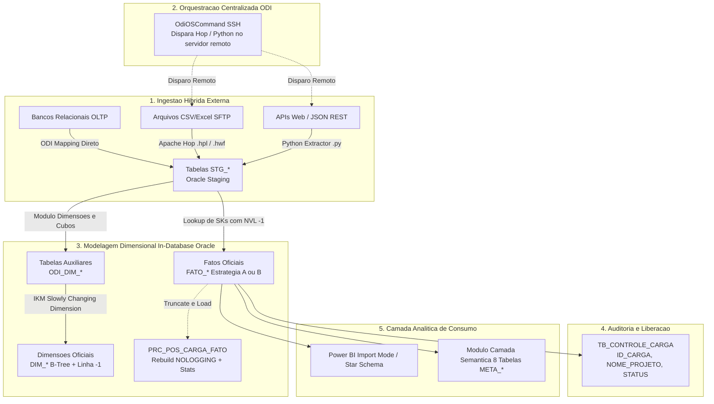

# Planejador de Data Warehouses (DW Planner)

Módulo corporativo para **planejamento, arquitetura e modelagem dimensional automatizada de Data Warehouses Oracle** a partir de fontes heterogêneas de dados (Bancos Relacionais OLTP, Arquivos/Planilhas em SFTP e APIs Web).

> **Papel do Módulo:** Atuar como um **Arquiteto de Dados Sênior Automatizado**.  
> Ele não executa a carga pesada de produção, mas projeta toda a arquitetura:
> 1. Modela as tabelas em camadas: `STG_*` -> `ODI_DIM_*` -> `DIM_*` -> `FATO_*`.
> 2. Suporta **Dual Strategy** de carga:
>    - **Estratégia A (Truncate & Load Massivo):** Cargas em lote noturnas, índices Bitmap nas FKs da Fato para Star Transformation, e procedure corporativa `PRC_POS_CARGA_FATO` (rebuild NOLOGGING + `DBMS_STATS`).
>    - **Estratégia B (Incremental Idempotente via MERGE):** Cargas intra-dia/diárias de APIs/telemetria, índices B-Tree exclusivos para prevenir locks `ORA-00060`.
> 3. Recomenda a esteira de ferramentas: **ODI** (Banco), **Apache Hop** (Arquivos) e **Python** (APIs).
> 4. Gera a orquestração centralizada no ODI via `OdiOSCommand` (SSH).
> 5. Produz os DDLs otimizados para Oracle (B-Tree em dimensões, SCD2, Particionamento e linha `-1`).
> 6. Entrega pipelines do Apache Hop (`.hpl` / `.hwf`) e extratores Python resilientes.
> 7. Entrega diretrizes e guia completo de modelagem para Power BI (`GUIA_ANALISTA_BI_<PROJETO>.md`).
> 8. Integra automaticamente com o **Módulo de Camada Semântica** (Views `VW_EVENTO`, `VW_KPI_*` e 8 tabelas `META_*`).

---

## 1. Visão Geral da Arquitetura Híbrida

O planejamento segue a esteira corporativa onde o **Oracle Data Integrator (ODI)** atua como maestro geral do pacote de cargas:



---

## 2. Estrutura de Diretórios do Módulo

```text
modulos/planejador_dw/
├── README.md                      # Esta visão geral do módulo
├── AGENTS.md                      # Protocolo de raciocínio e regras estritas para a IA
├── INTAKE_DW.md                   # Formulário de entrada (fontes, regras, perguntas do cliente)
│
├── ../../entrega/planejador_dw/   # Pasta oficial de entrega dos insumos pelo engenheiro de dados
│   ├── README.md                  # Guia de como fornecer os insumos
│   ├── ddl/                       # DDLs das fontes relacionais (OLTP)
│   ├── amostras/                  # Amostras reais de dados (10 a 50 linhas)
│   ├── arquivos_ftp/              # Modelos de CSV, TXT e planilhas Excel
│   └── api_specs/                 # Exemplos de payload JSON ou especificações OpenAPI
│
└── templates/                     # Biblioteca de templates canônicos
    ├── 01_tb_controle_carga.sql   # Tabela corporativa de controle e auditoria
    ├── 02_stg_template.sql        # Modelo de tabela STG_* com metadados de lote
    ├── 03_odi_dim_template.sql    # Modelo de tabela auxiliar ODI_DIM_* para IKM
    ├── 04_dim_scd2_template.sql   # Dimensão oficial com SCD2, Sequence e B-Tree
    ├── 05_fato_truncate_load_template.sql # Fato Estratégia A (Truncate & Load + Bitmap)
    ├── 05_fato_merge_template.sql # Fato Estratégia B (Incremental via MERGE + B-Tree)
    ├── 06_init_default_records_menos_1.sql # Carga da linha -1 (Não Informado)
    ├── 07_prc_pos_carga_fato.sql  # Procedure PL/SQL pós-carga (rebuild + stats)
    ├── 08_apache_hop_pipeline_template.hpl # Pipeline XML do Apache Hop
    ├── 09_apache_hop_workflow_template.hwf # Workflow XML do Apache Hop
    ├── 10_python_api_extractor_template.py # Extrator Python com OAuth2, flatten e oracledb
    ├── 12_guia_analista_bi_template.md     # Template corporativo do guia entregável para Power BI
    ├── 13_testes_integridade_template.sql  # Template de validações pós-carga do DW
    ├── 14_dicionario_dados_template.html   # Template interativo do dicionário de dados
    └── RELATORIO_ESTRATEGIAS_MODELO.md     # Template do relatório executivo e de linhagem
```

---

## 3. Destino dos Artefatos Gerados

Todos os arquivos gerados pelo agente para um projeto são salvos diretamente nas 11 subpastas numeradas da pasta central de saídas (sem criar subpasta com o nome do projeto):
`saida/planejador_dw/`

A estrutura gerada inclui:
- `01_controle_carga/`: DDL da tabela de auditoria.
- `02_staging/`: DDLs das tabelas `STG_*`.
- `03_dimensoes/`: DDLs das tabelas `ODI_DIM_*`, `DIM_*`, Sequences e script DML da linha `-1`.
- `04_fatos/`: DDL da `FATO_*` configurada para a Estratégia A ou B.
- `05_procedimentos_manutencao/`: Script da procedure `PRC_POS_CARGA_FATO` (se Estratégia A).
- `06_pipelines_hop/`: Arquivos `.hpl` e `.hwf` para ingestão de arquivos (se Apache Hop habilitado).
- `07_extratores_python/`: Scripts `.py` para ingestão de APIs (se Extratores Python habilitado).
- `08_datasets_bi/`: Entregável `GUIA_ANALISTA_BI_<PROJETO>.md` para a equipe externa de BI.
- `09_relatorio_estrategias/`: Relatório completo `RELATORIO_ESTRATEGIAS.md`.
- `10_testes_integridade/`: Script de validação pós-carga `13_testes_integridade.sql`.
- `11_dicionario_dados/`: Dicionário interativo `dicionario_dados.html`.

---

## 4. Documentos de Referência

- [Guia do Engenheiro de DW](../../documentacao/guias/GUIA_ENGENHEIRO_DW.md) — Manual prático do engenheiro e biblioteca de prompts.
- [Convenções Corporativas de DW](../../core/convencoes/CONVENCOES_DW.md) — Padrões e regras de modelagem dimensional e banco de dados.
- [Pasta Central de Saídas](../../saida/planejador_dw/README.md) — Repositório de entregáveis gerados.
