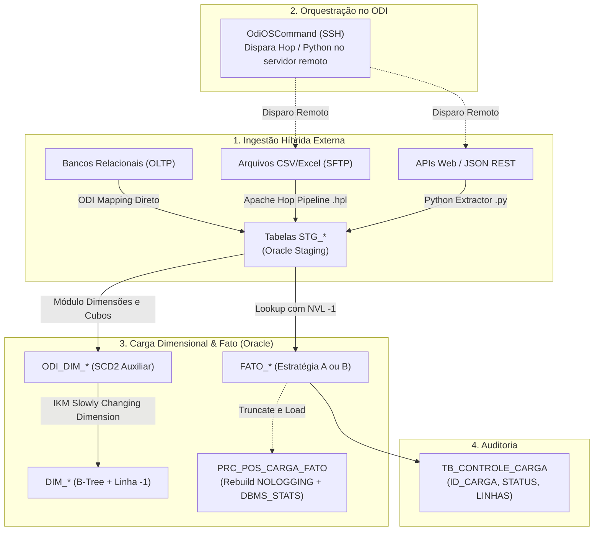

# Relatório de Estratégias & Linhagem: <NOME_PROJETO>

> **Versão do Projeto:** 1.0  
> **Engenheiro Responsável:** `<NOME_ENGENHEIRO>`  
> **Schema Alvo no Oracle:** `<SCHEMA_ALVO>`  
> **Data de Planejamento:** `<DATA>`  
> **Estratégia de Carga Adotada:** `[Estratégia A: Truncate & Load Massivo / Estratégia B: Incremental Idempotente]`

---

## 1. Topologia da Esteira & Orquestração Centralizada no ODI

O Oracle Data Integrator (ODI) atua como maestro geral do pacote de cargas do projeto. Abaixo estão as especificações exatas para cada ferramenta de ingestão e os comandos para os componentes `OdiOSCommand`:



### 1.1 Ingestão de Arquivos / FTPs via Apache Hop
- **Pipeline Hop:** `<NOME_PIPELINE>.hpl`
- **Workflow Hop:** `<NOME_WORKFLOW>.hwf`
- **Servidor Remoto:** `<HOST_SERVIDOR_HOP>`
- **Comando SSH configurado no `OdiOSCommand`:**
  ```bash
  ssh <USUARIO_SSH>@<HOST_SERVIDOR_HOP> "/opt/hop/hop-run.sh -r local -f /opt/etl/hop/pipelines/<NOME_PIPELINE>.hpl -l Basic"
  ```
- **Tabela Destino no Oracle:** `STG_<SISTEMA>_<DOMINIO>_<ARQUIVO>`
- **Estratégia de Carga na STG:** `TRUNCATE & LOAD` antes da execução.

### 1.2 Ingestão de APIs Web via Python
- **Script:** `<NOME_SCRIPT>.py`
- **Servidor Remoto:** `<HOST_SERVIDOR_PYTHON>`
- **Comando SSH configurado no `OdiOSCommand`:**
  ```bash
  ssh <USUARIO_SSH>@<HOST_SERVIDOR_PYTHON> "/usr/bin/python3 /opt/etl/python/<NOME_SCRIPT>.py --start-date \$(date -d '1 day ago' +\%Y-\%m-\%d) --end-date \$(date +\%Y-\%m-\%d)"
  ```
- **Tabela Destino no Oracle:** `STG_<SISTEMA>_<DOMINIO>_<SERVICO>`
- **Estratégia de Carga na STG:** `APPEND` com controle por `ID_LOTE`.

---

## 2. Seleção e Justificativa da Estratégia de Carga da Fato

| Dimensão de Análise | Estratégia A (Truncate & Load Massivo) | Estratégia B (Incremental via MERGE) |
| :--- | :--- | :--- |
| **Perfil da Fonte** | Bancos Relacionais OLTP em lote diário/mensal | APIs REST, microsserviços, telemetria FinOps |
| **Indexação Física** | **BITMAP INDEX** em todas as FKs (`DIM_*`) | **B-TREE INDEX** em chaves compostas |
| **Plano Otimizador** | Habilita **Star Transformation** no Oracle CBO | Otimiza junções pontuais via B-Tree |
| **Locks / Concorrência** | Monopoliza tabela (apenas batch noturno) | Permite concorrência sem bloqueio de blocos |
| **Manutenção Pós-Carga** | **Obrigatória:** `PRC_POS_CARGA_FATO` | Automática (estatísticas incrementais periódicas) |
| **Estratégia Adotada** | `[X] Indicada se carga noturna em lote` | `[X] Indicada se fluxo contínuo ou intra-dia` |

### Justificativa do Projeto:
> `<JUSTIFICATIVA_TECNICA_DA_ESCOLHA>`

---

## 3. Dicionário de Linhagem & "Como Chegar em Cada Valor"

### 3.1 Carga da Dimensão `DIM_<SISTEMA>_<DOMINIO>_<ENTIDADE>` (SCD Tipo 2)
- **Tabela Origem:** `STG_<SISTEMA>_<DOMINIO>_<ENTIDADE>`
- **Tabela Auxiliar do ODI:** `ODI_DIM_<SISTEMA>_<DOMINIO>_<ENTIDADE>`
- **Indexação:** **B-Tree exclusivo** (Bitmaps terminantemente proibidos para evitar deadlocks `ORA-00060`).
- **Mecanismo ODI:** Módulo *Dimensões e Cubos* (IKM Oracle Slowly Changing Dimension).

| Coluna Destino | Tipo | Origem (STG) | Regra / Transformação | Comportamento SCD2 |
| :--- | :--- | :--- | :--- | :--- |
| **DIMENSION_KEY** | NUMBER(38,0) | - | Gerado pela SEQUENCE `SEQ_DIM_<ENTIDADE>.NEXTVAL` | Surrogate Key (PK) |
| **ID_<ENTIDADE>** | NUMBER(38,0) | `STG.ID_<ENTIDADE>` | Direto da chave de negócio na origem | Natural Key (Compare) |
| **SIGLA_<ENTIDADE>** | VARCHAR2 | `STG.SIGLA` | `UPPER(TRIM(STG.SIGLA))` | Histórico (Gera nova linha se mudar) |
| **DS_<ENTIDADE>** | VARCHAR2 | `STG.DESCRICAO` | `TRIM(STG.DESCRICAO)` | Histórico (Gera nova linha se mudar) |
| **SIN_ATIVO** | CHAR(1 CHAR) | `STG.ATIVO` | `CASE WHEN STG.ATIVO = 1 THEN 'S' ELSE 'N' END` | Histórico |
| **DTC_EFETIVACAO** | DATE | - | Preenchido com `TRUNC(SYSDATE)` na inserção da nova versão | Início da vigência |
| **DTC_EXPIRACAO** | DATE | - | Mantido `NULL` enquanto vigente. Atualizado com `TRUNC(SYSDATE) - 1` ao expirar | Fim da vigência |
| **DES_ATUALIZAR** | CHAR(1 CHAR) | - | Flag técnica ('S'/'N') gerida pelo ODI | Controle técnico |

---

### 3.2 Carga da Tabela `FATO_<SISTEMA>_<DOMINIO>_<EVENTO>`
- **Tabela Origem:** `STG_<SISTEMA>_<DOMINIO>_<ENTIDADE>`
- **Grão Físico:** Uma ocorrência de `<EVENTO>` por data e combinação dimensional.

| Coluna Destino | Tipo | Origem (STG) | Regra / Como Calcular o Valor | Estratégia ODI (Lookup) |
| :--- | :--- | :--- | :--- | :--- |
| **DIM_<ENTIDADE_1>** | FK NOT NULL | `STG.ID_ENTIDADE_1` | Buscar `DIMENSION_KEY` em `DIM_<ENTIDADE_1>` onde `ID = STG.ID_ENTIDADE_1` e `DTC_EXPIRACAO IS NULL`. Se nulo, atribuir `-1`. | `NVL(LKP1.DIMENSION_KEY, -1)` |
| **DIM_<ENTIDADE_2>** | FK NOT NULL | `STG.ID_ENTIDADE_2` | Buscar `DIMENSION_KEY` em `DIM_<ENTIDADE_2>` onde `ID = STG.ID_ENTIDADE_2` e `DTC_EXPIRACAO IS NULL`. Se nulo, atribuir `-1`. | `NVL(LKP2.DIMENSION_KEY, -1)` |
| **DIM_TEMPO** | FK NOT NULL | `STG.DATA_EVENTO` | `TO_NUMBER(TO_CHAR(STG.DATA_EVENTO, 'YYYYMMDD'))`. Buscar em `DIM_TEMPO`. Se nulo, atribuir `-1`. | `NVL(LKP_TEMPO.DIMENSION_KEY, -1)` |
| **TOT_<EVENTO>** | Medida | - | Constante `1` para cada registro do evento. | Medida Aditiva direta |
| **QTD_<MEDIDA>** | Medida | `STG.QTDE_BRUTA` | `NVL(STG.QTDE_BRUTA, 0)`. Validar se `>= 0`. | Medida Aditiva direta |
| **VAL_<METRICA>** | Medida | `STG.VALOR_TOTAL` | `NVL(STG.VALOR_TOTAL, 0.0)`. | Medida Monetária |
| **DTC_CARGA** | Auditoria | - | Preenchido com `SYSDATE` durante a execução da carga. | Timestamp do job |

---

### 3.3 💡 Radar Consultivo da IA: Expansão de KPIs, Regras e Perguntas de Negócio

> *Além do escopo estrito solicitado pelo cliente, a análise estrutural das colunas de origem identificou as seguintes oportunidades analíticas de alto valor:*

#### A. Novos KPIs e Medidas Derivadas Incorporadas / Sugeridas
| KPI / Medida | Origem do Requisito | Fórmula / Regra de Cálculo | Valor de Negócio | Status |
| :--- | :--- | :--- | :--- | :--- |
| **`<KPI_CLIENTE_1>`** | 🎯 Solicitado pelo Cliente | `<FORMULA_SQL>` | Atende requisito direto do escopo inicial | `[x] Implementado` |
| **`<KPI_IA_LEAD_TIME>`** | 💡 Sugerido pela IA | `ROUND(DTC_CONCLUSAO - DTC_ABERTURA, 2)` | Mede o tempo de ciclo ponta a ponta (Lead Time) | `[x] Aprovado / [ ] Opcional` |
| **`<KPI_IA_BACKLOG>`** | 💡 Sugerido pela IA | `CASE WHEN DTC_CONCLUSAO IS NULL THEN 1 ELSE 0 END` | Permite monitorar o passivo/estoque aberto em tempo real | `[x] Aprovado / [ ] Opcional` |
| **`<KPI_IA_SLA>`** | 💡 Sugerido pela IA | `CASE WHEN NVL(DTC_CONCLUSAO, SYSDATE) <= DTC_PRAZO THEN 1 ELSE 0 END` | Apura o índice de cumprimento de SLA e atrasos | `[x] Aprovado / [ ] Opcional` |

#### B. Regras de Negócio e Qualidade de Dados Adicionais (Sanitização)
- **Regra do Cliente:** `<DESCRICAO_REGRA_SOLICITADA>`
- **💡 Sugestão da IA (Sanitização Cronológica):** Registros com data de conclusão menor que data de abertura (`DTC_CONCLUSAO < DTC_ABERTURA`) recebem flag de inconsistência e são isolados da média de SLA para evitar tempos negativos.
- **💡 Sugestão da IA (Preservação de Fila Órfã):** Chaves nulas de atribuição/responsável são convertidas para `DIMENSION_KEY = -1` (`'NÃO ATRIBUÍDO / FILA GERAL'`), permitindo auditar demandas sem dono.

#### C. Novas Perguntas Estratégicas de Negócio (`META_CONSULTA_NEGOCIO`)
1. **[Solicitada pelo Cliente]** `<PERGUNTA_1_DO_CLIENTE>`
2. **[💡 Sugerida pela IA — Executiva]** *Qual é a evolução mensal do Lead Time médio e da taxa de vazão (Throughput) por unidade?*
3. **[💡 Sugerida pela IA — Tática/Operacional]** *Qual é o volume atual do Backlog em aberto estratificado por faixa de envelhecimento (Aging: 0-15, 16-30, 31-60, >60 dias)?*
4. **[💡 Sugerida pela IA — Auditoria]** *Quais rotas ou unidades concentram o maior índice de retrabalho/auto-tramitação ou registros com inconsistência de datas?*

---

## 4. Rotina Pós-Carga (`PRC_POS_CARGA_FATO`)

Se a **Estratégia A** foi adotada, incluir a chamada da procedure no pacote do ODI após a carga da fato:

```sql
BEGIN
    "<SCHEMA_ALVO>"."PRC_POS_CARGA_FATO"(p_tabela_fato => 'FATO_<SISTEMA>_<DOMINIO>_<EVENTO>');
END;
/
```

- **Ações automáticas executadas:**
  1. Rebuild de todos os índices UNUSABLE ou BITMAP com `REBUILD NOLOGGING`, retornando-os a `LOGGING`.
  2. Coleta de estatísticas completas com `DBMS_STATS.GATHER_TABLE_STATS(CASCADE => TRUE)`.

---

## 5. Estimativa de Sizing e Crescimento de Storage (Para DBAs)

- **Tamanho médio estimado por linha da Fato:** `<BYTES_LINHA>` bytes
- **Volume de carga projetado:** `<LINHAS_DIA>` linhas/dia (~`<LINHAS_MES>` linhas/mês)
- **Crescimento Anual Estimado:**
  $$\text{Volume Anual (GB)} = \frac{\text{Bytes/Linha} \times \text{Linhas/Mês} \times 12}{1024^3} \approx \mathbf{<GB_ANO>\text{ GB/ano}}$$
- **Recomendação para a equipe de DBA:**
  - Alocação inicial recomendada para `<TABLESPACE_DADOS>`: `<GB_INICIAL>` GB com `AUTOEXTEND ON NEXT 1G MAXSIZE UNLIMITED`.
  - Particionamento: Interval Partitioning mensal por `DIM_TEMPO` quando volumetria anual superar 10 milhões de linhas.

---

## 6. Consumo Analítico (Power BI & Camada Semântica)

1. **Power BI:** Conectar em modo **Import**, estabelecer relacionamento 1:* da `DIM_*(DIMENSION_KEY)` para `FATO_*(DIM_*)` com direção de filtro cruzado **Single**, e criar tabela dedicada `_Medidas`.
2. **Módulo Camada Semântica:** O projeto está 100% aderente para gerar as views `VW_DIM_*_ATUAL`, `VW_EVENTO`, `VW_KPI_*` e as 8 tabelas `META_*`.
